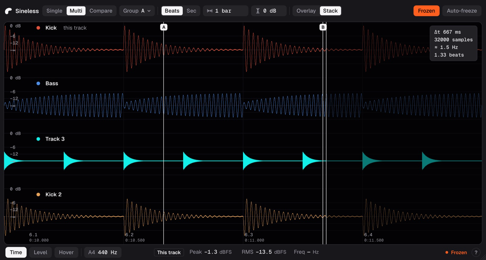

# Sineless

[](https://github.com/orizonaudio/Sineless/actions/workflows/ci.yml?query=branch%3Amain+event%3Apush) [](https://github.com/orizonaudio/Sineless/releases/latest) [](LICENSE) [](https://scorecard.dev/viewer/?uri=github.com/orizonaudio/Sineless) [](https://www.bestpractices.dev/projects/15526)

Sineless™ is an open-source oscilloscope by Orizon Audio, as a VST3 plugin and, on macOS, an Audio Unit. It shows the audio on its track in real time and passes it through unchanged, with zero latency.



- Triggered display from 0.5 ms to 1 s, with Auto, Normal, Free and Single trigger modes; spans up to 4 s scroll continuously.
- Tempo-synced sweep: a span in beats or bars, up to 16 bars, aligned to the host's bar lines, with a beat grid and playhead.
- Left, right, mid and side views, overlaid or stacked, on a vertical scale in dB.
- Multi-track view: every track with Sineless inserted, up to 16 lanes, each in its track colour and lined up in time, or overlaid. Groups A–D keep separate comparisons apart.
- Compare (beta): measure another track's offset, polarity and likeness against this one, see their sum and how loud it is, and preview the fix.
- Freeze, then pan back through the last 4 seconds in Seconds mode; optionally freeze automatically when the transport stops.
- Zoom in down to individual samples with ⌘ + scroll (Ctrl on Windows), pinch or drag.
- Time and level cursors that snap to zero crossings and peaks: read the time between them, its frequency and nearest note, beats, and levels in dB.
- Indicative peak, RMS and frequency readouts.
- Built-in help: turn it on, and every control explains itself.
- Settings are saved with your project.

## Requirements

- macOS 13.1 or later, on Apple silicon or Intel.
- Or Windows 10 or later, x64, with the Microsoft Edge WebView2 Runtime. On Windows on Arm, use an x64 host (or REAPER's ARM64EC build, which loads x64 plugins).
- A host that loads VST3 plugins, such as Ableton Live, Cubase, REAPER, Bitwig Studio or Studio One, or on macOS one that loads Audio Units, such as Logic Pro or GarageBand. See [HOSTS.md](HOSTS.md) for the hosts tested so far.

For the multi-track lanes to line up, put Sineless last on each track.

## Install

Releases are not signed yet, so the steps below get past macOS's and Windows's warnings. Before that, check the download is the one released: its SHA-256 must match the release page's (also in `SHA256SUMS.txt`).

```bash
shasum -a 256 ~/Downloads/Sineless-<version>-macOS.pkg
```

On Windows, in PowerShell:

```powershell
Get-FileHash $HOME\Downloads\Sineless-<version>-Windows-Setup.exe
```

### macOS

With the installer:

1. Download `Sineless-<version>-macOS.pkg` from the releases page and open it.
2. Releases are not signed with an Apple Developer ID yet, so the first time macOS says it could not verify the installer and does not open it. Click **Done**, then open **System Settings → Privacy & Security**, scroll down to **Security**, click **Open Anyway** next to the message about the installer, and confirm. Open the installer again.
3. It installs Sineless for your user only, without asking for a password: the VST3 plugin in `~/Library/Audio/Plug-Ins/VST3/` and the Audio Unit in `~/Library/Audio/Plug-Ins/Components/`. To install only one of them, click **Customize**.
4. Rescan plugins in your host. Sineless appears under Orizon Audio.

Or from the zip:

1. Download `Sineless-<version>-macOS.zip` from the releases page and unzip it.
2. Move `Sineless.vst3` to `~/Library/Audio/Plug-Ins/VST3/` and `Sineless.component` to `~/Library/Audio/Plug-Ins/Components/` (either one alone is fine).
3. Releases are not signed with an Apple Developer ID yet, so macOS quarantines the download. Clear the quarantine flag in Terminal:

   ```bash
   xattr -dr com.apple.quarantine ~/Library/Audio/Plug-Ins/VST3/Sineless.vst3
   ```

   ```bash
   xattr -dr com.apple.quarantine ~/Library/Audio/Plug-Ins/Components/Sineless.component
   ```

4. Rescan plugins in your host. Sineless appears under Orizon Audio.

### Windows

With the installer:

1. Close your host, then download `Sineless-<version>-Windows-Setup.exe` from the releases page and open it.
2. Releases are not code-signed yet, so Windows may say "Windows protected your PC". Click **More info**, then **Run anyway**, and allow the installer to make changes.
3. It installs Sineless in `C:\Program Files\Common Files\VST3\`, for all users.
4. Rescan plugins in your host. Sineless appears under Orizon Audio. To remove it, use **Settings → Apps → Installed apps → Sineless → Uninstall**.

Or from the zip:

1. Download `Sineless-<version>-Windows.zip` from the releases page and unzip it.
2. Move `Sineless.vst3` to `C:\Program Files\Common Files\VST3\`.
3. Rescan plugins in your host. Sineless appears under Orizon Audio.

## Build from source

You need Xcode 16 or later, CMake 3.25 or later, and Node.js 22 (see `.nvmrc`).

```bash
npm ci
cmake --preset dev
cmake --build --preset dev
```

The plugin is built at `build/dev/VST3/Debug/Sineless.vst3`. To work on the interface in a browser, without the plugin, run `npm run dev`; a built-in mock replaces the audio engine.

On Windows, you need Visual Studio 2022 or 2026 with the "Desktop development with C++" workload (the presets use the newest one installed), Node.js 22 and LLVM (`winget install LLVM.LLVM`, for `clang-format`). In a PowerShell window:

```powershell
npm.cmd ci
cmake --preset windows-x64
cmake --build --preset windows-x64
```

The plugin is built at `build\windows-x64\VST3\Release\Sineless.vst3`; use `windows-x64-debug` for a Debug build to step through. `scripts\check.ps1` runs the Windows checks.

`scripts/check.sh` runs CI's build, test, lint and performance checks for macOS and the shared code, the Linux ones in Docker; fuzzing, coverage and mutation testing run in CI. It also needs Homebrew LLVM (`brew install llvm`) and Docker. See [CONTRIBUTING.md](CONTRIBUTING.md) for the workflow.

[docs/DESIGN.md](docs/DESIGN.md) describes how Sineless is built and why: its requirements, modules, threads, protocol and design decisions.

Without macOS or Windows, the engine, plugin and the editor's shared code still build and test on Linux, as CI's Linux jobs do. They need LLVM 23 (on Ubuntu 24.04, `tools/linux-checks/install-llvm.sh` installs it), CMake and Ninja:

```bash
npm ci
scripts/check-linux.sh
```

## Bugs and ideas

Report a bug or suggest a feature in [Issues](https://github.com/orizonaudio/Sineless/issues): for a bug, say which Sineless version, host and operating system, and what you did. Report a security problem privately instead, as [SECURITY.md](SECURITY.md) describes.

## Licence

GPL-3.0-only, © 2026 Bruno Lima, trading as Orizon Audio. See [LICENSE](LICENSE). The fonts in
`ui/src/fonts/` are under the SIL Open Font License 1.1; `REUSE.toml` gives every file's licence.

Additional permission under GNU GPL version 3 section 7: you may convey Sineless combined with the
logo files in `ui/src/brand/`, which are under their own terms
([LICENSES/LicenseRef-Orizon-Brand.txt](LICENSES/LicenseRef-Orizon-Brand.txt)).

## Name and logo

"Sineless", "Orizon" and "Orizon Audio" and the Orizon logo are trademarks of Orizon Audio, and the
GPL doesn't cover them (sections 7(c) and 7(e)). Forks use their own name and logo; what you may
do with them is in [TRADEMARKS.md](TRADEMARKS.md).
