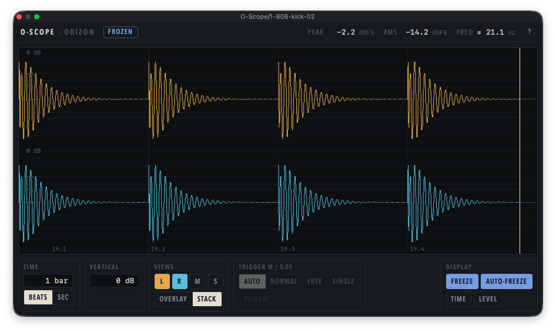

# O-Scope

An open-source VST3 oscilloscope by Orizon Audio. It shows the audio on its track in real time and passes it through unchanged, with zero latency.



- Triggered display from 0.5 ms to 1 s, with Auto, Normal, Free and Single trigger modes; spans up to 4 s scroll continuously.
- Tempo-synced sweep: a span in beats or bars, up to 16 bars, aligned to the host's bar lines, with a beat grid and playhead.
- Left, right, mid and side views, overlaid or stacked, on a vertical scale in dB.
- Multi-track view: every track with O-Scope inserted, each in its own lane in its track colour and lined up in time, or overlaid. Groups A–D keep separate comparisons apart.
- Freeze, then pan back through the last 4 seconds; optionally freeze automatically when the transport stops.
- Zoom in down to individual samples with ⌘ + scroll, pinch or drag.
- Time and level cursors that snap to zero crossings and peaks: read the time between them, its frequency and nearest note, beats, and levels in dB.
- Indicative peak, RMS and frequency readouts.
- Built-in help: turn it on, and every control explains itself.
- Settings are saved with your project.

## Requirements

- macOS 13 or later, on Apple silicon or Intel.
- A host that loads VST3 plugins, such as Ableton Live, Cubase, REAPER, Bitwig Studio or Studio One. See [HOSTS.md](HOSTS.md) for the hosts tested so far.

The multi-track view needs all O-Scope instances in one process, which is the default in every major host. Hosts that can run each plugin separately (Bitwig's "Individually" mode, REAPER's "Dedicated process") show each instance alone. For lanes to line up, put O-Scope last on each track.

Windows support is planned.

## Install

1. Download `O-Scope-<version>-macOS.zip` from the releases page and unzip it.
2. Move `O-Scope.vst3` to `~/Library/Audio/Plug-Ins/VST3/`.
3. Releases are not signed with an Apple Developer ID yet, so macOS quarantines the download. Clear the quarantine flag in Terminal:

   ```bash
   xattr -dr com.apple.quarantine ~/Library/Audio/Plug-Ins/VST3/O-Scope.vst3
   ```

4. Rescan plugins in your host. O-Scope appears under Orizon Audio.

## Build from source

You need Xcode 26 or later, CMake 3.25 or later, and Node.js 22 (see `.nvmrc`). Dependencies are fetched during configuration.

```bash
npm ci
cmake --preset dev
cmake --build --preset dev
```

The plugin is built at `build/dev/VST3/Debug/O-Scope.vst3`. To work on the interface in a browser, without the plugin, run `npm run dev`; a built-in mock replaces the audio engine.

`scripts/check.sh` runs every check that CI runs. It also needs Homebrew LLVM (`brew install llvm`). See [CONTRIBUTING.md](CONTRIBUTING.md) for the workflow.

## Licence

GPL-3.0. See [LICENSE](LICENSE).
