# Sineless: Design Document

| | |
| --- | --- |
| Status | Reference: an overview of the product and the reasons behind it, brought up to date with the code a few times a year |
| Last synced with | 0.5.1 (protocol version 6, state version 2), on 2026-10-17 |
| Structure | [arc42](https://arc42.org), sections 1–12 |
| Authoritative sources | Values the engine and UI share: `protocol/src/limits.ts`. Settings: `protocol/src/settings.ts`. Messages and frames: `protocol/src/messages.ts`, `protocol/src/frame.ts`. Test levels and CI: [CONTRIBUTING.md](../CONTRIBUTING.md). Host results: [HOSTS.md](../HOSTS.md). Where this document restates a value, those files win. |

This document records what Sineless must do, how it is built and why, for contributors and
agents who want the whole picture without reading the whole repository. It is not updated with
every change, so details may lag behind the code: where the two differ, the code and the sources
above are right.

**Contents.** 1 Introduction and goals (requirements, settings, user interface) · 2 Constraints ·
3 Context and scope · 4 Solution strategy · 5 Building blocks · 6 Runtime view · 7 Deployment ·
8 Crosscutting concepts · 9 Architecture decisions · 10 Quality requirements · 11 Risks and
technical debt · 12 Glossary.

**Where to start.**

- Contributing a change: 1.2.1 (what each mode and time base does), 5, 6, 8.2 and 8.6.
- Checking a change against the requirements: 1.2, 1.5, 8.4, 8.6 and 10.2.
- Revisiting a decision: 9 and 11.

IDs: FR functional requirement, QG quality goal, C constraint, AD architecture decision, QS
quality scenario, R risk. IDs are stable: a removed one is not reused.

## 1. Introduction and goals

### 1.1 Purpose

An open-source oscilloscope and multi-track analyser, as a VST3 plugin and, on macOS, an Audio
Unit, that displays the audio on its input in real time and passes it through unchanged, with zero
latency.

| | |
| --- | --- |
| Product | Sineless |
| Vendor | Orizon Audio |
| Bundles | `Sineless.vst3`; macOS bundle identifier `com.orizonaudio.sineless`. On macOS also the Audio Unit `Sineless.component`, bundle identifier `com.orizonaudio.sineless.component` |
| VST3 subcategory | `Fx\|Analyzer` |
| Audio Unit | Effect (`aufx`), subtype `Snls`, manufacturer `Oriz`, factory `SinelessFactory`; the codes are saved in projects and never change |
| Repository | github.com/orizonaudio/Sineless |
| Release assets | `Sineless-<version>-macOS.zip`, `Sineless-<version>-Windows.zip`, `SHA256SUMS.txt`, build provenance |

The CMake project (`OrizonOscilloscope`) and npm package (`orizon-oscilloscope`) keep their
original internal names.

### 1.2 Functional requirements

Each requirement is numbered for reference from tests, issues and commits; long requirements have
numbered parts. "Verified by" names the main tests; it is a pointer, not the full list.

**Display modes and time bases.** Most requirements depend on two settings: the display mode
(Single, Multi, Compare) and the time base (Seconds, labelled "Sec" in the UI, or Beats). In
Seconds, spans up to 1 s are *triggered* and longer spans *roll*; in Beats the display *sweeps*.
"Single" is both a display mode and a trigger mode; this document always says which. Section 1.2.1
gives, for each combination, what the trigger reads, what readouts measure, what cursors snap to
and what a freeze holds.

#### 1.2.1 Behaviour by mode and time base

| | Seconds, triggered (≤ 1 s) | Seconds, roll (> 1 s) | Beats (sweep) |
| --- | --- | --- | --- |
| **Single display mode**: trigger reads | Trigger source | — | — |
| **Single display mode**: readouts, cursor snap, hover | Trigger source | Trigger source | Mid |
| **Multi, Compare**: trigger reads | This track's Mid | — | — |
| **Multi, Compare**: readouts, cursor snap | This track's Mid | This track's Mid | This track's Mid |
| Freeze holds | Newest 4 s; lanes 4 s + 1 s | Same | Readable capture (7/8); sweep image kept |
| Pan while frozen | Yes, not zoomed | Yes, not zoomed | No |
| Time labels | From the trigger point | Back from now | bar.beat over project time |

On a mono track, L takes the place of the trigger source and of Mid in Single display mode. Level
cursors in stacked lanes snap to each lane's own trace. Holds keep 7/8 of the capture because the
audio thread keeps writing into the last eighth while a freeze copies (5.2, CaptureRing).

#### 1.2.2 Requirements

| ID | Requirement | Verified by |
| --- | --- | --- |
| FR-1 | Accepts a mono or stereo main input (one input and one output bus, of the same arrangement) and passes it to the output bit-exactly, in 32- or 64-bit as the host processes, with zero latency. Channels the host flags silent are captured as silence and the flags are passed on. There is no bypass of its own: the host's bypass applies. | `plugin/tests/ProcessorTests.cpp` |
| FR-2 | Draws the input as a time-domain trace with an adjustable vertical scale (top of screen −60 to +6 dBFS) and span. In Seconds the visible span (full screen width) ranges from 0.5 ms to 4 s; in Beats it is a beat span (FR-9). | `AnalyzerTests`, `ui/tests/app/controls.test.ts` |
| FR-3 | In Seconds, spans up to 1 s (`rollThresholdSeconds`) are triggered by an edge trigger with level, slope, hysteresis and hold-off, in one of four modes. **Auto** triggers on edges, and draws untriggered if no edge arrives within the larger of the span and 100 ms. **Normal** draws only on a trigger and otherwise holds the last trace. **Free** ignores the trigger. **Single** (the trigger mode) arms, captures one triggered frame and then freezes; Re-arm arms it again. The trigger point sits 10% of the span from the left edge (`triggerPosition`). A sample that is not finite neither arms nor crosses. The trigger is off in Beats. | `TriggerTests`, `AnalyzerTests` |
| FR-4 | In Seconds, spans above 1 s scroll continuously (roll), on columns fixed to absolute sample positions so the trace does not shimmer. | `RollTests` |
| FR-5 | Channel views L, R, Mid = (L+R)/2 and Side = (L−R)/2, overlaid or stacked, with the trigger source selectable among them. On a mono track only L exists: it is drawn, triggered on and measured, and the other views are disabled. Views apply in Single display mode; Multi and Compare show each track's Mid. | `ChannelViewsTests`, `ui/tests/app/mono.test.ts` |
| FR-6 | Freeze holds recent audio, and scale, views, zoom, cursors and readouts keep working on it. In Seconds a freeze holds the newest 4 s (`frozenHoldSeconds`), which can be panned back through while not zoomed, as far as the frame's pan reach. In Beats it holds what the capture holds (FR-9.6). A frozen view keeps the sample rate its audio was recorded at. Freeze is never saved. | `HoldBufferTests`, `ui/tests/app/frozen-pan.test.ts`, `held-rate.test.ts` |
| FR-7 | Readouts of sample peak, RMS and estimated frequency, for the readout channel (1.2.1). They are indicative, not standards-compliant metering; help says so. Peak and RMS cover the whole span (not only the zoomed part) and refresh every 0.1 s of audio (`readoutIntervalSeconds`), and on every frame while frozen. Frequency is measured over the newest 1 s (`frequencyWindowSeconds`) from the rising crossings of the mean level, with hysteresis of 10% of the peak-to-peak range (`crossingHysteresis`); it is shown only when at least 60% of cycles fall within 15% of the median (`periodTolerance`) and the level is above −90 dBFS (`analysisGateDbfs`), as the mean of those cycles, marked ≈. Samples that are not finite are left out of every measurement, counted, and reported (8.6; the Invalid samples chip, 1.5). | `ReadoutsTests`, `SignalCorpusTests`, `ui/tests/app/readouts.test.ts` |
| FR-8 | All settings (table below) are saved with the host project as plugin state; none is a host-automatable parameter. A value is accepted only if finite and in range (enum and flag values integral, flags non-empty); an invalid value is refused, not clamped. | `StateTests`, `SettingsTests`, `setting-values.test.ts` |
| FR-9 | Tempo sync (Beats time base). | `SweepTests`, `SweepImageTests`, `TimelineTests`, `MatrixTests` |
| FR-9.1 | The span is a beat span, from 1/16 beat to 16 bars, at the host tempo; a beat is a quarter note and a bar follows the host time signature. The display sweeps: the left edge is the start of the current cycle, aligned to multiples of the span from the project start. Until the host has reported a tempo (an instance it has not played through yet), nothing is placed: no sweep, grid or bar labels, and the UI says so ("No tempo"). | `AnalyzerTests`, `ui/tests/app/no-tempo.test.ts` |
| FR-9.2 | A playhead line follows the host position, with the current cycle to its left and the previous cycle, dimmed, to its right. As on a sweeping scope, what is drawn stays in place until the playhead passes it again, also when the transport jumps (stop and play, loops, relocation). While stopped, the sweep continues at the last tempo. | |
| FR-9.3 | A sweep may be longer than the audio the capture holds: it shows what has been captured and fills in as the playhead passes ("Filling"). A sweep is limited to 2^23 samples per lane (87 s at 96 kHz); a longer beat span is stepped down and the UI says so ("Span limited"). | |
| FR-9.4 | A tempo change that alters the sweep's length by at most 1/1024 keeps the sweep; a larger one starts it again. Other tracks' lanes take this track's sweep length within the same tolerance. | |
| FR-9.5 | Sweeps keep receiving audio while the editor's page is hidden, so it is complete when shown again. | |
| FR-9.6 | Freezing a sweep keeps the image on screen and holds as much audio as the capture can (7/8 of it). Choosing a shorter span while frozen crops it from the image once the image is complete; a longer span is rebuilt from the held audio and, where the held audio does not reach, is drawn in part and flagged ("Partial"). A frozen sweep does not pan. | |
| FR-10 | View zoom: the displayed frame can be magnified horizontally, to 1/256 of the span (`minimumViewWidth`), and panned, in every mode. Zoom is temporary: it never changes a setting, and it resets when the span, beat span or time base changes. The engine renders the zoomed region at full resolution: the trigger, roll or sweep window is placed from the whole span, and only the visible part is reduced to screen columns. Peak and RMS still cover the whole span. | `zoom.test.ts`, `AnalyzerTests` |
| FR-11 | Auto-freeze: when on, the display freezes when the host transport goes from playing to stopped while the editor is open, and resumes when it plays again. A freeze made by the user or by Single mode is never ended by playback; unfreezing by hand while stopped cancels the resume. Turning Auto-freeze off leaves a current freeze in place. When off, the transport does not affect freezing. | `AnalyzerTests` |
| FR-12 | Cursors. | `cursors.test.ts`, `snap.test.ts` |
| FR-12.1 | Time cursors: two vertical lines, A and B, starting at 1/3 and 2/3 of the screen. The readout gives Δt in time and samples, its frequency 1/Δt, with the nearest note and cent offset when 1/Δt is between 20 Hz and 20 kHz, and, in Beats, the distance in beats. They sit at positions in the signal, so they follow zoom and pan. | |
| FR-12.2 | Level cursors: two horizontal lines, 1 and 2, drawn in every lane at a sample value, starting 6 and 12 dB below the top of the screen (−6 and −12 dBFS at the default scale); the readout gives each level in dBFS and the difference in dB. | |
| FR-12.3 | While dragged, time cursors snap to zero crossings and to where the trace reaches its highest and lowest values, and level cursors to the trace's highest and lowest values and to zero, within 10 px; holding ⌥ (Alt on Windows) places them freely. They snap to the readout channel (1.2.1); level cursors in stacked lanes use the lane's own trace. | |
| FR-12.4 | Cursors work live and frozen, and are temporary (not saved). | |
| FR-13 | Help: a toggle at the right end of the top bar, off whenever the editor opens. While on, resting the pointer on any control, readout or the screen for 400 ms shows a tooltip that explains what it is, what it does and how to use it, with numbers read from the shared limits. While off, the UI shows no tooltips except the help switch's own, so it can be found. | `help.test.ts` |
| FR-14 | Multi-track view. | `InstanceRegistryTests`, `AnalyzerTests`, `ui/tests/app/multi-track.test.ts` |
| FR-14.1 | Every Sineless instance in a host process belongs to one of four groups, A to D, and contributes its track to its group whatever its own display mode. | |
| FR-14.2 | An instance in Multi mode shows each track of its group, at most 16 (`maxLanes`), as the track's Mid, stacked in lanes or overlaid. Further tracks are counted ("+n hidden"), not drawn; the instance's own track is always drawn, in the last lane if it would otherwise be hidden. | |
| FR-14.3 | Lanes are labelled and coloured with the host's track name and colour where the host provides them (otherwise "Track n" and a fallback palette), ordered by the host's track order, then by creation; the instance's own lane is marked. | |
| FR-14.4 | Lanes share the vertical scale, time window, freeze, zoom and cursors. In Beats lanes align on the shared musical clock; in Seconds the instance's own track triggers and the other lanes show the same time window. Frozen lanes recorded at another sample rate are drawn silent. Lanes line up only when Sineless is the last plugin on each track: the host compensates for the latency of plugins after it by delaying the other tracks, so their instances see their audio later (R-2). | |
| FR-14.5 | With stacked lanes, the editor's minimum height grows so that each lane is at least 40 px tall (1.5, Layout). | `MinimumHeightTests` |
| FR-15 | Compare view (beta). | `PairAnalysisTests`, `AnalyzerTests`, `SignalCorpusTests` |
| FR-15.1 | A third display mode shows the same tracks as Multi mode (at most 15) plus a lane with the sample-by-sample sum of the checked tracks, stacked or overlaid. Unchecked tracks are drawn faint. With no other track in the group the screen says so. | |
| FR-15.2 | Each track's swatch is its check box. This track is the reference and is always compared; until the user chooses, the first other track is checked; with no other track checked the sum is this track alone. The choice is kept while the plugin is loaded (closing and opening the editor keeps it, as does a track being hidden or moving group) but is not saved. | |
| FR-15.3 | Summing gain: over the visible part of the span, refreshed every 0.1 s, counting only 10 ms blocks where at least two checked tracks sound together (within 20 dB of each other, not more than 60 dB below the loudest block, and above −90 dBFS), the engine reports the level of the checked tracks' sum against the level they would give if unrelated. Within ±1 dB (`summingMarginDb`) summing is harmless; below it the tracks cancel, above it they reinforce. | |
| FR-15.4 | Match: for each checked track, over the 8 s before the playhead (`matchWindowSeconds`; the newest 8 s of the view when zoomed away from it), the engine reports its correlation with this track at zero offset (−1 to +1) and the offset, within ±10 ms (`matchReachSeconds`), and polarity that would align them best. A track whose best match is weaker than 0.3 is reported as unrelated, with nothing to fix. Each track's match is refreshed at most every 0.5 s, one track at a time. | |
| FR-15.5 | Each checked lane label shows its offset, polarity (Ø) and correlation; the sum label shows the summing gain and Preview fix, which redraws the sum as if every checked track were shifted and flipped as suggested, with the new summing gain measured only where every shifted track has audio. Preview fix is temporary. | |
| FR-15.6 | The sum lane is shaded where its peak is more than 3 dB below the louder compared track's, when at least one checked track is related to this one; very quiet stretches (about 26 dB below the loudest) are not shaded, and gaps of three columns or less are bridged. | `trace-geometry.test.ts` |
| FR-15.7 | Freeze, zoom, cursors and both time bases work as in Multi mode. | |
| FR-16 | Hover readout and measuring extras. | `hover.test.ts`, `musical-grid.test.ts` |
| FR-16.1 | With the Hover toggle on (saved, off by default), resting the pointer on a trace shows beside it the trace's name, the position (bar.beat.sixteenth and project time in Beats; time from the trigger point when triggered; time back from now in roll), the peak level there, and the cycle around the pointer: its length in ms and samples and its frequency and note. Cycles are found as in FR-7 (rising crossings of the mean, with neighbouring cycles within 15%, above −90 dBFS); exact from raw samples, and from min/max columns only with at least 24 columns per cycle, rounded and without cents. A dotted line marks the point read and a band the cycle. | |
| FR-16.2 | Beats-mode grid labels carry the project time under bar.beat. | |
| FR-16.3 | A concert pitch setting (A4, 400–500 Hz, default 440) in the Display popover tunes every note name. | |

#### 1.2.3 Settings

The protocol's settings table (`protocol/src/settings.ts`) is authoritative; the engine validates
against it and the UI builds its controls from it.

| Setting | Values | Default |
| --- | --- | --- |
| Time span | 0.5 ms – 4 s, logarithmic | 1 s |
| Vertical scale (top of screen) | −60 dBFS … +6 dBFS | 0 dBFS |
| Channel views | Any non-empty set of L, R, Mid, Side | L + R |
| View layout | Overlaid, stacked | Stacked |
| Trigger mode | Auto, Normal, Free, Single | Auto |
| Trigger source | L, R, Mid, Side | Mid |
| Trigger slope | Rising, falling | Rising |
| Trigger level | −1.0 … +1.0 (linear, full scale) | 0.0 |
| Trigger hysteresis | 0 … 0.5 (linear, full scale) | 0.01 |
| Trigger hold-off | 0 … 1 s (stored in seconds, shown in ms) | 0 |
| Time base | Seconds, Beats | Beats |
| Beat span | 1/16, 1/8, 1/4, 1/2, 1 and 2 beats; 1, 2, 4, 8 and 16 bars | 1 bar |
| Auto-freeze | Off, on | Off |
| Display mode | Single, Multi, Compare | Single |
| Group | A, B, C, D | A |
| Hover readout | Off, on | Off |
| Concert pitch (A4) | 400 – 500 Hz, linear | 440 Hz |

Enumeration values are stable: they are saved in projects. Values that are not settings, and how
long each lasts, are in 8.4.

### 1.3 Quality goals

The top goals, in priority order. Section 10 states each as measurable scenarios.

| ID | Goal | Meaning |
| --- | --- | --- |
| QG-1 | Real-time safety | The audio thread never allocates, locks, blocks or does I/O. |
| QG-2 | Transparency | The plugin passes audio bit-exactly and adds zero latency. |
| QG-3 | Truthful display | What is shown is what the engine measured. A missing value is shown as "—", never as 0; levels and limits are defined once. |
| QG-4 | Light on the host | Display cost stays low and nearly flat in tracks, span and window size; opening and closing the editor leaves nothing behind. |
| QG-5 | Minimal dependencies | An external library is adopted only for a genuinely complex problem, and only if it is widely used, permissively licensed and easy to integrate (8.1). |
| QG-6 | Maintainability | Clear module boundaries, consistent naming, tests at every level, automated validation and CI. |

### 1.4 Stakeholders

| Role | Expectation |
| --- | --- |
| Users (producers, mix and mastering engineers) | A scope that is accurate, responsive and never disturbs playback; clear help. |
| Hosts (DAWs) | A well-behaved VST3: conformant, real-time safe, no latency, stable editor lifecycle. |
| Contributors | A design that says what must hold and why; fast, trustworthy checks (CONTRIBUTING.md). |
| Maintainer (Orizon Audio) | A small dependency surface; releases that can be verified (checksums, provenance). |

### 1.5 User interface

What the editor shows and how it responds, in every mode. The requirements above say what each
feature does; this section says where it is and how it looks. The values here are in the UI's
source (`ui/src/view/`) and its tests; where they differ, the source wins.

A redesign of the UI is in progress in [docs/ui/](ui/README.md). This section describes the UI
that ships until the redesign is built; that change rewrites it, supersedes AD-23, and moves
Help (FR-13) and the A4 setting (FR-16.3) to their new places.

#### Layout

- The top bar, the screen and the control strip fill the window. The strip is always complete and
  on one row; nothing is cropped, hidden or moved when the window is resized (AD-23).
- The editor's minimum width, 900 px, is the narrowest that fits the top bar and the whole strip
  in every state (the editor tests check each state). Its minimum height is 250 px, or 144 px
  plus 40 px per stacked lane when that is more (Compare counts its sum lane); the editor asks the
  host to grow when lanes are added. The default size is 900 × 500. The size is kept in CSS
  pixels across display-scale changes.

| Area | Left to right |
| --- | --- |
| Top bar | Wordmark · Single \| Multi \| Compare (beta) · A \| B \| C \| D · Peak, RMS, Freq readouts · Help switch |
| Screen, top right | Status chips; the cursor readout below them |
| Strip: Time | Span field (beat span in Beats) · Beats \| Sec |
| Strip: Vertical | Vertical scale field |
| Strip: Views | L, R, M, S toggles · Overlay \| Stack |
| Strip: Trigger | Title with a summary (for example "M ↑ +0.00") opening the trigger popover · Auto \| Normal \| Free \| Single · Re-arm (Single trigger mode only) |
| Strip: Display (right end) | Title with a summary ("A4 440") opening the Display popover · Freeze, Auto-freeze · Time, Level, Hover |
| Trigger popover | Source, Slope, Level, Hysteresis, Hold-off |
| Display popover | A4 (concert pitch) |

Popovers open above their group, aligned with its left edge and kept 8 px inside the window; a
press outside closes them.

#### Screen

- Ten time divisions; time labels on every second division, following zoom.
- Level lines every 3 dB down from the top of each lane, at most four below it, placed where the
  linear trace reaches them; a brighter zero line for each lane. Lines thin to 6 dB steps, then to
  the top only, when they would sit closer than 8 px.
- Level labels in dB on the left: the top reads the vertical scale with its unit, the zero line
  −∞; labels thin by the same rule at 14 px, and stacked lanes are labelled above their zero line
  only.
- A dashed line marks the trigger point, and a level marker on the left edge, in the own lane's
  colour, can be dragged.
- Beats: grid lines on bars with stronger lines every four bars when 8 bars or more are visible; on
  beats with stronger bar lines from one bar; below a bar on sixteenths, halving down to
  1/1024 beat. At most five labels, each bar.beat with the project time under it. The playhead is
  a vertical line; the previous cycle is dimmed. Trigger controls do not apply: they are dimmed
  and disabled, the trigger popover closes, and the trigger line and marker are hidden.
- Lane labels at the top of each stacked lane, or as a legend when overlaid; the own track is
  marked "· this track". Compare adds check-box swatches, match readouts, the sum's gain coloured
  by whether tracks cancel or reinforce, and Preview fix.
- A trace waiting for a trigger is dimmed.

#### Interaction

| Action | macOS | Windows |
| --- | --- | --- |
| Zoom around the pointer | ⌘ + scroll, or pinch | Ctrl + scroll, or pinch |
| Zoom to a region | Drag across the screen (at least 4 px) | Same |
| Pan | Horizontal swipe or scroll | Same |
| Reset zoom | Double-click | Same |
| Pan back while frozen (Seconds, not zoomed) | Horizontal swipe or scroll | Same |
| Place a cursor without snapping | ⌥ while dragging | Alt while dragging |

- Numeric values are drag fields: drag vertically (8 px a step), scroll to step (one notch or
  100 px of trackpad a step), double-click to type (units are parsed; a bare number in a time
  field is milliseconds). Shift gives fine steps.
- The time span steps through a 1-2-5 sequence from 0.5 ms to 2 s, then 4 s; hold-off 1-2-5 from
  0 to 1 s; vertical scale 3 dB (1 dB fine).
- Every control shows only values reported by the engine.
- Keystrokes go to the host unless a text field is being typed into, so the host's transport
  shortcuts keep working; the page has no keyboard navigation of its own.

#### Readouts and states

- Peak and RMS in dBFS; frequency marked ≈; "—" when there is no value.

| Chip | Shown when |
| --- | --- |
| Trig'd | A trigger placed the frame. |
| Waiting | Normal or Single trigger mode with no frame for 0.25 s. |
| *trigger mode* (Auto, Normal, Free, Single) | Seconds span up to 1 s, after Trig'd or Waiting. |
| Roll | Seconds span above 1 s. With **Span limited** when the span is longer than the capture keeps (a host changed the sample rate while processing, or a rate above 384 kHz). |
| Sync | Beats. With **Span limited** when the beat span was stepped down (FR-9.3), **Filling** while the sweep fills in. |
| No tempo | Beats before the host has reported a tempo (FR-9.1): nothing is placed until it does. Also after **Frozen**. |
| Frozen | Frozen; followed by the pan offset (for example "−1.2 s") when panned, **Span limited** when the span was shortened to what is held, and **Partial** when the held audio does not cover the span. |
| Zoom ×n | Zoomed in. |
| +n hidden | Multi or Compare with more tracks than lanes. |
| Invalid samples | A drawn trace holds samples that are not finite (warning tone). |

- Messages over the screen replace the traces and explain what to do: **Version mismatch**,
  **Display unavailable** (no engine) and **Display error** come from the engine; **Graphics
  unavailable** from the page, when there is no WebGL2 or the graphics context is lost. An engine
  error outranks the graphics message, which never replaces it. Each says that audio still passes
  through. Failures of the webview itself are in 8.9.

#### Style

- Dark theme only; the panel colour is also the webview's native background, so nothing flashes
  while loading.
- Trace colours: L amber, R cyan, Mid bone, Side lilac. Lanes take the host's track colour, or a
  16-colour fallback palette; the sum lane is bone. Cursors are pink.
- A condensed face for labels, a monospaced face for values (Roboto Condensed, Roboto Mono,
  embedded).
- A visible focus ring on every control.

## 2. Constraints

| ID | Constraint |
| --- | --- |
| C-1 | Plugin formats: VST3 on macOS and Windows, and Audio Unit v2 on macOS (AD-25). |
| C-2 | Platforms shipped: macOS 13.1+ (universal binary, arm64 and x86_64) and Windows 10+ x64. Windows on Arm runs the x64 build in an x64 host or REAPER's ARM64EC build; a native ARM64 build is not shipped for now (AD-24). Linux builds the engine, plugin and editor's shared code for the checks only, with no editor window. |
| C-3 | Licence: GPL-3.0-only. Every dependency must be GPL-3.0-compatible. |
| C-4 | Engine and plugin back end: C++20; the Audio Unit module C++23 (AudioUnitSDK's headers need it); the macOS editor glue and the Audio Unit's view in Objective-C++. |
| C-5 | User interface: TypeScript, hosted in the operating system's webview: WKWebView on macOS, the Evergreen WebView2 Runtime on Windows. The WebView2 loader and the C runtime are linked statically, so no other runtime is installed. |
| C-6 | Toolchain: Xcode 16+, Visual Studio 2022 or 2026, CMake 3.25+, Node.js 22.18+. |

## 3. Context and scope

### 3.1 Context

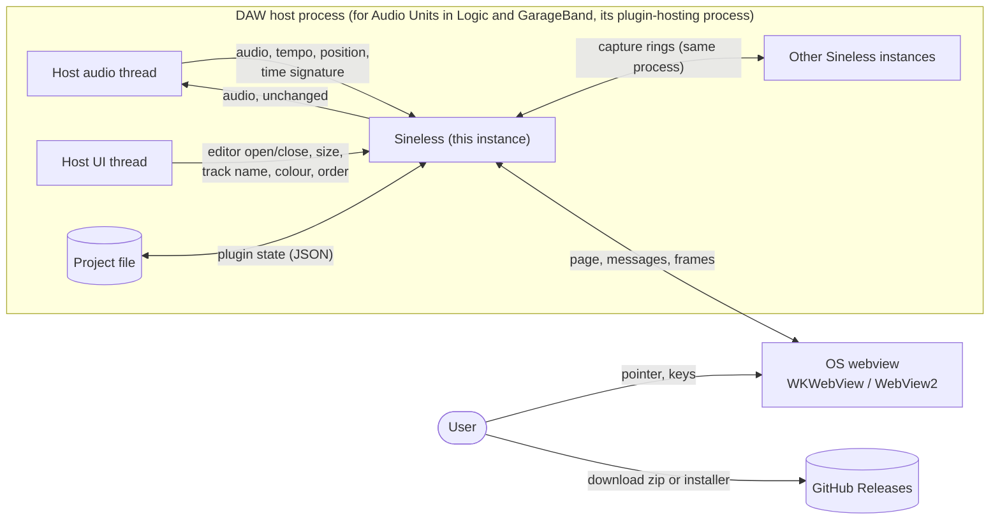

| Interface | Partner | What crosses it |
| --- | --- | --- |
| `IAudioProcessor` | Host audio thread | Audio in and out (32/64-bit, mono or stereo), `ProcessContext` (tempo, musical position, time signature, playing), silence flags. |
| `IComponent`, `IAudioProcessor` setup | Host UI thread | Bus arrangements, `setupProcessing`, activation; plugin state through `getState`/`setState` (8.4). |
| `IEditController`, `IPlugView` | Host UI thread | Editor creation, attach, size and resize requests, content scale. |
| `ChannelContext::IInfoListener` | Host | Track name, colour and position, where the host provides them. |
| `IConnectionPoint` | Own controller | A token that lets the editor find the processor's engine (AD-10). |
| Instance registry | Other Sineless instances of the same version in the process | Shared read access to their capture rings and track details (AD-14). |
| WKWebView / WebView2 | Operating system | The embedded page (`orizon://ui/`), JSON control messages, binary frames (AD-3). |
| GitHub Releases | Users | Zips, checksums and build provenance (7). |

### 3.2 Scope

In scope: everything in 1.2.

Deferred: XY/vectorscope, spectrum analyser and phosphor persistence. The capture and frame design
must not preclude them.

Out of scope: other plugin formats (C-1), such as AUv3, AAX, CLAP and LV2; sound-shaping or automatable parameters (AD-6);
standards-compliant loudness metering (FR-7 readouts are indicative).

## 4. Solution strategy

| Goal | Approach | Decisions |
| --- | --- | --- |
| Real-time safety (QG-1) | The audio thread only copies samples into a preallocated ring and publishes the musical position; all analysis runs on a worker thread per open editor. | AD-2, AD-13, 8.2 |
| Transparency (QG-2) | Pass-through by copy (or nothing, in place); no processing, no latency. | FR-1 |
| Truthful display (QG-3) | The engine measures and renders; the UI draws what the frame carries and does not work it out again. Shared numbers are defined once in the protocol module and generated into C++. "No value" is NaN. | AD-2, AD-18, 8.6 |
| Light on the host (QG-4) | Cost follows change, not size; one frame in flight, paced by the display; binary frames drawn by the GPU. | AD-12, AD-17, AD-19, AD-21, AD-22 |
| Minimal dependencies (QG-5) | Each format's SDK directly (VST3 SDK, AudioUnitSDK), the OS webview, no UI framework. | AD-1, AD-4, AD-7, AD-25 |
| Maintainability (QG-6) | Format-agnostic engine; protocol defined once; tests at every level, sanitizers, fuzzing, mutation testing. | 5.1, 8.3 |

## 5. Building block view

### 5.1 Level 1: modules

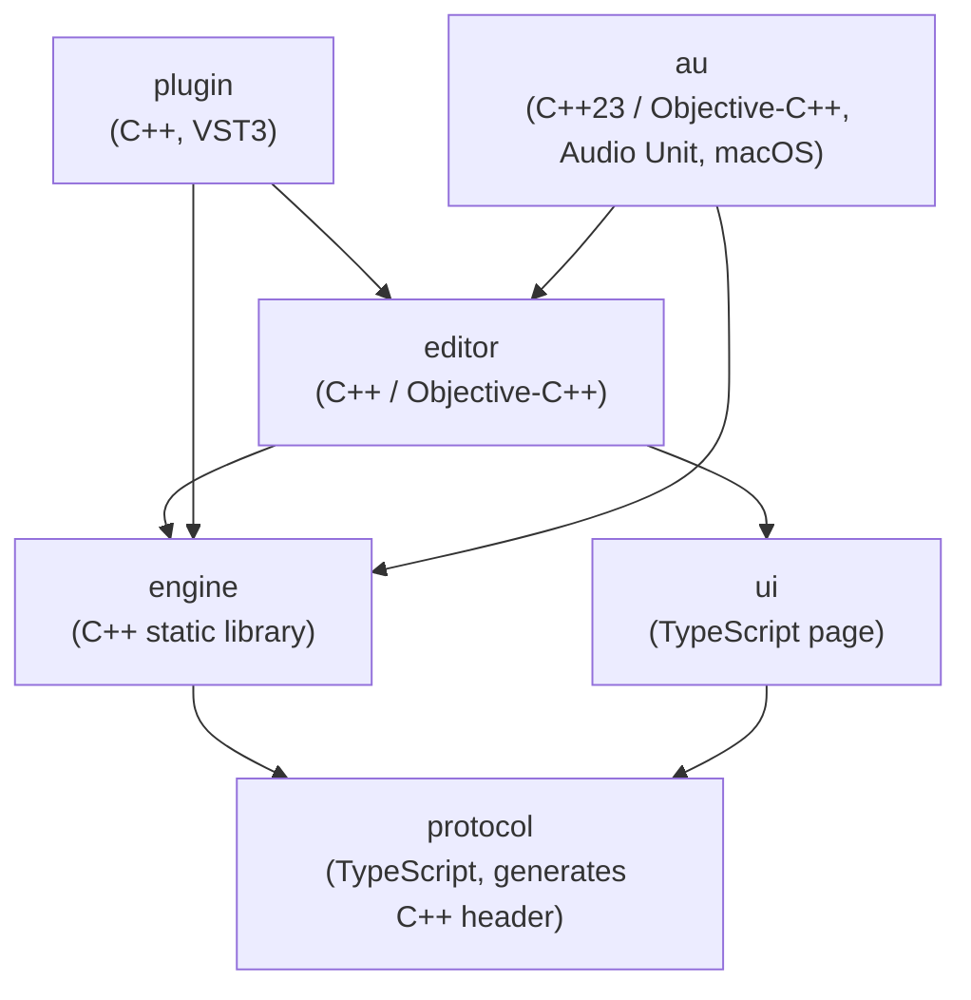

Arrows point from a module to what it depends on. Each module is a top-level folder with its own
`tests/`.

| Module | Language | Responsibility |
| --- | --- | --- |
| `protocol` | TypeScript | Defines enums, settings, shared limits (`limits.ts`), setting validation, message types and the frame layout once, as `as const` modules, with a frame encoder and decoder. The UI imports it directly; at build time a Node script generates the matching C++ header (never committed). Golden frames and messages in `protocol/tests/data` are shared by the C++ and TypeScript tests. |
| `engine` | C++ (static library) | Capture, musical clock, analysis (trigger, reduction, sweeps, readouts, Compare), settings (the store of record), saved state, frame encoding, the instance registry, and the engine token registry the formats' editors find their engine by (AD-10). No dependency on the VST3 SDK or any webview; the build forbids it. Optimised in Debug builds too. |
| `ui` | TypeScript | The page: a typed bridge behind a transport interface, an observable settings store, a render loop, a WebGL2 trace renderer, DOM views for labels, readouts and controls (`view/`, `components/`), and an in-memory mock back end for running in a browser. No runtime dependencies. |
| `editor` | C++ / Objective-C++ | Two libraries. `editor_core`, whatever the format: `EditorCore` (the window's contents and sizing rules), the webview wrapper per platform (`mac/`, `win/`, a `linux/` stub), the embedded assets and their URL scheme, the session (protocol handling), frame flow, the UI-thread dispatcher and display scale. `editor`: the VST3 view (`IPlugView`) around it. Benchmarks (`bench/`). It builds the `ui` page with Vite and embeds it. |
| `plugin` | C++ | VST3 processor, controller and factory; the process benchmark. |
| `au` | C++23 / Objective-C++ (macOS) | The Audio Unit on AudioUnitSDK (AD-25): the effect (pass-through, capture, timeline from the host's callbacks, state, track name from the context name), its Cocoa view around `EditorCore`, the factory the component exports, and `Sineless.component` with its Info.plist. |

The build enforces the C++ boundaries (`orizon_forbid_dependencies` in `CMakeLists.txt`): protocol,
engine and editor fail configuration if they link a module above them; the engine and
`editor_core` link neither plugin SDK; `au` links neither `plugin`, the VST3 view nor the VST3 SDK;
and only `au` links AudioUnitSDK. What the `ui` page imports, and C++ file names, are kept by review.

### 5.2 Level 2: engine

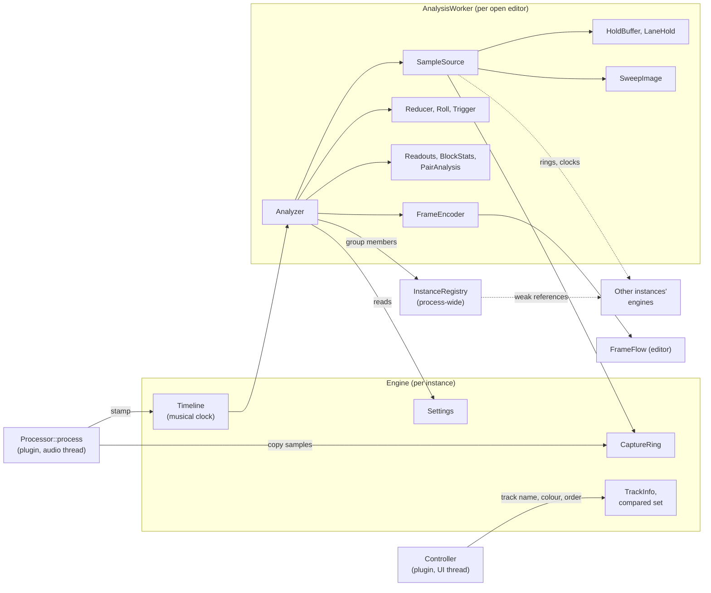

The tables follow the diagram from the audio thread to the frame.

| Block | Responsibility |
| --- | --- |
| CaptureRing | Per instance, preallocated in `setupProcessing` for the sample rate: a power of two of at least 2^20 samples (21.8 s at 48 kHz), 2^21 above 229 kHz, sized so a 4 s freeze fits at up to 384 kHz. Its writer, the audio thread, is lock-free and copies samples on every block whether or not an editor is open, so opening the editor shows recent history at once. Readers hold its storage by shared ownership across a resize. 7/8 of it is readable at any time: the last eighth (at least 0.57 s at any rate) is where the audio thread keeps writing while a reader copies, and a reader detects samples overwritten during its copy (8.2). Channels the host flags silent are written as silence. |
| Timeline | The musical clock. The audio thread publishes the latest musical stamp (position, tempo, time signature, playing, at a capture index) through a seqlock; readers map sample indices to quarter notes and back by extrapolating from it, free-running at the last tempo while stopped (AD-13). |
| Settings | The store of record, validated against the protocol's settings table, with its JSON form (`SettingJson`) shared by saved state and messages. |
| AnalysisWorker | One thread per open editor, running the Analyzer every 2 ms or when a frame is requested. |
| Analyzer | Produces each frame: places the trigger, roll or sweep window, reduces it to columns, measures readouts and Compare, and encodes the frame. Reads all sources through `SampleSource`, an abstraction over the ring, held audio and sweep images. |
| SweepImage | One per lane in Beats: the sweep as columns that persist between frames, reporting which ranges changed (AD-17, AD-19). |
| Reducer, Roll, Trigger | Min/max reduction to about one pair per device pixel (raw samples when zoomed in far enough), roll columns on fixed absolute indices, edge trigger (FR-3). |
| Readouts, BlockStats | Peak, RMS and frequency (FR-7); per-10 ms block statistics that keep readout and summing-gain cost proportional to new audio. |
| PairAnalysis | Compare's correlation, offset and polarity, and summing gains (FR-15). |
| HoldBuffer, LaneHold | On freeze, this track's held audio (4 s in Seconds, the readable capture in Beats) and each other track's Mid (4 s + 1 s margin). HoldBuffer is allocated at the capture's size when the editor opens and kept until it closes; LaneHold is allocated on freeze and released on unfreeze. |
| InstanceRegistry | Process-wide list of engines, held weakly, filtered by group and ordered by host position, then creation (AD-14). |
| FrameEncoder | Writes the binary frame (8.5). |

### 5.3 Level 2: editor and UI

| Block | Responsibility |
| --- | --- |
| Editor | `IPlugView`: creates the webview, the worker and the session on attach; sizing, minimum size from the lanes shown (FR-14.5), and content scale. With no engine it creates no session and answers the page's `hello` with `engineUnavailable` itself. |
| Session | The protocol's native side: handshake, settings, freeze, pan, zoom, Compare choices. The Editor's 100 ms timer calls its `sync`, which sends what changed in the engine meanwhile (`setState`, sample rate, channel count, lanes). |
| FrameFlow | Credit-based delivery (AD-12): on the worker, makes a frame only while the page's request is open; on the UI thread, hands it to the webview. |
| Transport | One interface to the webview's message channel and frame requests, per platform. |
| UiDispatcher, DisplayScale | Posting work to the UI thread (main queue on macOS, a message-only window on Windows); the display's scale factor. |
| WebView (`mac/`, `win/`) | Own thin wrappers (AD-4), the `orizon://` scheme handler serving embedded assets and frames, keyboard handoff to the host, crash recovery. |
| Page (`ui/`) | Bridge and store (applies only engine replies), render loop on `requestAnimationFrame`, WebGL2 renderer, DOM views, help. |

## 6. Runtime view

Message contents are defined only in the protocol module; 8.5 summarises them. Which thread each
step runs on is in 8.2.

### 6.1 UI session

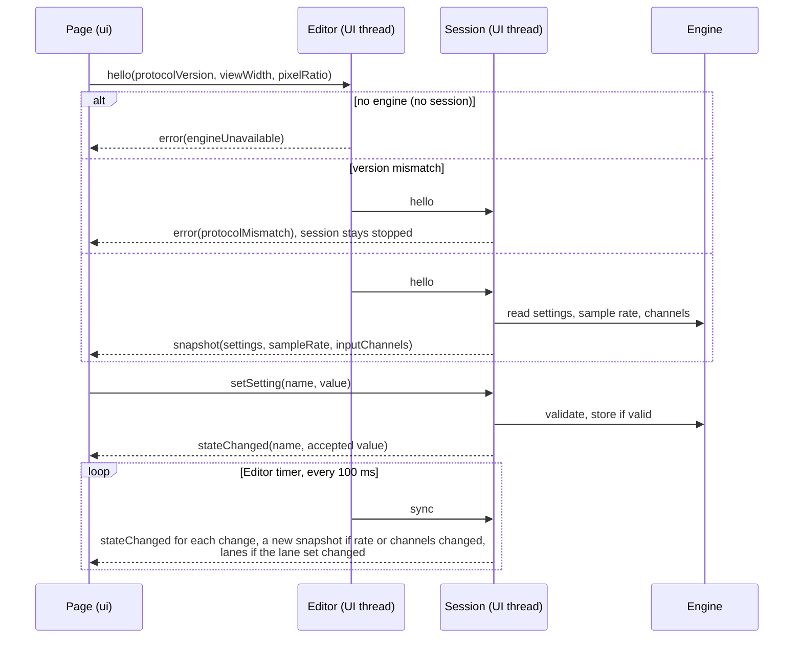

1. The page sends `hello` with its protocol version, view width and pixel ratio.
2. With no engine, the Editor itself replies `engineUnavailable`. Otherwise the session replies
   with one full snapshot: settings, sample rate and channel layout; on a protocol version
   mismatch it replies with an error and ignores everything until a matching `hello`. The UI shows
   either error in place of the traces.
3. The UI never updates its store optimistically. It sends `setSetting` and applies only the
   `stateChanged` reply, which always comes: a refused value is answered with the current one, so
   the control snaps back.
4. Changes made elsewhere (the host's `setState`, a new sample rate or channel count, tracks
   joining or leaving the group) reach the page through the Editor's 100 ms timer, which calls the
   session's `sync`.
5. The handshake can be repeated at any time, for example after a page reload.

### 6.2 Frame delivery

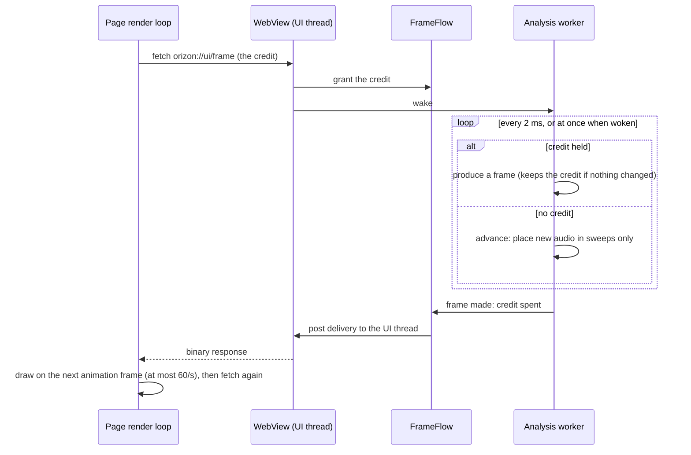

Without a credit the worker makes no frame; it only keeps the sweeps current, so a hidden page's
sweep is complete when shown (FR-9.5). Waking the worker on a request means a frame does not wait
for the next 2 ms step.

### 6.3 Freeze and trigger states

Two things are independent: why the display is frozen, and, in the Single trigger mode, whether
it is armed.

The display:

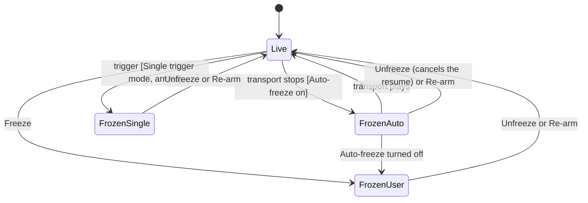

The Single trigger mode (Seconds, spans up to 1 s):

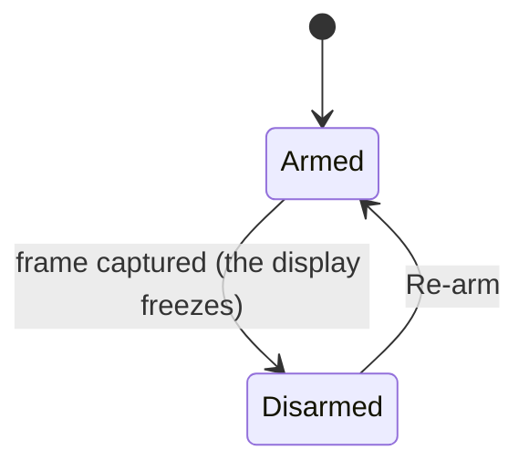

- Only an automatic freeze is ended by playback (FR-11).
- Re-arm is the page sending `arm` and then `freeze(false)`, so it also ends any freeze.
- Unfrozen without Re-arm, the Single trigger mode stays disarmed and keeps showing the last trace.
- Every frozen state holds audio as FR-6 and FR-9.6 describe.

### 6.4 Reading another instance

When the page shows Multi or Compare, the worker asks the registry for the members of its group,
takes shared ownership of each engine for the read, maps this track's window to each track's own
capture through the musical clocks (AD-15), and reads their rings directly. Nothing runs on any
audio thread for this; an instance removed meanwhile stays readable until the read ends.

### 6.5 Instance and editor lifecycle

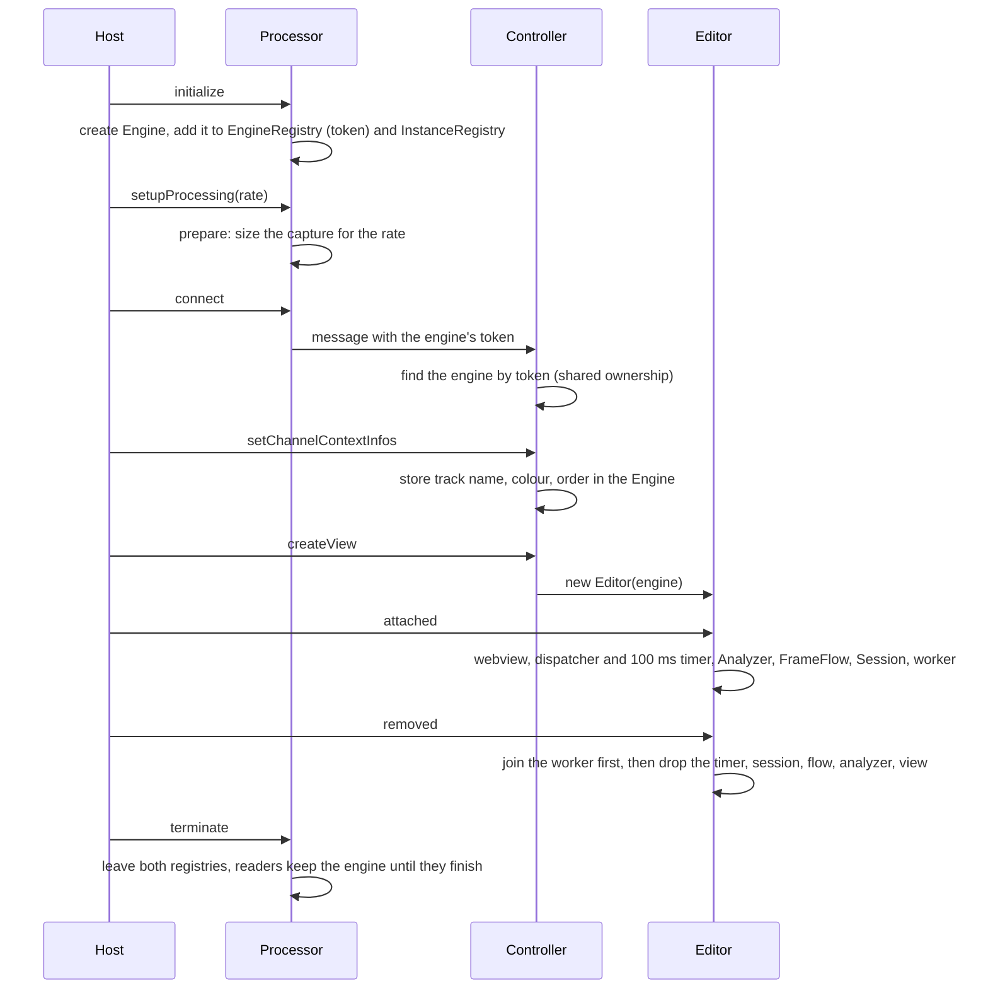

- Bus arrangements other than one input and one output of the same mono or stereo layout are
  refused.
- A `setupProcessing` while active, which the VST3 rules do not allow but some hosts send, keeps
  the capture's size and lets holds shrink to fit, rather than move memory under the audio thread.
- The editor's state (holds, zoom, cursors) goes with it; Compare's checks stay on the Engine
  (8.4).

### 6.6 Saving and restoring a project

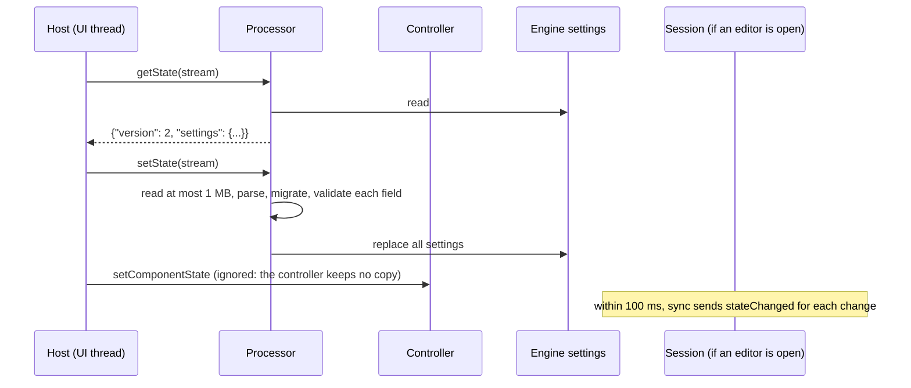

How state is read, migrated and validated is in 8.4.

## 7. Deployment view

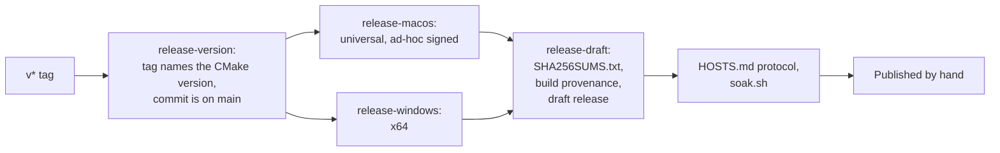

- One `.vst3` bundle per platform: universal (arm64 and x86_64) on macOS, x64 on Windows; on
  macOS also the Audio Unit, `Sineless.component`, universal.
- Each platform's release on GitHub Releases is a zip and an installer. The macOS installer
  installs both formats for the user, without a password, into `~/Library/Audio/Plug-Ins/VST3`
  and `~/Library/Audio/Plug-Ins/Components` (either can be left out under Customize); the Windows
  installer installs into `C:\Program Files\Common Files\VST3` for all users. From a zip, users
  move the bundles into those folders.
- At run time the plugin writes to disk only on Windows: WebView2's profile, in
  `%LOCALAPPDATA%\Orizon Audio\Sineless\WebView2-<n>` (8.7).
- The macOS bundle is ad-hoc signed (no Developer ID, so users clear the quarantine flag); the
  Windows bundle is not signed.
- Each release carries `SHA256SUMS.txt` and a build provenance attestation, also attached as
  `Sineless-<version>.intoto.jsonl` so a download can be checked from the files alone with
  `gh attestation verify`.
- A release is built only from a commit on `main` whose tag names the version in
  `CMakeLists.txt` (`scripts/release-on-main.ts`, `scripts/release-version.ts`); anything else
  stops the workflow.
- Packaging checks each bundle: the macOS minimum version and both architectures, and on Windows
  the x64 machine type and no dependency on the Visual C++ runtime DLLs. The release runner
  installs each installer and checks what it installed.
- Each bundle carries the licences of the third-party code compiled into it
  (`cmake/Licences.cmake`).
- The release workflow can be run as a dry run by hand, and runs as one on a pull request that
  changes its scripts.

## 8. Crosscutting concepts

### 8.1 Dependencies

| Dependency | Licence | Scope | Purpose | Pinned by |
| --- | --- | --- | --- | --- |
| VST3 SDK | MIT | shipped | Plugin API. | FetchContent, git tag |
| WebView2 SDK | BSD-3-Clause | shipped (Windows) | Webview embedding; static loader. | NuGet version + SHA-256 |
| AudioUnitSDK | Apache-2.0 | shipped (macOS Audio Unit) | The Audio Unit (AUv2) API: dispatch, buses, state, render. Its headers need C++23. | FetchContent, URL + SHA-256 |
| nlohmann/json | MIT | shipped | Control messages and saved state. | FetchContent, URL + SHA-256 |
| Roboto, Roboto Condensed, Roboto Mono | SIL OFL 1.1 | shipped (embedded in the UI) | The UI's fonts, the same on every system (subset; see `ui/src/fonts/README.md`). | In repo |
| GoogleTest (with GMock) | BSD-3-Clause | tests | C++ unit tests. | FetchContent, URL + SHA-256 |
| TypeScript, Vite, Vitest, ESLint, typescript-eslint, Prettier, @types/node | Apache-2.0 / MIT | dev | UI build, dev server, tests, lint. | `package-lock.json` |
| Playwright, @vitest/browser-playwright | Apache-2.0 / MIT | dev | App tests in WebKit and Chromium. | `package-lock.json` |
| fast-check | MIT | dev | Property tests. | `package-lock.json` |
| @vitest/coverage-v8 | MIT | dev | TypeScript coverage. | `package-lock.json` |
| Stryker | Apache-2.0 | dev | TypeScript mutation testing (`tools/mutation`). | its own lock file |
| pluginval | GPL-3.0 | checks | Host-like stress testing of the built VST3 plugin and Audio Unit. | download, version + SHA-256 |
| LLVM 23 (clang, clang-tidy, clang-format, sanitizers, libFuzzer, llvm-cov) | Apache-2.0 with LLVM exception | checks | Lint, sanitizers, fuzzing, coverage on Linux. | apt.llvm.org; clang-format via pipx version |
| Mull | Apache-2.0 | checks | C++ mutation testing. | `.deb` + SHA-256 |
| GitHub Actions, Docker base images | various | CI | CI and release. | commit SHA; image digest |

Dependabot updates npm, Actions and Docker images weekly; the C++ dependencies are updated by hand.
A new dependency is agreed on first and pinned (CONTRIBUTING.md).

### 8.2 Real-time safety and threads

- `Processor::process` and everything it calls are marked `ORIZON_NONBLOCKING`
  (`[[clang::nonblocking]]` where supported), and `-Wfunction-effects` is enabled on every
  compiler that accepts it.
- RealtimeSanitizer runs the processor tests on Linux with LLVM 23.
- On every compiler, tests replace global `operator new`/`delete` with counting versions and
  assert that the audio path makes no allocations.
- The audio thread's work per block: copy the block into the capture ring (a lock-free writer) and
  publish one musical stamp (a seqlock writer). It never waits on a reader.
- A performance benchmark runs eight instances and requires that all of them together use at most
  5% of each block's duration, at the 99.9th percentile (QS-1).

**Threads.** Three kinds of thread touch an instance; only the audio thread is real-time.

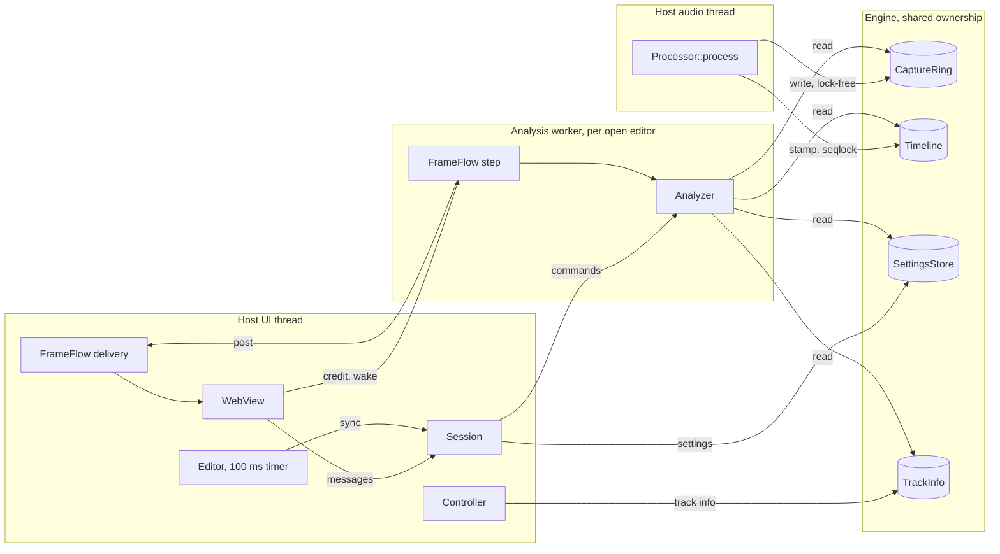

| Shared object | Written by | Read by | How |
| --- | --- | --- | --- |
| CaptureRing samples | Audio thread | Workers (this instance's and others') | Lock-free. The writer publishes the index it is about to overwrite before writing and the written end after, so a reader detects samples overwritten while it copied. Readers take the storage pointer under a lock the writer never takes. |
| Timeline stamp | Audio thread | Workers | Seqlock: the writer never waits; a reader retries if it overlapped a write. |
| SettingsStore | UI thread (session, `setState`) | UI thread, workers | Mutex. The audio thread never reads settings. |
| TrackInfo, compared set | UI thread (controller, session) | Workers | Mutex. |
| Analyzer commands (freeze, pan, view, arm, Compare) | UI thread (session) | Its worker | Mutex; the worker takes them on its next step. |
| Published lane set | Worker | UI thread (session) | Mutex. |
| FrameFlow credit and frame | UI thread (credit), worker (frame) | The other | Mutex; delivery is posted to the UI thread. |
| InstanceRegistry | Any thread adding or removing an instance | Workers | Mutex over weak references; a reader holds each engine by shared ownership while it reads. |

No lock is ever taken by the audio thread, and no thread waits for it.

### 8.3 Build, checks and testing

CMake builds the C++; presets cover macOS, Windows x64, Linux and the sanitizer, coverage, fuzz
and benchmark builds. Test levels, where each runs and the definition of done are in
[CONTRIBUTING.md](../CONTRIBUTING.md); review questions in [REVIEW.md](../REVIEW.md). In summary:

| Kind | What | Where |
| --- | --- | --- |
| Static | `tsc -b` (strict, `noUncheckedIndexedAccess`, `exactOptionalPropertyTypes`), ESLint (strict type-checked), Prettier, clang-format, clang-tidy | Linux; clang-tidy for the macOS glue on macOS |
| Unit, component, contract | GoogleTest and Vitest; golden frames and messages shared by C++ and TypeScript, golden saved states for C++; a signal corpus of approved frames; a matrix of sample rates, spans, mono/stereo, live/frozen | All platforms |
| Integration and app | The editor with its page in a real WKWebView or WebView2; the real page against the mock in WebKit and Chromium (Playwright) | macOS, Windows; Linux |
| Conformance | Steinberg VST3 validator (part of the build); pluginval at strictness 10; for the Audio Unit, Apple's auval (strict, in and out of process) and pluginval on a copy installed for the user (`scripts/validate-au.sh`) | macOS, Windows |
| Sanitizers | RealtimeSanitizer, ThreadSanitizer, AddressSanitizer + LeakSanitizer + UBSan on the shared code (Linux); ASan + UBSan and TSan on the macOS glue; MSVC ASan on the Windows glue | Linux, macOS, Windows |
| Fuzzing | libFuzzer on state loading, setting values, the session's messages; fast-check on frame decoding and transport. Five minutes per pull request, 30 nightly, from a corpus kept on main | Linux |
| Coverage, mutation | Changed-line coverage (llvm-cov, V8); mutation testing of changed lines (Stryker, Mull), the mutants no test noticed triaged in CI (below) | Linux |
| Performance | Audio-thread deadline, frame rate, analysis CPU, reopen leaks (section 10); reported in CI, judged locally | macOS, Windows |
| Release | Soak test (`scripts/soak.sh`), scripted REAPER test on Windows, the HOSTS.md protocol by hand | Before a release |

CI runs on pull requests, the merge queue and pushes to main; changes to documentation only skip
the builds. `main` is changed only through the merge queue.

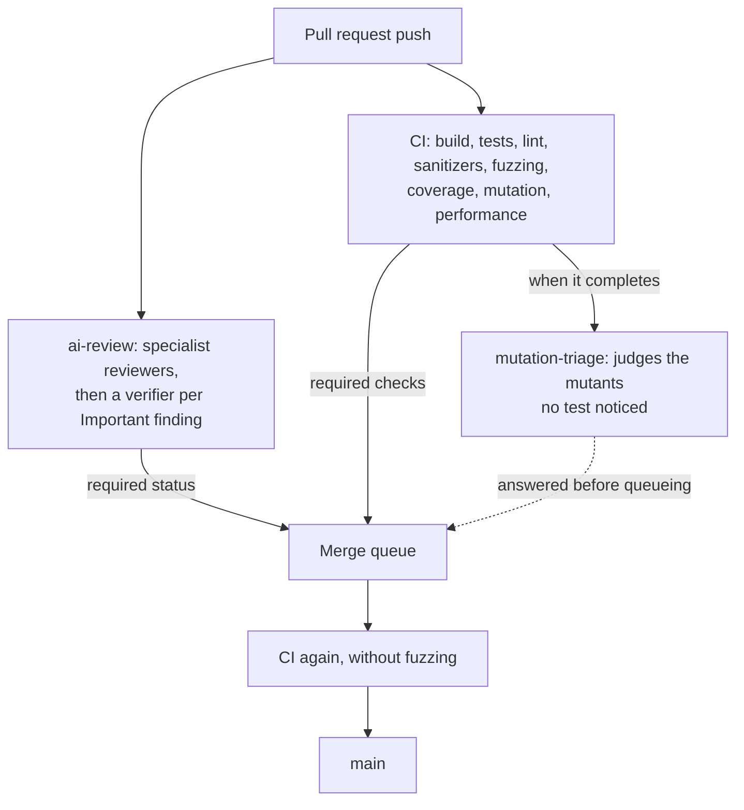

- **ai-review** reviews each push against REVIEW.md and fails while a verified finding is
  Important. A maintainer can start it on a fork's pull request with `/ai-review`, or pass it with
  `/ai-review waive <reason>`; after two failed reviews the pull request is labelled `needs-human`.
  In the merge queue it passes at once: the pull request was reviewed.
- **mutation-triage** runs after CI, from `main`'s version of the workflow, and passes or fails
  on whether each surviving mutant needs a test (REVIEW.md); `/mutation-triage waive <reason>`
  passes it.
- Fuzzing also runs nightly for 30 minutes. Dependency review fails a pull request that adds a
  dependency with a known vulnerability; OpenSSF Scorecard runs weekly; a closed pull request's
  caches are deleted.

### 8.4 State and persistence

Every value a user sees or sets lives in one of three tiers. A new value is placed in a tier by
what it is, not by convenience.

| Tier | Lasts | Values |
| --- | --- | --- |
| Saved with the project | Until changed; travels with the project | The settings table (1.2.3). |
| Kept while the plugin is loaded | Until the instance is removed or the project closed; survives closing and opening the editor | Compare's checked tracks (on the Engine). |
| Reset when the editor closes | The editor session | Freeze and held audio, pan, zoom, cursors, Preview fix, Help. |

Saved state:

- Format: `{ "version": n, "settings": { ... } }`, current version in the header. Settings are
  saved by name, and enum and flag values by the names of their values, so the protocol may
  reorder or add values without breaking saved projects; renaming or removing one needs a
  migration.
- On load, migrations run in sequence from the saved version up to the current one. Version 2
  made Beats the default time base; its migration gives a version 1 state without a time base
  (saved before tempo sync) the Seconds time base.
- Each field is validated on its own. A missing or invalid field takes its default, and unknown
  fields are ignored, so a project saved by a newer version still opens in an older one; a
  setting added without a version change is simply absent from older states.
- Loading never throws to the host. A state larger than 1 MB, a stream that fails or ends early,
  or text that does not parse loads every default; a state that parses loads field by field as
  above.
- The processor's engine holds the only copy; the controller ignores the component state.
- Tests keep a golden state for each state version, and for each release that adds settings
  without a new version, and prove that every setting and every value name in them still loads
  (`engine/tests/data`).

### 8.5 Engine–UI protocol

Defined in `protocol/src`; `protocolVersion` (current value in the header) changes on any
incompatible change.

**Control messages** (JSON over the webview's message channel):

| Message | Direction | Fields | Purpose |
| --- | --- | --- | --- |
| `hello` | UI → engine | protocolVersion, viewWidth, pixelRatio | Start or restart a session. |
| `snapshot` | engine → UI | protocolVersion, settings, sampleRate, inputChannels | Full state. |
| `error` | engine → UI | code (`protocolMismatch`, `engineUnavailable`), message | Replace the screen with an explanation. |
| `setSetting` | UI → engine | name, value | Change a setting. |
| `stateChanged` | engine → UI | name, value | The setting's accepted value. |
| `viewport` | UI → engine | viewWidth, pixelRatio | Screen width in device pixels. |
| `freeze` | UI → engine | frozen | Freeze or unfreeze. |
| `pan` | UI → engine | seconds | Pan back through held audio. |
| `arm` | UI → engine | — | Re-arm Single. |
| `view` | UI → engine | start, end (fractions of the span) | Zoom. |
| `lanes` | engine → UI | laneSet, lanes (id, name, colour, own, compared), hidden | Who the lanes are. |
| `compare` | UI → engine | ids | Checked tracks. |
| `previewFix` | UI → engine | on | Preview fix. |

- `snapshot` is sent in reply to `hello`, and again when the sample rate or channel count changes;
  `stateChanged` in reply to every `setSetting` and for each change found by the 100 ms sync;
  `lanes` when the set of lanes changes.
- The native side ignores every message before a `hello` it accepts, and drops a message of an
  unknown type or with missing or malformed fields without replying, except a `setSetting` for a
  known setting, which is always answered (6.1).
- Each `lanes` message and each frame carry a lane set id. The page names and colours a frame's
  lanes from the `lanes` message with the same id (the latest one until it arrives), so labels
  stay with their traces although the two travel separately.

**Frames** (binary, little-endian; the reply to `fetch("orizon://ui/frame")`): a fixed header
(`frameHeaderFields` in `protocol/src/frame.ts`, 84 bytes), then float32 data.

| Part | Contents |
| --- | --- |
| Header | mode (min/max or raw), flags, views, lane count, point count; start fraction; peak, RMS, frequency; sweep cursor, cycle start, span and bar in quarter notes; view start and end, visible samples; lane set; summing gain and fixed gain; cycle seconds; pan reach; invalid sample count and lane mask; sample rate. |
| Flags | triggered, frozen, roll, synced, limited, compared, partial (shown as "Filling" live, "Partial" frozen). |
| Data | Per view (Single) or per lane (Multi, Compare; the sum last): min/max pairs or raw samples. Compare frames then carry correlation, offset and polarity for each track. |

For example, a Compare frame with three tracks has four lanes (the sum last): 4 × point count × 2
floats of min/max pairs, then 3 × 3 match values.

"No value" travels as NaN (8.6).

### 8.6 Values and levels

- "No value" (not measured, silent, never sounding together) is NaN and shows "—"; a real 0 dB or
  0 correlation stays distinguishable.
- Levels are converted, floored and formatted only through the shared helpers
  (`protocol/src/limits.ts`, `ui/src/view/format.ts`).
- Three different "too quiet" limits apply to three quantities: level readouts show −∞ at or
  below −120 dBFS; a summing gain shows −∞ at or below −140 dB; analysis (frequency, Compare)
  ignores audio at or below −90 dBFS RMS.
- Samples that are not finite are left out of measurements, counted, and shown: an "Invalid
  samples" chip, and affected lanes named in orange.

Shared limits (`protocol/src/limits.ts`, generated into the C++ header; the file explains each):

| Name | Value | What it is |
| --- | --- | --- |
| `levelFloorDbfs` | −120 dBFS | Level readouts show −∞ at or below. |
| `gainFloorDb` | −140 dB | Summing gains show −∞ at or below. |
| `analysisGateDbfs` | −90 dBFS | Analysis ignores audio at or below. |
| `crossingHysteresis` | 0.1 | Of peak-to-peak, for finding cycles. |
| `periodTolerance` | 0.15 | Steady cycles lie within this of the median. |
| `frozenHoldSeconds` | 4 s | Freeze hold in Seconds (the longest span). |
| `triggerPosition` | 0.1 | Trigger point from the left. |
| `rollThresholdSeconds` | 1 s | Longer spans roll. |
| `minimumViewWidth` | 1/256 | Narrowest zoom. |
| `maxLanes` | 16 | Multi lanes; Compare shows one fewer. |
| `readoutIntervalSeconds` | 0.1 s | Readout refresh. |
| `matchReachSeconds` | 0.01 s | Compare offset reach, each way. |
| `matchWindowSeconds` | 8 s | Audio Compare matches over. |
| `summingMarginDb` | 1 dB | Harmless summing band. |
| `frequencyWindowSeconds` | 1 s | Audio the frequency readout measures. |
| `minimumEditorWidth` | 900 px | Editor minimum width. |
| `minimumLaneHeight` | 40 px | Stacked lane minimum height. |
| `chromeHeight` | 144 px | Height around the screen. |

Engine-only thresholds live in the engine source, each with its reason; the requirements state
the behaviour they set: the Auto timeout (FR-3), the steady share of cycles (FR-7), the sweep cap
and tempo tolerance (FR-9.3, FR-9.4), Compare's "together", "audible" and "related" levels and its
match pacing (FR-15.3, FR-15.4), the 10 ms statistics block and the lane hold margin (5.2), and
the highest sample rate the capture is sized for (5.2, CaptureRing).

**Floating point.** NaN and infinity must survive the build: "no value" is NaN, and samples that
are not finite are detected and counted. The engine therefore needs a precise floating-point
model; the VST3 SDK turns on `/fp:fast`, the project turns it off again
(`cmake/ProjectOptions.cmake`), and `engine/include/engine/PreciseFloatingPoint.h` fails the build
under `/fp:fast` or `-ffast-math`.

### 8.7 Webview integration

The editor hosts its page in the system's webview through its own thin wrapper per platform
(AD-4): `editor/src/mac/WebViewMac.mm` and `editor/src/win/WebViewWin.cpp`.

- **One origin.** The page and its fonts are embedded in the binary and served from `orizon://ui/`
  (AD-11); the frame endpoint is `orizon://ui/frame`. Native code accepts messages only from that
  origin's main frame.
- **Several plugins in one process.** On macOS the Objective-C classes are created at run time
  with names unique to the loaded binary, so two copies or versions of Sineless, or another
  plugin's classes, never clash.
- **Keyboard.** Keystrokes go to the host unless a text field in the page has focus, so the
  host's transport shortcuts keep working. On Windows, where WebView2 runs in another process,
  shortcuts arrive as accelerator keys and the page reports other keys for forwarding.
- **WebView2 profile (Windows).** WebView2 keeps a profile on disk. Its default folder sits next to
  the host's executable, which may not be writable, so it is set to
  `%LOCALAPPDATA%\Orizon Audio\Sineless\WebView2-<n>`. Views sharing a folder share one browser
  process, which refuses views with other environment options or another DPI awareness: `<n>`
  changes with the options, and DPI-unaware host windows (Live's Auto-Scale) get a folder of
  their own.
- **No flash.** The panel colour is also the webview's native background.
- **Crash recovery** is in 8.9.

**Hardening.** The context menu is off on both platforms. On Windows, page zoom, pinch
zoom of the page, browser accelerator keys and developer tools are off too; on macOS, the first
click acts in an inactive window.

### 8.8 Security

Sineless opens no network connection or socket and serves only its embedded content (10.1). The
inputs it does not control are the threats it guards against (SECURITY.md):

| Input | Risk | Guard | Checked by |
| --- | --- | --- | --- |
| Plugin state from a project someone else made | Crash or memory corruption while loading | At most 1 MB read; parsed by nlohmann/json; each field validated against the settings table, an invalid one refused (FR-8); never throws to the host | State fuzzer, `StateFaultTests`, ASan + UBSan |
| Messages from the page | A page that misbehaves drives the engine into bad state | Only from `orizon://ui/`'s main frame; unknown or malformed messages dropped; settings validated; the viewport width capped at 16384 columns | Session fuzzer, `SessionTests`; the width cap has no test of its own (R-8) |
| Navigation from the page | The page loads or opens content from elsewhere | Navigation outside `orizon://ui/` and new windows are refused on both platforms | No test yet (R-8) |
| Audio | Samples that are not finite corrupt readouts | Left out of every measurement, counted and reported (FR-7) | Signal corpus, `invalid-samples.test.ts` |
| Downloads | A release altered after it was built | Checksums and a build provenance attestation (7) | Release workflow |

Vulnerabilities are reported privately through GitHub's security advisories (SECURITY.md).
Unsigned binaries are a known limit, not a vulnerability (R-4).

### 8.9 Failure handling

What happens when something the editor depends on fails. In every case audio keeps passing
through unchanged, and the editor says what happened in place of the traces.

| Failure | What the user sees | Where |
| --- | --- | --- |
| The editor finds no engine (AD-10) | "Display unavailable" | Editor, `app.ts` |
| The page and the plugin come from different releases | "Version mismatch", and the session stays stopped | Session |
| No WebGL2, or the shaders fail to build | "Graphics unavailable" | `app.ts` |
| The graphics context is lost (GPU reset, driver update) | "Graphics unavailable" until the context is back, then the last frame is drawn again; it stays if the restored context cannot draw | `app.ts` |
| An engine error and a graphics failure together | The engine error, which says what to do; the graphics message never replaces it | `app.ts` |
| The page's process ends (macOS memory pressure, a crash) | The page loads afresh, says `hello` and gets the session's state again; after 3 failures within a minute it is not reloaded and the editor says to reopen it | `WebViewMac.mm`, `WebViewWin.cpp` |
| WebView2's browser process exits (Windows) | A native message to close and reopen the editor; every view sharing that process is affected | `WebViewWin.cpp` |
| No WebView2 Runtime, or WebView2 fails to start (Windows) | A native message saying what is needed | `WebViewWin.cpp` |
| The host's stream fails while loading state | Every setting at its default (8.4) | `Processor::setState` |

### 8.10 Naming conventions

| Element | C++ (follows the VST3 SDK) | TypeScript |
| --- | --- | --- |
| Types, classes | `PascalCase` | `PascalCase` |
| Functions, variables, members | `camelCase`, no member prefix | `camelCase`; a leading `_` marks an unused parameter |
| Constants, enumerators | `kPascalCase` | `camelCase`; enum-like `as const` objects are `PascalCase` |
| Namespaces | lowercase, rooted at `orizon` (`engine`, `plugin`, `editor`, `protocol`) | n/a |
| Files | `PascalCase.h`/`.cpp`/`.mm`, named after the main type | `kebab-case.ts` |

The protocol generator maps schema names to the C++ convention. clang-tidy and ESLint enforce
identifiers, and ESLint TypeScript file names; C++ file names are kept by review.

## 9. Architecture decisions

This table is the project's only decision log. A decision is edited in place while it stands;
when it is replaced, its status says by which decision, and git history keeps earlier versions.

| ID | Status | Decision | Rationale |
| --- | --- | --- | --- |
| AD-1 | Accepted; amended by AD-25 | Build directly on each format's SDK (the VST3 SDK; AudioUnitSDK for the Audio Unit), with no plugin framework. | With two formats sharing a format-agnostic engine and editor core, a framework's cross-format layer adds little: each format's glue is thin. Using the SDKs directly runs no third-party code per block and avoids a large dependency. Cost: editor and webview embedding, and each format's view, are written in-house. |
| AD-2 | Accepted | Trigger, reduction, readouts and Compare analysis run in C++ on a worker per open editor; the UI only draws. | Deterministic and unit-testable in C++. Small frames over the bridge instead of raw samples, and no analysis on the DAW's UI thread or in the webview. No editor, no worker: a closed editor costs only the capture. |
| AD-3 | Accepted; its frame transport superseded by AD-21 | Engine and UI exchange control messages as JSON over the webview's native message channel (page to native through `webkit.messageHandlers` or `chrome.webview.postMessage`; native to page through `evaluateJavaScript` or `PostWebMessageAsString`). Display frames travel separately, as binary (AD-21). Each side reaches both through one transport interface. | No sockets and no local attack surface. The interface lets the transport change, as it did for frames when profiling demanded it. |
| AD-4 | Accepted | Own thin webview wrapper per platform, and a stub on Linux for the checks. | Full control over plugin-specific issues: class-name collisions between plugins in one process, keyboard handoff to the host, the WebView2 user-data folder, teardown order, crash recovery. |
| AD-5 | Accepted | Traces drawn by a hand-written WebGL2 renderer; text and controls are DOM. | Smooth at high resolutions and refresh rates, and leaves room for persistence and XY without a rewrite. |
| AD-6 | Accepted | No host-automatable parameters; all settings are plugin state. | A scope's settings are view settings, not sound-shaping, and a parameter list is a permanent compatibility contract. |
| AD-7 | Accepted | No UI framework. | Few controls, and the per-frame path must bypass any reactive framework anyway. Zero runtime dependencies. |
| AD-8 | Accepted | GoogleTest for C++; Vite and Vitest for the UI, with Playwright for the real page in WebKit and Chromium. | Widely adopted. Vitest shares Vite's configuration, and the Vite dev server with the mock back end gives fast UI iteration outside a DAW. WebKit is what macOS hosts the page in. |
| AD-9 | Accepted | JSON via nlohmann/json for control messages and saved state, never on the audio thread. | Readable, easy to version and migrate. Robust parsing of untrusted state is a problem worth delegating. |
| AD-10 | Accepted | Separate VST3 processor and controller. At connect time the processor sends the controller a random 64-bit token, which the controller looks up in a module-wide registry to get shared ownership of the processor's engine. If no engine is found, the editor shows an "unavailable" state. | Follows the SDK's recommended structure, which the validator and hosts expect, while letting the editor read the capture ring without copying frames through the host's message system. Passing a token rather than a pointer means the controller never holds a raw address, and holds the engine by shared ownership while it uses it. |
| AD-11 | Accepted | The built UI, fonts included, is embedded in the binary at build time and served through a custom URL scheme on both platforms. | Self-contained binary with one stable origin; nothing on disk can go missing or be altered; the same fonts on every system. |
| AD-12 | Accepted | Frame flow is credit-based with one frame in flight. The credit is the page's open request for a frame; the worker hands over a frame only while one is open, and the page asks again after drawing, at most 60 times a second. | Production follows the display's refresh rate, no backlog can build up, and it stops by itself while the page is hidden. |
| AD-13 | Accepted | The audio thread publishes the host's latest musical position (position, tempo, time signature, playing, at a capture index) through a seqlock. Readers map sample indices to quarter notes and back by extrapolating from it; while stopped the clock free-runs at the last tempo. | Tempo sync needs to map sample indices to beats off the audio thread. One small write per block, no locks, no waiting. A single stamp suffices because the mapping is only needed near the present and tempo changes restart sweeps that move by more than the tolerance (FR-9.4). |
| AD-14 | Accepted | Instances find each other through a process-wide registry in the engine module, holding weak references to the engines in a flat list; a group's members are those whose group setting matches, ordered by host track position, then creation. Each engine carries its track name, colour and position. Readers get shared ownership for as long as they read, and the editor's worker reads other instances' capture rings directly. | Needs no routing in the host and no audio-thread work: capture rings already allow lock-free writing alongside readers, and shared ownership keeps a ring alive while another editor reads it; weak references let an instance vanish even if it was never removed. It works wherever instances share a process, which is every major host's default (R-1). Instances of different Sineless versions, or of different formats (VST3 and Audio Unit), keep separate registries, so they never read each other's data. |
| AD-15 | Accepted | Lanes align on the musical clock (AD-13) that every instance receives from the host. In Beats each lane's sweep follows its own instance's clock. In Seconds the own track's window start is mapped to quarter notes on its clock, then to each other track's sample index on that track's clock. | All instances see the same host position while their capture indices start at different moments. The clocks already exist, so the audio thread does no new work. While stopped, every clock free-runs at the same tempo from the same position, so lanes stay aligned; a host that reports no position would leave tracks offset by when they started. |
| AD-16 | Accepted | The engine renders Compare frames through the multi-track lane path: the tracks, then the sum of the checked ones, and computes the analysis on raw samples, each track against this one. The summing gains travel in the frame header and each track's match after the lane data. The UI names tracks by the lane id that each `lanes` entry carries, which also says which are checked. The checked set lives on the Engine. | Summing and correlating min/max columns in the UI would be wrong; only the engine has the samples. Results in the frame stay in step with the lanes they describe, at no extra message traffic. Correlation and offset are pairwise, so each track is measured against one reference: this track. On the Engine, the choice outlives the editor but not the project (8.4). |
| AD-17 | Accepted | Display cost follows change, not size. Lanes and views keep their screen columns between frames: a sweep reduces again only the columns its newest samples landed in (SweepImage reports changed ranges), a roll window only the columns that scrolled in (columns on fixed absolute indices), and a Compare sum lane only where compared tracks changed. Readouts and summing gains are measured at most every 0.1 s of audio (always while frozen), from per-block statistics; Compare matches at most every 0.5 s per track, one track per frame, one every 0.1 s at most. The engine is optimised in Debug builds too. Measured with `editor/bench/PerfBench.mm` (`scripts/bench.sh`). | The analysis thread spent 70% of a core re-reducing whole lanes every frame, and Debug builds dropped to 5–16 frames/s. After: costs nearly flat in tracks, span and window width (doubling the width adds about 1 point). |
| AD-18 | Accepted | Numbers the engine and UI share are defined once in `protocol/src/limits.ts`, with what each measures and why it has its value, and generated into the C++ header; help text reads them from there. "No value" is NaN end to end. | Two copies of a threshold drift apart, and a display that shows 0 for "not measured" misleads. One definition makes engine, UI and help agree by construction. |
| AD-19 | Accepted | Long sweeps keep raw sample images per lane, with no lower-resolution tier: a sweep may be longer than the capture and fills in as it plays, up to 2^23 samples per lane. The worst case accepted is 15 lanes of 16 bars at 60 BPM and 96 kHz, about 580 MB, checked in Live. | One representation keeps zoom exact at every span and the code simple. The cap bounds memory; the worst case was measured acceptable in a host, and the performance check keeps it so. |
| AD-20 | Accepted | Values are persisted in three tiers (8.4): saved with the project, kept while the plugin is loaded, reset when the editor closes. | Zoom, freeze, cursors and Compare's checks are viewing choices, not settings of the track; saving them would make the project change when it is only looked at. Compare's checks are kept while the plugin is loaded so that closing and opening the editor does not undo them. |
| AD-21 | Accepted | Frames travel as the binary body of the response to the page's fetch of `orizon://ui/frame`, which is also the credit (AD-12). Replaces AD-3's frames as base64 text over the message channel. | Text encoding and decoding on both sides cost a fixed share of every frame in WebKit. A fetch carries bytes as they are, and the open request is a natural credit. |
| AD-22 | Accepted | The page builds trace geometry on the GPU: instanced quads read from the frame's bytes as received, with no per-frame JavaScript geometry; the sweep playhead is drawn in WebGL, not as page elements. | Per-frame JavaScript geometry and DOM changes added fixed WebKit cost on every frame. The remaining cost is WebKit's per-frame display pipeline (QS-3). |
| AD-23 | Accepted | The editor's layout is stable: nothing is cropped, hidden or moved as the window is resized. The minimum width (`minimumEditorWidth`) fits the widest content in every state, and content of unbounded width (the status chips) wraps in a place with room for it, the screen's top-right corner. No responsive breakpoints, compact labels or hidden elements. | A control that disappears, shortens or moves at some sizes is hard to find again and makes the window feel unreliable; and a plugin window is resized often. Rejected: a shrinking chip area, hiding the wordmark below a width, single-letter compact controls. Cost: a wider minimum window (900 px), checked in every state by the editor tests. |
| AD-24 | Accepted | Windows ships x64 only; no native ARM64 build is built, tested or released for now. Windows on Arm runs the x64 build in an x64 host or in REAPER's ARM64EC build. The ARM64 presets stay, and `scripts/package.ps1` says how to bring the build back. | No native ARM64 Windows host is expected among users soon, and its CI job was among the slowest, waiting for an ARM runner. Shipping only what CI tests means dropping the binary with the job. Revisit when a user needs a native ARM64 host (R-5). |
| AD-25 | Accepted | On macOS, also an Audio Unit v2, native on Apple's AudioUnitSDK, in its own module (`au`) beside the VST3 glue, sharing the engine and `editor_core`. Codes `aufx`/`Snls`/`Oriz`. Its view is a Cocoa view factory named per build; it exports only its factory and leaves out `sandboxSafe`, so sandboxed hosts load it out of process. | Logic Pro and GarageBand load Audio Units only. AUv2 with the host's context name keeps track names, and a spike showed Logic and GarageBand keep a project's instances in one process (out of process, in AUHostingService) and Live in its own, so Multi and Compare work. Rejected: Steinberg's VST3-to-AU wrapper (no track names, Xcode generator only), clap-wrapper (needs a CLAP port first, no track names), AUv3 (an app extension in a sandboxed process where instances do not reliably share a process, which Multi and Compare need, and a Developer ID for distribution). |

## 10. Quality requirements

### 10.1 Overview

| Category (ISO/IEC 25010) | Requirement | Goals |
| --- | --- | --- |
| Performance efficiency | The audio thread meets its deadline with headroom; the editor draws at display rate at low CPU; memory is bounded. | QG-1, QG-4 |
| Functional suitability | Measurements are correct across sample rates, spans, channel layouts and live/frozen states; "no value" is never shown as a number. | QG-3 |
| Compatibility | Passes VST3 conformance; works in the major hosts (HOSTS.md); state from any release loads. | QG-2 |
| Reliability | Malformed state, messages or samples never crash or corrupt; the editor survives reopening and webview crashes (8.9). | QG-1, QG-6 |
| Maintainability | Every change is checked by static analysis, tests at every level, sanitizers, and mutation testing of the lines it changes. | QG-6 |
| Security | No network or sockets; embedded assets only; untrusted state and messages refused safely; dependencies pinned and reviewed; releases verifiable (8.8). | QG-1, QG-5 |

### 10.2 Scenarios

| ID | Scenario | Measure | Checked by |
| --- | --- | --- | --- |
| QS-1 | Eight instances process audio together. | All eight together use at most 5% of each block's duration at the 99.9th percentile; zero allocations on the audio path. | `process_bench`; allocation-counting tests; RealtimeSanitizer |
| QS-2 | Audio passes through any instance, in any state. | Bit-exact output; reported latency 0. | `ProcessorTests` |
| QS-3 | The editor shows seven tracks over four bars, in Multi and in Compare. | At least 45 frames/s; analysis thread within 10% (Multi) and 30% (Compare) of a core. | `perf_bench` (judged locally, reported in CI) |
| QS-4 | The worst case: fifteen tracks over sixteen bars at 60 BPM and 96 kHz. | At least 45 frames/s once filled; analysis within 20% of a core; host memory grows well under 1 GB. | `perf_bench`; HOSTS.md step 10 |
| QS-5 | The editor is opened and closed 50 times while playing (200 before a release). | No threads or web views left behind; memory grows at most 20 MB (40 MB over 200). | `perf_bench --reopen=50`; `soak.sh` |
| QS-6 | A project saved by any earlier release is opened. | Every setting it saved is restored; missing or invalid ones take their defaults; loading never throws. | `StateTests` golden files; state fuzzer |
| QS-7 | A host passes malformed state, a page sends malformed messages, a frame is malformed. | No crash, no undefined behaviour; the input is refused. | libFuzzer and fast-check; ASan + UBSan |
| QS-8 | Audio contains NaN or infinite samples. | They are left out of every measurement and reported; other values stay correct. | `ui/tests/app/invalid-samples.test.ts`; signal corpus |
| QS-9 | Any sample rate from 44.1 to 384 kHz, mono or stereo, live or frozen. | Readouts, lanes and holds are correct at each. | `MatrixTests`, `high-sample-rate.test.ts` |
| QS-10 | A change adds a setting, mode or formatter. | Generated test cases cover it without new test code. | Parameterised tests over the protocol's tables |
| QS-11 | The page's process crashes, or the graphics context is lost, while playing. | The editor recovers by itself (up to 3 page failures a minute) or says what to do; audio is unaffected. | Editor tests; `graphics-lost.test.ts`, `graphics-and-errors.test.ts` |
| QS-12 | The host changes the sample rate or channel count with the editor open. | The page gets a new snapshot at the next sync, within 100 ms. | `SessionTests` |
| QS-13 | The page sends a message from another origin, or tries to navigate away. | The message is ignored; the navigation is refused. | Not yet tested (R-8) |

## 11. Risks and technical debt

Known risks and debts, with what limits them. A risk is removed when it no longer holds; its ID is
not reused.

| ID | Risk or debt | Effect | Mitigation | See |
| --- | --- | --- | --- | --- |
| R-1 | Hosts that run plugins in separate processes (REAPER's "Dedicated process", Bitwig's "Individually") | Instances cannot find each other: Multi and Compare show each track alone. | Shared processes are every major host's default; HOSTS.md records each host's modes. A cross-process registry would need shared memory and is not planned. | AD-14, HOSTS.md |
| R-2 | Lane alignment depends on the host | Lanes line up only when Sineless is last on each track (the host delays other tracks to compensate for later plugins' latency) and when the host reports a musical position (AD-15). | The README tells users to put Sineless last. | FR-14.4, AD-15 |
| R-3 | Memory of long sweeps | The worst case (15 lanes, 16 bars at 60 BPM, 96 kHz) uses about 580 MB. | The sweep cap bounds it; the performance check and HOSTS.md step 10 keep it so. | AD-19, QS-4 |
| R-4 | Releases are not signed with a Developer ID or code-signing certificate | macOS quarantines the download and users clear it by hand; Windows may warn. | Checksums and build provenance let a download be verified (7). | SECURITY.md |
| R-5 | No native Windows ARM64 build | Windows on Arm needs an x64 host or REAPER's ARM64EC build. | Its presets remain; `scripts/package.ps1` names what to add. | C-2, AD-24 |
| R-6 | Few hosts tested | Live (macOS, Windows) and REAPER (Windows) are tested; Cubase, Studio One, Bitwig and FL Studio are not. | pluginval and the VST3 validator on every change; the HOSTS.md protocol before each release. | HOSTS.md |
| R-7 | Compare is in beta | Its matching and summing gain may change with use. | Labelled beta in the UI; the signal corpus pins its results. | FR-15 |
| R-8 | Two security guards have no test: navigation refusal, and the viewport width cap | A regression would go unnoticed. | Both are small and reviewed; tests to be added. | 8.8 |
| R-9 | Mutation testing holds Vitest for Stryker at 4 | Its Vitest lags the project's until Stryker supports Vitest 5. | Pinned in `.github/dependabot.yml`, with the upstream issues named. | 8.3 |
| R-10 | The C++ dependencies are updated by hand | Fixes upstream arrive only when someone updates them. | Each is pinned by version and hash (8.1). | 8.1 |
| R-11 | Audio Unit hosts tell the plugin less, and run it apart from the VST3 plugin | Audio Units get no track colour or position: lanes take palette colours and creation order. A VST3 and an Audio Unit instance of Sineless in one host keep separate registries, so they never see each other in Multi or Compare. Logic and GarageBand run Audio Units out of process; Multi relies on them keeping a project's instances in one process, and closing a project leaves its instances for about ten seconds. | The track name comes from the host's context name; HOSTS.md records each host's process model; the README names the formats. | AD-14, AD-25, HOSTS.md |

## 12. Glossary

| Term | Meaning |
| --- | --- |
| Beat | A quarter note, whatever the time signature. |
| Beat span | The span in Beats, from 1/16 beat to 16 bars. |
| Capture (ring) | Each instance's recent audio, written by the audio thread. |
| Channel view | L, R, Mid or Side of this track. Not to be confused with the zoomed *view*. |
| Clock (musical) | An instance's mapping between capture samples and quarter notes (AD-13). |
| Column | One screen column of a reduced trace: a min/max pair, or raw samples when zoomed in far. |
| Compared / checked track | A track included in Compare's sum and matches. |
| Credit | The page's open request for a frame (AD-12). |
| Cycle | One pass of a sweep across the screen ("sweep cycle"); also one period of a signal (FR-7, FR-16). The text says which where both could apply. |
| Filling | A sweep longer than the captured audio, filling in as the playhead passes. |
| Frame | One binary message from engine to page with everything one screen needs. |
| Freeze, hold | Stopping the display on held audio; the held audio itself. |
| Group | A–D: the set of instances that appear together in Multi and Compare. |
| Lane | One track's trace in Multi or Compare, or one channel view when stacked. |
| Match | Compare's correlation, offset and polarity of a track against this track. |
| No value | NaN in a frame, shown "—": not measured, silent or never sounding together. |
| This track (own track) | The track this instance is inserted on; the UI says "this track". |
| Partial | A frozen sweep whose held audio does not cover the span. |
| Readout channel | What readouts, cursors and hover measure in each mode (1.2.1). |
| Related | A track whose best match with this track reaches 0.3. |
| Roll | Continuous scrolling, for Seconds spans above 1 s. |
| Seconds | The time base whose span is a time; labelled "Sec" in the UI. |
| Single | A display mode (one track, its channel views) and, separately, a trigger mode (capture one triggered frame, then freeze). Always qualified. |
| Span | The time the full screen width shows: seconds, or a beat span. |
| Span limited | A span shortened to what can be kept: a beat span stepped down because its sweep would exceed the cap, or a Seconds span longer than the capture or the freeze holds. |
| Sum lane | Compare's lane with the sample-by-sample sum of the checked tracks. |
| Summing gain | The level of the checked tracks' sum against the level they would give if unrelated, in dB. |
| Sweep | The Beats display: written left to right by a playhead, cycle after cycle. |
| View (zoom) | The visible part of the span, after zoom and pan. |

**Abbreviations.** ASan, TSan, UBSan, LSan, RTSan: Address, Thread, Undefined Behaviour, Leak and
Realtime Sanitizer. CI: continuous integration. DAW: digital audio workstation (the host). dBFS:
decibels relative to digital full scale. p99.9: the 99.9th percentile. RMS: root mean square.
Seqlock: a sequence lock, where the writer never waits and readers retry if a write overlapped.
Ø: polarity inverted.
