# Sineless: Design Document

| | |
| --- | --- |
| Status | Reference: an overview of the product and the reasons behind it, brought up to date with the code a few times a year |
| Last synced with | 0.5.1 (protocol version 6, state version 2), on 2026-10-17 |
| Structure | [arc42](https://arc42.org), sections 1–12 |
| Authoritative sources | Values the engine and UI share: `protocol/src/limits.ts`. Settings: `protocol/src/settings.ts`. Messages and frames: `protocol/src/messages.ts`, `protocol/src/frame.ts`. Test levels and CI: [CONTRIBUTING.md](../CONTRIBUTING.md). Host results: [HOSTS.md](../HOSTS.md). Where this document restates a value, those files win. |

This document records what Sineless must do, how it is built and why, for contributors and
agents who want the whole picture without reading the whole repository. It is not updated with
every change, so details may lag behind the code: where the two differ, the code and the sources
above are right.

**Contents.** 1 Introduction and goals (requirements, settings, user interface) · 2 Constraints ·
3 Context and scope · 4 Solution strategy · 5 Building blocks · 6 Runtime view · 7 Deployment ·
8 Crosscutting concepts · 9 Architecture decisions · 10 Quality requirements · 11 Risks and
technical debt · 12 Glossary.

**Where to start.**

- Contributing a change: 1.2.1 (what each mode and time base does), 5, 6, 8.2 and 8.6.
- Checking a change against the requirements: 1.2, 1.5, 8.4, 8.6 and 10.2.
- Revisiting a decision: 9 and 11.

IDs: FR functional requirement, QG quality goal, C constraint, AD architecture decision, QS
quality scenario, R risk. IDs are stable: a removed one is not reused.

## 1. Introduction and goals

### 1.1 Purpose

An open-source oscilloscope and multi-track analyser, as a VST3 plugin and, on macOS, an Audio
Unit, that displays the audio on its input in real time and passes it through unchanged, with zero
latency.

| | |
| --- | --- |
| Product | Sineless |
| Vendor | Orizon Audio |
| Bundles | `Sineless.vst3`; macOS bundle identifier `com.orizonaudio.sineless`. On macOS also the Audio Unit `Sineless.component`, bundle identifier `com.orizonaudio.sineless.component` |
| VST3 subcategory | `Fx\|Analyzer` |
| Audio Unit | Effect (`aufx`), subtype `Snls`, manufacturer `Oriz`, factory `SinelessFactory`; the codes are saved in projects and never change |
| Repository | github.com/orizonaudio/Sineless |
| Release assets | `Sineless-<version>-macOS.zip`, `Sineless-<version>-Windows.zip`, `SHA256SUMS.txt`, build provenance |

The CMake project (`OrizonOscilloscope`) and npm package (`orizon-oscilloscope`) keep their
original internal names.

### 1.2 Functional requirements

Each requirement is numbered for reference from tests, issues and commits; long requirements have
numbered parts. "Verified by" names the main tests; it is a pointer, not the full list.

**Display modes and time bases.** Most requirements depend on two settings: the display mode
(Single, Multi; Multi with the Compare switch on adds Compare) and the time base (Beats, Free, or
Trigger, labelled "Trig" in the UI).
In Trigger the window is *triggered*; in Free it *runs free*; in Beats the display *sweeps*.
"Single" is both a display mode and a trigger mode; this document always says which. Section 1.2.1
gives, for each combination, what the trigger reads, what readouts measure, what cursors snap to
and what a freeze holds.

#### 1.2.1 Behaviour by mode and time base

| | Trigger | Free | Beats (sweep) |
| --- | --- | --- | --- |
| **Single display mode**: trigger reads | Trigger source, when drawn | — | — |
| **Single display mode**: readouts, cursor snap, hover | Readout source, when drawn | Same | Same |
| **Multi** (Compare on or off): trigger reads | This track's Mid | — | — |
| **Multi** (Compare on or off): readouts, cursor snap | This track's Mid | This track's Mid | This track's Mid |
| Freeze holds | Newest 4.25 s (4 s to pan through); lanes 1 s more | Same | Readable capture (7/8); sweep image kept |
| Pan while frozen | Yes, not zoomed | Yes, not zoomed | No |
| Time labels | From the trigger point | Back from the right edge | bar.beat over project time |

The trigger source picks only the channel the trigger reads. Like the readout source, it is used only
while its view is drawn; otherwise the trigger reads the first view drawn, and the frame names the
view read, which the level marker takes the lane and colour of. The readout source, chosen in the
status bar, is measured only while its view is drawn; otherwise the readouts measure the first view
drawn (L, R, M, S order), and the choice applies again once its view is drawn again. The frame
names the channel measured, the *readout channel*, so it is always a drawn trace. On a mono track,
L takes the place of the trigger source and of the readout channel in Single display mode. Level
cursors in stacked lanes snap to each lane's own trace. Holds keep 7/8 of the capture because the audio thread keeps writing into the
last eighth while a freeze copies (5.2, CaptureRing).

#### 1.2.2 Requirements

| ID | Requirement | Verified by |
| --- | --- | --- |
| FR-1 | Accepts a mono or stereo main input (one input and one output bus, of the same arrangement) and passes it to the output bit-exactly, in 32- or 64-bit as the host processes, with zero latency. Channels the host flags silent are captured as silence and the flags are passed on. There is no bypass of its own: the host's bypass applies. | `plugin/tests/ProcessorTests.cpp` |
| FR-2 | Draws the input as a time-domain trace with an adjustable vertical scale (top of screen −60 to +6 dBFS) and span. The visible span (full screen width) is the time base's own: in Trigger from 0.5 ms to 1 s (`longestTriggerSpanSeconds`), in Free from 100 ms (`shortestFreeSpanSeconds`) to 4 s, and in Beats a beat span (FR-9). Each time base keeps its span, so returning to one brings its span back. | `AnalyzerTests`, `ui/tests/app/controls.test.ts` |
| FR-3 | In the Trigger time base the window is placed by an edge trigger with level, slope, hysteresis and hold-off, in one of three modes. **Auto** triggers on edges, and draws untriggered if no edge arrives within the larger of the span and 100 ms. **Normal** draws only on a trigger and otherwise holds the last trace; switched to from Free or Beats, it first shows the newest span, untriggered. **Single** (the trigger mode) arms, captures one triggered frame and then freezes; Re-arm arms it again. The trigger point sits 10% of the span from the left edge (`triggerPosition`). A sample that is not finite neither arms nor crosses. The trigger is off in Beats and Free, and its controls and Re-arm show in Trigger only. | `TriggerTests`, `AnalyzerTests` |
| FR-4 | In the Free time base the window *runs free*, whatever the trigger mode: it ends at the newest audio and moves with it. It shows exactly the span, on columns on a grid fixed to absolute sample positions (column *k* covers ⌊*k*·span/columns⌋ onwards), so the trace does not shimmer; time labels and hover read back from the right edge; a freeze keeps the right edge, also when Trigger is then chosen (its span then ends there); no chip names it, as the time base's button does. Live, the right edge is *paced* (AD-29): it moves evenly between the host's blocks, a measured delay (about a block, at most `pacingDelayCapSeconds`) behind the newest audio, never past it; the newest sample offline, before the block clock locks, and for spans under `pacedSpanMinimumSeconds`. Auto drawing untriggered ends at the paced edge too. On macOS 14+ each frame reads the edge at the display clock's time, so successive frames move by exactly their refreshes' worth of audio (AD-30). | `FreeRunningTests`, `AnalyzerTests`, `PacedAnalyzerTests`, `MotionTests`, `FramePacingTests` |
| FR-5 | Channel views L, R, Mid = (L+R)/2 and Side = (L−R)/2, overlaid or stacked, with the trigger source selectable among the views drawn. On a mono track only L exists: it is drawn, triggered on and measured, and the other views are disabled. Views apply in Single display mode; Multi shows each track's Mid. | `ChannelViewsTests`, `ui/tests/app/mono.test.ts` |
| FR-6 | Freeze holds recent audio, and scale, views, zoom, cursors and readouts keep working on it. In Trigger and Free a freeze holds the newest 4 s (`frozenHoldSeconds`), which can be panned back through while not zoomed, as far as the frame's pan reach, and twice `pacingDelayCapSeconds` more, so that freezing a paced window keeps the window last shown. In Beats it holds what the capture holds (FR-9.6). A frozen view keeps the sample rate its audio was recorded at. Freeze is never saved. | `HoldBufferTests`, `ui/tests/app/frozen-pan.test.ts`, `held-rate.test.ts` |
| FR-7 | Readouts of sample peak, RMS and estimated frequency, for the readout channel (1.2.1), which the readout source chooses in Single display mode. They are indicative, not standards-compliant metering; help says so. Peak and RMS cover the whole span (not only the zoomed part) and refresh every 0.1 s of audio (`readoutIntervalSeconds`), and on every frame while frozen. Frequency is measured over the newest 1 s (`frequencyWindowSeconds`) from the rising crossings of the mean level, with hysteresis of 10% of the peak-to-peak range (`crossingHysteresis`); it is shown only when at least 60% of cycles fall within 15% of the median (`periodTolerance`) and the level is above −90 dBFS (`analysisGateDbfs`), as the mean of those cycles, marked ≈. Samples that are not finite are left out of every measurement, counted, and reported (8.6; the Invalid samples chip, 1.5). | `ReadoutsTests`, `SignalCorpusTests`, `ui/tests/app/readouts.test.ts` |
| FR-8 | All settings (table below) are saved with the host project as plugin state; none is a host-automatable parameter. A value is accepted only if finite and in range (enum and flag values integral, flags non-empty); an invalid value is refused, not clamped. | `StateTests`, `SettingsTests`, `setting-values.test.ts` |
| FR-9 | Tempo sync (Beats time base). | `SweepTests`, `SweepImageTests`, `TimelineTests`, `MatrixTests` |
| FR-9.1 | The span is a beat span, from 1/16 beat to 16 bars, at the host tempo; a beat is a quarter note and a bar follows the host time signature. The display sweeps: the left edge is the start of the current cycle, aligned to multiples of the span from the project start. Until the host has reported a tempo (an instance it has not played through yet), nothing is placed: no sweep, grid or bar labels, and the UI says so ("No tempo"). | `AnalyzerTests`, `ui/tests/app/no-tempo.test.ts` |
| FR-9.2 | A playhead line follows the host position, with the current cycle to its left and the previous cycle, dimmed, to its right. As on a sweeping scope, what is drawn stays in place until the playhead passes it again, also when the transport jumps (stop and play, loops, relocation): audio is placed by the position of the block it came in, except when a change of the sweep's length (its beat span, or a tempo or metre change too large for it to keep its length, FR-9.4) redraws the whole sweep from the audio held, which places all of it by the position at its newest audio. While stopped, the sweep continues at the last tempo. Live, the playhead and the audio reaching it stand at the paced edge (AD-29), so they move evenly between blocks and nothing newer than the playhead shows in the dimmed cycle; other tracks' lanes reach the same musical position, except until both instances have played with a host position (before that each timeline runs on from where it started; after it they stay aligned while stopped, AD-15), and while this track receives no blocks, when each lane is drawn to its own newest audio. A freeze shows the newest audio held. On macOS 14+ the playhead and the sweeps are placed at the display clock's time, and the playhead at its exact position with soft edges (AD-30). | `PacedSweepTests`, `MetalTraceRendererTests` |
| FR-9.3 | A sweep may be longer than the audio the capture holds: it shows what has been captured and fills in as the playhead passes ("Filling"). A sweep is limited to 2^23 samples per lane (87 s at 96 kHz); a longer beat span is stepped down and the UI says so ("Span limited"). | |
| FR-9.4 | A tempo change that alters the sweep's length by at most 1/1024 keeps the sweep; a larger one starts it again. Other tracks' lanes take this track's sweep length within the same tolerance. | |
| FR-9.5 | Sweeps keep receiving audio while the editor's page is hidden, so it is complete when shown again. | |
| FR-9.6 | Freezing a sweep keeps the image on screen and holds as much audio as the capture can (7/8 of it). Choosing a shorter span while frozen crops it from the image once the image is complete; a longer span is rebuilt from the held audio and, where the held audio does not reach, is drawn in part and flagged ("Partial"). A frozen sweep does not pan. | |
| FR-10 | View zoom: the displayed frame can be magnified horizontally, to 1/256 of the span (`minimumViewWidth`), and panned, in every mode. Zoom is temporary: it never changes a setting, and it resets when the span, beat span or time base changes. The engine renders the zoomed region at full resolution: the trigger, free-running or sweep window is placed from the whole span, and only the visible part is reduced to screen columns. Peak and RMS still cover the whole span. | `zoom.test.ts`, `AnalyzerTests` |
| FR-11 | Auto-freeze: when on, the display freezes when the host transport goes from playing to stopped while the editor is open, and resumes when it plays again. A freeze made by the user or by Single mode is never ended by playback; unfreezing by hand while stopped cancels the resume. Turning Auto-freeze off leaves a current freeze in place. When off, the transport does not affect freezing. | `AnalyzerTests` |
| FR-12 | Cursors. | `cursors.test.ts`, `snap.test.ts` |
| FR-12.1 | Time cursors: two vertical lines, A and B, starting at 1/3 and 2/3 of the screen. The readout gives Δt in time and samples, its frequency 1/Δt, with the nearest note and cent offset when 1/Δt is between 20 Hz and 20 kHz, and, in Beats, the distance in beats. They sit at positions in the signal, so they follow zoom and pan. While the diagnostic switch is on (§8.3), the readout is hidden; the cursors stay. | |
| FR-12.2 | Level cursors: two horizontal lines, 1 and 2, drawn in every lane at a sample value, starting 6 and 12 dB below the top of the screen (−6 and −12 dBFS at the default scale); the readout gives each level in dBFS and the difference in dB. While the diagnostic switch is on (§8.3), the readout is hidden; the cursors stay. | |
| FR-12.3 | While dragged, time cursors snap to zero crossings and to where the trace reaches its highest and lowest values, and level cursors to the trace's highest and lowest values and to zero, within 10 px; holding ⌥ (Alt on Windows) places them freely. They snap to the readout channel (1.2.1), always a drawn trace; level cursors in stacked lanes use the lane's own trace. | |
| FR-12.4 | Cursors work live and frozen, and are temporary (not saved). | |
| FR-13 | Help: a toggle near the right end of the status bar, before About, off whenever the editor opens. While on, resting the pointer on any control, readout or the screen for 400 ms shows a tooltip that explains what it is, what it does and how to use it, with numbers read from the shared limits. A drag, a move with a mouse button held, never shows one. While off, the UI shows no tooltips except the help switch's own, so it can be found. Turning help on with the switch says so at once, in a tooltip above the switch, until the switch is pressed again, a press lands elsewhere or the pointer leaves the switch; a small move over the switch keeps it. | `help.test.ts`, `ui/tests/app/help-tips.test.ts` |
| FR-13.1 | About: an info button after Help, at the right end of the status bar, opens a popover with the product's name and its version as the host lists it, shown also when the editor cannot reach the engine. In a build with the brand (AD-27) it also holds About us, which opens the vendor's contact page in the default browser, never in the editor. The page names no address: the editor opens only the one it was built with. | `ui/tests/app/about.test.ts`, `EditorTest.ShowsTheVersionTheHostIsGiven`, `EditorTest.AboutUsOpensTheVendorsPageOnlyInABrandedBuild` |
| FR-14 | Multi-track view. | `InstanceRegistryTests`, `AnalyzerTests`, `ui/tests/app/multi-track.test.ts` |
| FR-14.1 | Every Sineless instance in a host process belongs to one of four groups, A to D, and contributes its track to its group whatever its own display mode. | |
| FR-14.2 | An instance in Multi mode shows each track of its group, at most 16 (`maxLanes`; 15 with Compare on, FR-15.1), as the track's Mid, stacked in lanes or overlaid. Further tracks are counted ("+n hidden"), not drawn; the instance's own track is always drawn, in the last lane if it would otherwise be hidden. | |
| FR-14.3 | Lanes are labelled and coloured with the host's track name and colour where the host provides them (otherwise "Track n" and a fallback palette), ordered by the host's track order, then by creation; the instance's own lane is marked. | |
| FR-14.4 | Lanes share the vertical scale, time window, freeze, zoom and cursors. In Beats lanes align on the shared musical clock; in Trigger and Free the instance's own track places the window (by its trigger, or at its newest audio) and the other lanes show the same time window. Frozen lanes recorded at another sample rate are drawn silent. Lanes line up only when Sineless is the last plugin on each track: the host compensates for the latency of plugins after it by delaying the other tracks, so their instances see their audio later (R-2). | |
| FR-14.5 | With stacked lanes, the editor's minimum height grows so that each lane is at least 40 px tall (1.5, Layout). | `MinimumHeightTests` |
| FR-15 | Compare (beta): a switch in Multi. | `PairAnalysisTests`, `AnalyzerTests`, `SignalCorpusTests` |
| FR-15.1 | A switch (Compare, On \| Off) in Multi's Views popover, saved with the project, adds to Multi a lane with the sample-by-sample sum of the checked tracks, after the tracks, stacked or overlaid; the sum takes a lane, so Multi then shows at most 15 tracks. Unchecked tracks are drawn faint. With no other track in the group the screen says so. The switch keeps its state while the display mode is Single, which it does not change; the Views field shows Σ, dimmed while it is off (its accessible name says Compare). Matches and summing gains are measured only while Compare is on show, so Multi without it costs what Multi costs (QS-3). Turning it off, or leaving Multi, removes all that it adds and resets Preview fix. | |
| FR-15.2 | Each track's swatch is its check box. This track is the reference and is always compared; until the user chooses, the first other track is checked; with no other track checked the sum is this track alone. The choice is kept while the plugin is loaded (closing and opening the editor keeps it, as does a track being hidden or moving group) but is not saved. | |
| FR-15.3 | Summing gain: over the visible part of the span, refreshed every 0.1 s, counting only 10 ms blocks where at least two checked tracks sound together (within 20 dB of each other, not more than 60 dB below the loudest block, and above −90 dBFS), the engine reports the level of the checked tracks' sum against the level they would give if unrelated. Within ±1 dB (`summingMarginDb`) summing is harmless; below it the tracks cancel, above it they reinforce. | |
| FR-15.4 | Match: for each checked track, over the 8 s before the playhead (`matchWindowSeconds`; the newest 8 s of the view when zoomed away from it), the engine reports its correlation with this track at zero offset (−1 to +1) and the offset, within ±10 ms (`matchReachSeconds`), and polarity that would align them best. A track whose best match is weaker than 0.3 is reported as unrelated, with nothing to fix. Each track's match is refreshed at most every 0.5 s, one track at a time. | |
| FR-15.5 | Each checked lane label shows its offset, polarity (Ø) and correlation; the sum label shows the summing gain and Preview fix, which redraws the sum as if every checked track were shifted and flipped as suggested, with the new summing gain measured only where every shifted track has audio. Preview fix is temporary. | |
| FR-15.6 | The sum lane is shaded where its peak is more than 3 dB below the louder compared track's, when at least one checked track is related to this one; very quiet stretches (about 26 dB below the loudest) are not shaded, and gaps of three columns or less are bridged. | `trace-geometry.test.ts` |
| FR-15.7 | Freeze, zoom, cursors and every time base work as in Multi without Compare. | |
| FR-16 | Hover readout and measuring extras. | `hover.test.ts`, `musical-grid.test.ts` |
| FR-16.1 | With the Hover toggle on (saved, off by default), resting the pointer on a trace shows beside it the trace's name, the position (bar.beat.sixteenth and project time in Beats; time from the trigger point when triggered; time back from the right edge when free-running), the peak level there, and the cycle around the pointer: its length in ms and samples and its frequency and note. Cycles are found as in FR-7 (rising crossings of the mean, with neighbouring cycles within 15%, above −90 dBFS); exact from raw samples, and from min/max columns only with at least 24 columns per cycle, rounded and without cents. A dotted line marks the point read and a band the cycle. | |
| FR-16.2 | Beats-mode grid labels carry the project time under bar.beat. | |
| FR-16.3 | A concert pitch setting (A4, 400–500 Hz, default 440) in the status bar tunes every note name. | |

#### 1.2.3 Settings

The protocol's settings table (`protocol/src/settings.ts`) is authoritative; the engine validates
against it and the UI builds its controls from it.

| Setting | Values | Default |
| --- | --- | --- |
| Trigger span | 0.5 ms – 1 s, logarithmic | 1 s |
| Free span | 100 ms – 4 s, logarithmic | 4 s |
| Vertical scale (top of screen) | −60 dBFS … +6 dBFS | 0 dBFS |
| Channel views | Any non-empty set of L, R, Mid, Side | L + R |
| View layout | Overlaid, stacked | Stacked |
| Trigger mode | Auto, Normal, Single | Auto |
| Trigger source (used only while drawn, 1.2.1) | L, R, Mid, Side | Mid |
| Readout source (Single; measured only while drawn, 1.2.1) | L, R, Mid, Side | Mid |
| Trigger slope | Rising, falling | Rising |
| Trigger level | −1.0 … +1.0 (linear, full scale) | 0.0 |
| Trigger hysteresis | 0 … 0.5 (linear, full scale) | 0.01 |
| Trigger hold-off | 0 … 1 s (stored in seconds, shown in ms) | 0 |
| Time base | Beats, Free, Trigger | Beats |
| Beat span | 1/16, 1/8, 1/4, 1/2, 1 and 2 beats; 1, 2, 4, 8 and 16 bars | 1 bar |
| Auto-freeze | Off, on | Off |
| Display mode | Single, Multi | Single |
| Group | A, B, C, D | A |
| Compare (applies in Multi; kept in Single) | Off, on | Off |
| Hover readout | Off, on | Off |
| Concert pitch (A4) | 400 – 500 Hz, linear | 440 Hz |

Enumeration names are stable: projects save them; the numbers may change. Values that are not
settings, and how long each lasts, are in 8.4.

### 1.3 Quality goals

The top goals, in priority order. Section 10 states each as measurable scenarios.

| ID | Goal | Meaning |
| --- | --- | --- |
| QG-1 | Real-time safety | The audio thread never allocates, locks, blocks or does I/O. |
| QG-2 | Transparency | The plugin passes audio bit-exactly and adds zero latency. |
| QG-3 | Truthful display | What is shown is what the engine measured. A missing value is shown as "—", never as 0; levels and limits are defined once. |
| QG-4 | Light on the host | Display cost stays low and nearly flat in tracks, span and window size; opening and closing the editor leaves nothing behind. |
| QG-5 | Minimal dependencies | An external library is adopted only for a genuinely complex problem, and only if it is widely used, permissively licensed and easy to integrate (8.1). |
| QG-6 | Maintainability | Clear module boundaries, consistent naming, tests at every level, automated validation and CI. |

### 1.4 Stakeholders

| Role | Expectation |
| --- | --- |
| Users (producers, mix and mastering engineers) | A scope that is accurate, responsive and never disturbs playback; clear help. |
| Hosts (DAWs) | A well-behaved VST3: conformant, real-time safe, no latency, stable editor lifecycle. |
| Contributors | A design that says what must hold and why; fast, trustworthy checks (CONTRIBUTING.md). |
| Maintainer (Orizon Audio) | A small dependency surface; releases that can be verified (checksums, provenance). |

### 1.5 User interface

What the editor shows and how it responds, in every mode. The requirements above say what each
feature does; this section says where it is and how it looks. The values here are in the UI's
source (`ui/src/view/`) and its tests; where they differ, the source wins. The design work behind
it, with its reasoning and previews, is in [docs/ui/](ui/README.md).

#### Layout

- A toolbar, the screen and a status bar fill the window. Every control that applies in the
  current mode is in the toolbar, always; one that does not apply is hidden, not dimmed. Nothing
  folds away as the window narrows: only the wordmark hides below the default width, and the mark
  stays (AD-26).
- The editor's minimum width, 1030 px, is the narrowest that fits the widest toolbar (Multi with or
  without Compare, Trigger, the Single trigger mode and frozen) and the status bar in every state, with the mark alone (the
  editor tests check each state). Its minimum height is 400 px, or 84 px plus 40 px per stacked
  lane when that is more (with Compare on, its sum lane counts); the editor asks the host to grow when lanes
  are added. The default size is 1060 × 580, which also fits the wordmark. The size is kept in CSS
  pixels across display-scale changes.

| Area | Left to right |
| --- | --- |
| Toolbar | Mark and wordmark · Single \| Multi · Views in Multi (the group and Σ, as "A·Σ", Σ dimmed with Compare off) · Beats \| Free \| Trig · Span (the time base's own) · Vertical scale · Views (Single) · Overlay \| Stack · Trigger (Trigger), and Re-arm in the Single trigger mode · Freeze, Auto-freeze |
| Views popover in Multi | Group (A \| B \| C \| D) · Compare (On \| Off) |
| Views popover | L, R, M, S toggles, each with its trace's colour |
| Trigger popover | Mode (Auto \| Normal \| Single), Source (Single; the views not drawn disabled, the view the trigger reads lit), Slope, Level, Hysteresis, Hold-off |
| Screen, top right | The cursor readout; the frame barcode instead while the diagnostic switch is on (§8.3) |
| Status bar | Left: Time, Level, Hover · A4 (concert pitch). Centre: what the readouts measure (in Single on a stereo track, a button opening the readout popover) · Peak, RMS, Freq. Right: the state chips, in a fixed width · Help switch · About |
| Readout popover | Channel: L \| R \| M \| S, the views not drawn disabled; the channel measured lit |

- Span, scale, Views and Trigger show icons, not labels; the Views field shows all four letters,
  those the frame draws lit, so it keeps its width, and the Trigger field the mode; their popovers
  carry the labels.
- A field's button opens its popover under it, aligned with its left edge and kept 8 px inside the
  window; it closes any other popover, and a press outside closes it. The status bar's popovers
  open above their buttons instead, About's aligned with its right edge and the readout popover
  with its button's left edge, and follow the same rules.
- The status bar never moves: the cursor buttons and A4 keep their width, each readout has a fixed
  width, and the chips have a fixed area. The readouts are labelled with the channel they measure
  (1.2.1): in Single the channel the frame measured (Left on a mono track), a button that opens
  the readout popover on a stereo track; "This track" in Multi, a label. Invalid samples, a problem in the audio, comes first, so it always shows. Chips that
  do not fit fold, from the last, into one "+n" chip that lists them on hover or focus; the first
  stays shown.

#### Screen

- Ten time divisions; time labels on every second division, following zoom.
- Level lines every 3 dB down from the top of each lane, at most four below it, placed where the
  linear trace reaches them; a brighter zero line for each lane. Lines thin to 6 dB steps, then to
  the top only, when they would sit closer than 8 px.
- Level labels in dB on the left: the top reads the vertical scale with its unit, the zero line
  −∞; labels thin by the same rule at 14 px, and stacked lanes are labelled above their zero line
  only.
- A dashed line marks the trigger point, and a level marker on the left edge, in the own lane's
  colour, can be dragged.
- Beats: grid lines on bars with stronger lines every four bars when 8 bars or more are visible; on
  beats with stronger bar lines from one bar; below a bar on sixteenths, halving down to
  1/1024 beat. At most five labels, each bar.beat with the project time under it. The playhead is
  a vertical line; the previous cycle is dimmed. Trigger controls do not apply: they are hidden,
  the trigger popover closes, and the trigger line and marker are hidden.
- Lane labels at the top of each stacked lane, or as a legend when overlaid: a dot in the lane's
  colour, the name, and "this track" on the own track. Compare, when on, adds check-box swatches, match
  readouts, the sum's gain (yellow where tracks cancel), and Preview fix.
- A trace waiting for a trigger is dimmed.

#### Interaction

| Action | macOS | Windows |
| --- | --- | --- |
| Zoom around the pointer | ⌘ + scroll, or pinch | Ctrl + scroll, or pinch |
| Zoom to a region | Drag across the screen (at least 4 px) | Same |
| Pan | Horizontal swipe or scroll | Same |
| Reset zoom | Double-click | Same |
| Pan back while frozen (Trigger and Free, not zoomed) | Horizontal swipe or scroll | Same |
| Place a cursor without snapping | ⌥ while dragging | Alt while dragging |

- Numeric values are drag fields: drag vertically (8 px a step), scroll to step (one notch or
  100 px of trackpad a step), double-click to type (units are parsed; a bare number in a time
  field is milliseconds). Shift gives fine steps. In the bars (Span, Scale, A4) the whole pill,
  icon or label included, does the same.
- On macOS, while a value is pressed with the mouse, the pointer hides and stays put, so a drag
  goes on past the screen's edge; on release it shows again where it was pressed, as in Live's
  own devices (AD-28). Elsewhere (Windows, and Audio Units a host loads in an XPC service), the
  pointer follows the drag.
- The Trigger and Free spans step through one 1-2-5 sequence (0.5 ms to 2 s, then 4 s), each
  within its own range; hold-off 1-2-5 from
  0 to 1 s; vertical scale 3 dB (1 dB fine).
- Every control shows only values reported by the engine.
- Keystrokes go to the host unless a text field is being typed into, so the host's transport
  shortcuts keep working; the page has no keyboard navigation of its own.

#### Readouts and states

- Peak and RMS in dBFS; frequency marked ≈; "—" when there is no value.

| Chip | Shown when |
| --- | --- |
| Trig'd | A trigger placed the frame. |
| Waiting | Normal or Single trigger mode with no frame for 0.25 s. |
| *trigger mode* (Auto, Normal, Single) | Trigger, after Trig'd or Waiting. |
| Span limited | Free, when the span is longer than the capture keeps (a host changed the sample rate while processing, or a rate above 384 kHz); no chip otherwise, as the Free button names the time base. |
| Sync | Beats. With **Span limited** when the beat span was stepped down (FR-9.3), **Filling** while the sweep fills in. |
| No tempo | Beats before the host has reported a tempo (FR-9.1): nothing is placed until it does. Also after **Frozen**. |
| Frozen | Frozen (in the accent colour); followed by the pan offset (for example "−1.2 s") when panned, **Span limited** when the span was shortened to what is held, and **Partial** when the held audio does not cover the span. |
| Zoom ×n | Zoomed in. |
| +n hidden | Multi with more tracks than lanes (one fewer lane for tracks with Compare on). |
| Invalid samples | A drawn trace, or the channel the readouts measure, holds samples that are not finite (in yellow, the problem colour). |

- Messages over the screen replace the traces and explain what to do: **Version mismatch**,
  **Display unavailable** (no engine) and **Display error** come from the engine; **Graphics
  unavailable** from the page, when there is no WebGL2, the graphics memory for the traces is
  refused, or the graphics context is lost, and on macOS 14+ when the editor's native drawing
  stops for good (close and reopen the editor, AD-30). An engine error outranks the graphics message,
  which never replaces it. Each says that audio still passes through. Failures of the webview
  itself are in 8.9.

#### Style

The colours are tokens (`ui/src/tokens.css`, from `docs/ui/tokens/`), checked for contrast and
colour blindness in `docs/ui/colour.html`.

- Dark theme only: graphite chrome around an inset black screen; the selected option is white. The
  case colour is also the webview's native background, so nothing flashes while loading.
- Colour belongs to traces. Trace colours: L blue, R pink, Mid white, Side lime. Lanes take the
  host's track colour, or a 16-colour fallback palette ordered so that neighbouring lanes differ
  with colour blindness too; the sum lane is white. Cursors, the playhead, the hover line and the
  focus ring are white or grey.
- Orange, the brand's accent, marks Frozen alone: the Frozen button and chip. Yellow marks a
  problem: invalid samples, tracks that cancel when summed.
- Geist for text and labels, Geist Mono for values (embedded).
- The mark and the product's name come from `ui/src/brand/`, which has terms of its own (README,
  TRADEMARKS.md); a build without the brand shows neutral ones (AD-27).
- A visible focus ring on every control.

## 2. Constraints

| ID | Constraint |
| --- | --- |
| C-1 | Plugin formats: VST3 on macOS and Windows, and Audio Unit v2 on macOS (AD-25). |
| C-2 | Platforms shipped: macOS 14+ (universal binary, arm64 and x86_64) and Windows 10+ x64. Windows on Arm runs the x64 build in an x64 host or REAPER's ARM64EC build; a native ARM64 build is not shipped for now (AD-24). Linux builds the engine, plugin and editor's shared code for the checks only, with no editor window. |
| C-3 | Licence: GPL-3.0-only, with an additional permission under section 7 for the logo files in `ui/src/brand/`, under their own terms in `LICENSES/LicenseRef-Orizon-Brand.txt` (README, Licence); the names and the logo are not under the GPL (TRADEMARKS.md). `REUSE.toml` gives every file's licence. Every dependency must be GPL-3.0-compatible. |
| C-4 | Engine and plugin back end: C++20; the Audio Unit module C++23 (AudioUnitSDK's headers need it); the macOS editor glue and the Audio Unit's view in Objective-C++. |
| C-5 | User interface: TypeScript, hosted in the operating system's webview: WKWebView on macOS, the Evergreen WebView2 Runtime on Windows. The WebView2 loader and the C runtime are linked statically, so no other runtime is installed. |
| C-6 | Toolchain: Xcode 16+, Visual Studio 2022 or 2026, CMake 3.25+, Node.js 22.18+. |

## 3. Context and scope

### 3.1 Context

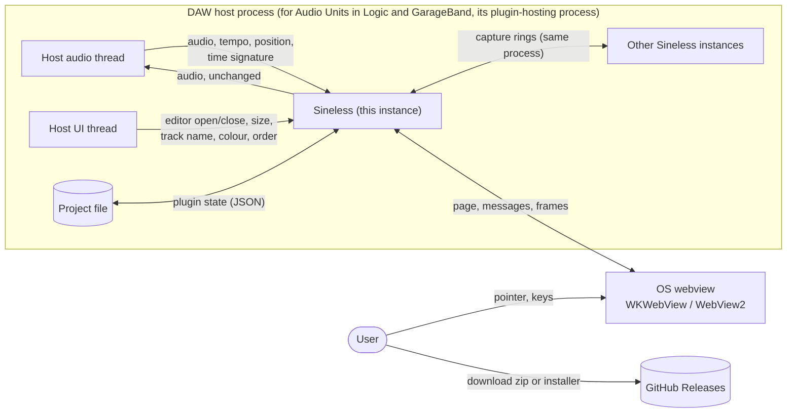

| Interface | Partner | What crosses it |
| --- | --- | --- |
| `IAudioProcessor` | Host audio thread | Audio in and out (32/64-bit, mono or stereo), `ProcessContext` (tempo, musical position, time signature, playing), silence flags. |
| `IComponent`, `IAudioProcessor` setup | Host UI thread | Bus arrangements, `setupProcessing`, activation; plugin state through `getState`/`setState` (8.4). |
| `IEditController`, `IPlugView` | Host UI thread | Editor creation, attach, size and resize requests, content scale. |
| `ChannelContext::IInfoListener` | Host | Track name, colour and position, where the host provides them. |
| `IConnectionPoint` | Own controller | A token that lets the editor find the processor's engine (AD-10). |
| Instance registry | Other Sineless instances of the same version in the process | Shared read access to their capture rings and track details (AD-14). |
| WKWebView / WebView2 | Operating system | The embedded page (`orizon://ui/`), JSON control messages, binary frames (AD-3). |
| GitHub Releases | Users | Zips, checksums and build provenance (7). |

### 3.2 Scope

In scope: everything in 1.2.

Deferred: XY/vectorscope, spectrum analyser and phosphor persistence. The capture and frame design
must not preclude them.

Out of scope: other plugin formats (C-1), such as AUv3, AAX, CLAP and LV2; sound-shaping or automatable parameters (AD-6);
standards-compliant loudness metering (FR-7 readouts are indicative).

## 4. Solution strategy

| Goal | Approach | Decisions |
| --- | --- | --- |
| Real-time safety (QG-1) | The audio thread only copies samples into a preallocated ring and publishes the musical position and when each block arrived; all analysis runs on a worker thread per open editor. | AD-2, AD-13, 8.2 |
| Transparency (QG-2) | Pass-through by copy (or nothing, in place); no processing, no latency. | FR-1 |
| Truthful display (QG-3) | The engine measures and renders; the UI draws what the frame carries and does not work it out again. Shared numbers are defined once in the protocol module and generated into C++. "No value" is NaN. | AD-2, AD-18, 8.6 |
| Light on the host (QG-4) | Cost follows change, not size; one frame in flight, paced by the display; binary frames drawn by the GPU. | AD-12, AD-17, AD-19, AD-21, AD-22 |
| Minimal dependencies (QG-5) | Each format's SDK directly (VST3 SDK, AudioUnitSDK), the OS webview, no UI framework. | AD-1, AD-4, AD-7, AD-25 |
| Maintainability (QG-6) | Format-agnostic engine; protocol defined once; tests at every level, sanitizers, fuzzing, mutation testing. | 5.1, 8.3 |

## 5. Building block view

### 5.1 Level 1: modules

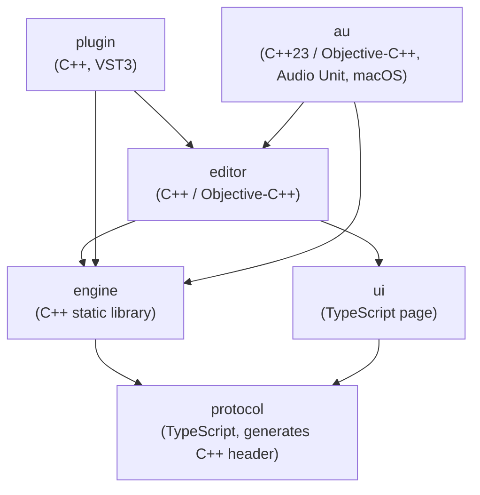

Arrows point from a module to what it depends on. Each module is a top-level folder with its own
`tests/`.

| Module | Language | Responsibility |
| --- | --- | --- |
| `protocol` | TypeScript | Defines enums, settings, shared limits (`limits.ts`), setting validation, message types and the frame layout once, as `as const` modules, with a frame encoder and decoder. The UI imports it directly; at build time a Node script generates the matching C++ header (never committed). Golden frames and messages in `protocol/tests/data` are shared by the C++ and TypeScript tests. |
| `engine` | C++ (static library) | Capture, musical clock, analysis (trigger, reduction, sweeps, readouts, Compare), settings (the store of record), saved state, frame encoding, the instance registry, and the engine token registry the formats' editors find their engine by (AD-10). No dependency on the VST3 SDK or any webview; the build forbids it. Optimised in Debug builds too. |
| `ui` | TypeScript | The page: a typed bridge behind a transport interface, an observable settings store, a render loop, a WebGL2 trace renderer, DOM views for labels, readouts and controls (`view/`, `components/`), and an in-memory mock back end for running in a browser. No runtime dependencies. |
| `editor` | C++ / Objective-C++ | Two libraries. `editor_core`, whatever the format: `EditorCore` (the window's contents and sizing rules), the webview wrapper per platform (`mac/`, `win/`, a `linux/` stub), the embedded assets and their URL scheme, the session (protocol handling), frame flow, the UI-thread dispatcher and display scale. `editor`: the VST3 view (`IPlugView`) around it. Benchmarks (`bench/`). It builds the `ui` page with Vite and embeds it. |
| `plugin` | C++ | VST3 processor, controller and factory; the process benchmark. |
| `au` | C++23 / Objective-C++ (macOS) | The Audio Unit on AudioUnitSDK (AD-25): the effect (pass-through, capture, timeline from the host's callbacks, state, track name from the context name), its Cocoa view around `EditorCore`, the factory the component exports, and `Sineless.component` with its Info.plist. |

The build enforces the C++ boundaries (`orizon_forbid_dependencies` in `CMakeLists.txt`): protocol,
engine and editor fail configuration if they link a module above them; the engine and
`editor_core` link neither plugin SDK; `au` links neither `plugin`, the VST3 view nor the VST3 SDK;
and only `au` links AudioUnitSDK. What the `ui` page imports, and C++ file names, are kept by review.

### 5.2 Level 2: engine

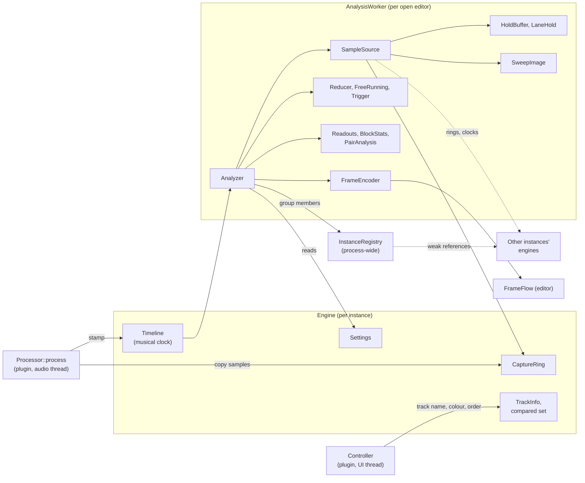

The tables follow the diagram from the audio thread to the frame.

| Block | Responsibility |
| --- | --- |
| CaptureRing | Per instance, preallocated in `setupProcessing` for the sample rate: a power of two of at least 2^20 samples (21.8 s at 48 kHz), 2^21 above 215.9 kHz, sized so a Trigger or Free freeze (4.25 s: the longest span and twice `pacingDelayCapSeconds`) fits at up to 384 kHz. Its writer, the audio thread, is lock-free and copies samples on every block whether or not an editor is open, so opening the editor shows recent history at once. Readers hold its storage by shared ownership across a resize. 7/8 of it is readable at any time: the last eighth (at least 0.57 s at any rate) is where the audio thread keeps writing while a reader copies, and a reader detects samples overwritten during its copy (8.2). Channels the host flags silent are written as silence. |
| Timeline | The musical clock. The audio thread publishes the latest musical stamp (position, tempo, time signature, playing, at a capture index) through a seqlock; readers map sample indices to quarter notes and back by extrapolating from it, free-running at the last tempo while stopped (AD-13). |
| Settings | The store of record, validated against the protocol's settings table, with its JSON form (`SettingJson`) shared by saved state and messages. |
| AnalysisWorker | One thread per open editor, running the Analyzer every 2 ms or when a frame is requested. |
| Analyzer | Produces each frame: places the trigger, free-running or sweep window, reduces it to columns, measures readouts and Compare, and encodes the frame. Reads all sources through `SampleSource`, an abstraction over the ring, held audio and sweep images. |
| SweepImage | One per lane in Beats: the sweep as columns that persist between frames, reporting which ranges changed (AD-17, AD-19). |
| Reducer, FreeRunning, Trigger | Min/max reduction to about one pair per device pixel (raw samples when zoomed in far enough), free-running columns on a grid fixed to absolute indices (FR-4), edge trigger (FR-3). |
| Readouts, BlockStats | Peak, RMS and frequency (FR-7); per-10 ms block statistics that keep readout and summing-gain cost proportional to new audio. |
| PairAnalysis | Compare's correlation, offset and polarity, and summing gains (FR-15). |
| HoldBuffer, LaneHold | On freeze, this track's held audio (4.25 s in Trigger and Free, the readable capture in Beats) and each other track's Mid (4.25 s + 1 s margin). HoldBuffer is allocated at the capture's size when the editor opens and kept until it closes; LaneHold is allocated on freeze and released on unfreeze. |
| InstanceRegistry | Process-wide list of engines, held weakly, filtered by group and ordered by host position, then creation (AD-14). |
| FrameEncoder | Writes the binary frame (8.5). |

### 5.3 Level 2: editor and UI

| Block | Responsibility |
| --- | --- |
| Editor | `IPlugView`: creates the webview, the worker and the session on attach; sizing, minimum size from the lanes shown (FR-14.5), and content scale. With no engine it creates no session and answers the page's `hello` with `engineUnavailable` itself. |
| Session | The protocol's native side: handshake, settings, freeze, pan, zoom, Compare choices. The Editor's 100 ms timer calls its `sync`, which sends what changed in the engine meanwhile (`setState`, sample rate, channel count, lanes). |
| FrameFlow | Credit-based delivery (AD-12): on the worker, makes a frame only while the page's request is open; on the UI thread, hands it to the webview. On macOS 14+ the display link's request is the credit, and the page's request takes a copy of the newest frame drawn that it has not had, at once or when it next asks (AD-30). |
| Transport | One interface to the webview's message channel and frame requests, per platform. |
| UiDispatcher, DisplayScale | Posting work to the UI thread (main queue on macOS, a message-only window on Windows); the display's scale factor. |
| WebView (`mac/`, `win/`) | Own thin wrappers (AD-4), the `orizon://` scheme handler serving embedded assets and frames, keyboard handoff to the host, crash recovery. |
| TraceLayer, MetalTraceRenderer (`mac/`) | macOS 14+ (AD-30): the Metal layer below the page at its screen rectangle, presented from a `CAMetalDisplayLink` on a thread of its own; the page's renderer, grid, shading and playhead in Metal. |
| FramePacing (engine), TraceView, TraceGeometry | The display clock frames and sweeps are placed by, and which refreshes show a new frame (AD-12, AD-30); the page's `traceView` parsed and checked; the lanes, grid and shading the page draws around the traces, ported and checked against its own helpers. |
| Page (`ui/`) | Bridge and store (applies only engine replies), render loop on `requestAnimationFrame`, WebGL2 renderer (or, under a native layer, the `traceView` it needs), DOM views, help. |

## 6. Runtime view

Message contents are defined only in the protocol module; 8.5 summarises them. Which thread each
step runs on is in 8.2.

### 6.1 UI session

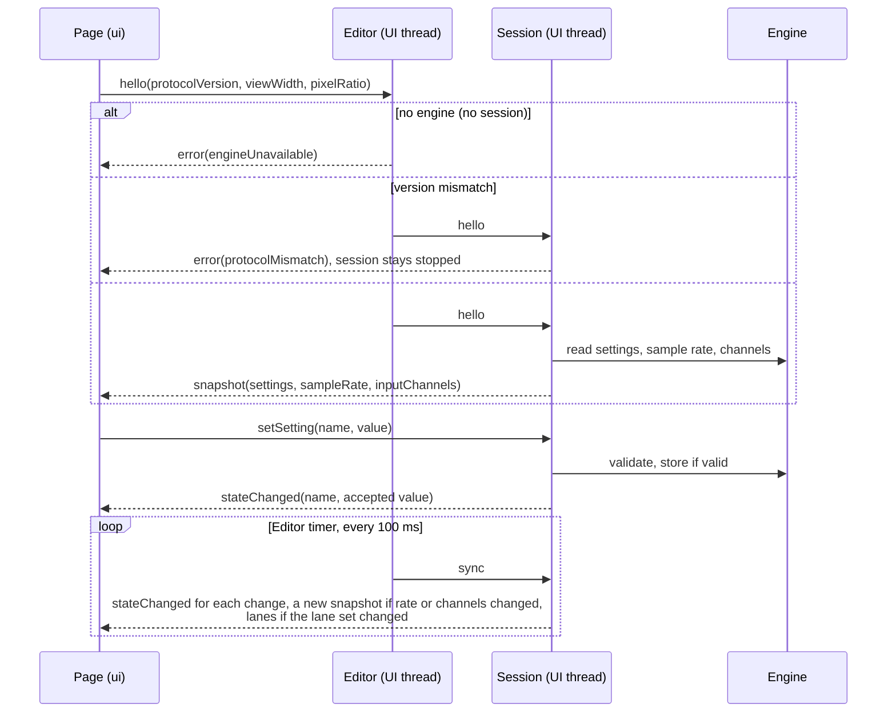

1. The page sends `hello` with its protocol version, view width and pixel ratio.
2. With no engine, the Editor itself replies `engineUnavailable`. Otherwise the session replies
   with one full snapshot: settings, sample rate and channel layout; on a protocol version
   mismatch it replies with an error and ignores everything until a matching `hello`. The UI shows
   either error in place of the traces.
3. The UI never updates its store optimistically. It sends `setSetting` and applies only the
   `stateChanged` reply, which always comes: a refused value is answered with the current one, so
   the control snaps back.
4. Changes made elsewhere (the host's `setState`, a new sample rate or channel count, tracks
   joining or leaving the group) reach the page through the Editor's 100 ms timer, which calls the
   session's `sync`.
5. The handshake can be repeated at any time, for example after a page reload.

### 6.2 Frame delivery

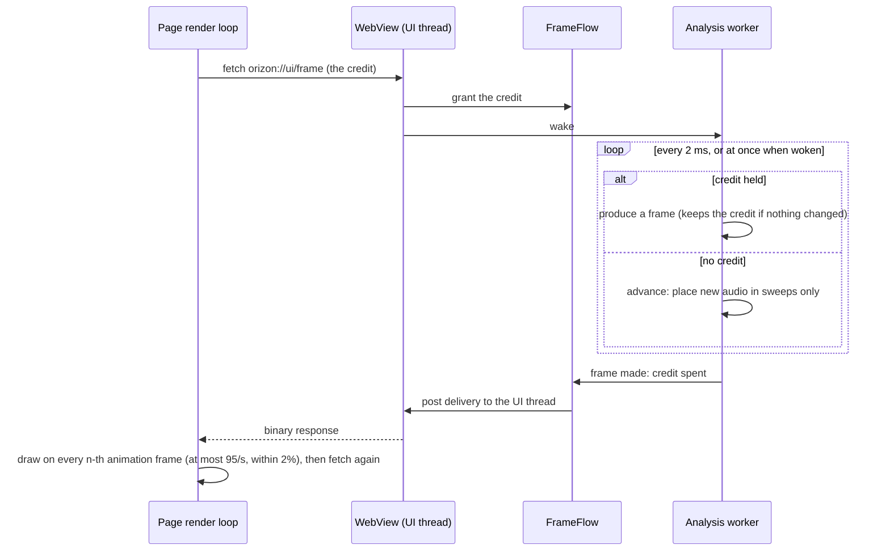

Without a credit the worker makes no frame; it only keeps the sweeps current, so a hidden page's
sweep is complete when shown (FR-9.5). Waking the worker on a request means a frame does not wait
for the next 2 ms step.

On macOS 14+ the display link drives instead (AD-30). Each callback, on the layer's own thread,
steps the display clock to its target presentation time less the measured lead, draws the newest
frame made since the last callback (or the last one again when the page's `traceView` changed) and
presents it, and, before a refresh that shows a new frame, asks for one: the worker, woken, makes it
at the display clock's time, and the next callback draws it. Each frame is placed the lead plus a
refresh before it is shown, and successive frames exactly n refreshes apart. The page's fetch takes
a copy of the newest frame drawn that it has not had, at once or when it next asks (frozen, no
newer frame may come), and never makes one, so the sweeps advance whenever the display has not
asked.

### 6.3 Freeze and trigger states

Two things are independent: why the display is frozen, and, in the Single trigger mode, whether
it is armed.

The display:

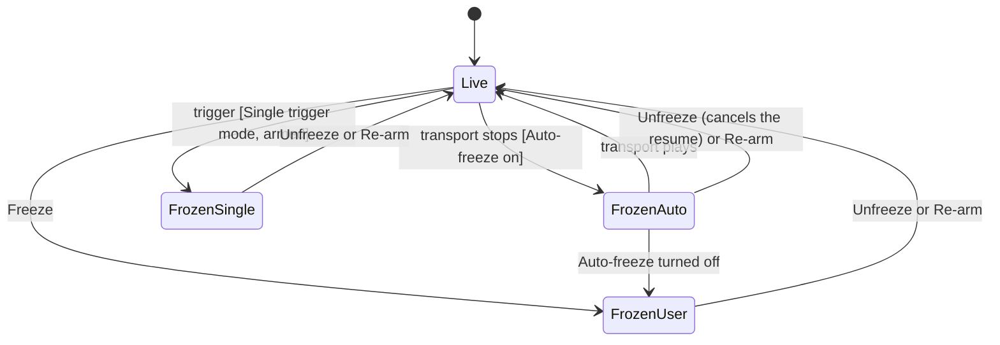

The Single trigger mode (the Trigger time base):

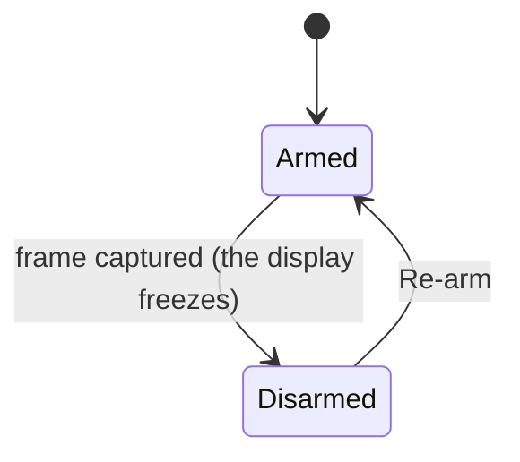

- Only an automatic freeze is ended by playback (FR-11).
- Re-arm is the page sending `arm` and then `freeze(false)`, so it also ends any freeze.
- Unfrozen without Re-arm, the Single trigger mode stays disarmed and keeps showing the last trace.
- Every frozen state holds audio as FR-6 and FR-9.6 describe.

### 6.4 Reading another instance

When the page shows Multi, the worker asks the registry for the members of its group,
takes shared ownership of each engine for the read, maps this track's window to each track's own
capture through the musical clocks (AD-15), and reads their rings directly. Nothing runs on any
audio thread for this; an instance removed meanwhile stays readable until the read ends.

### 6.5 Instance and editor lifecycle

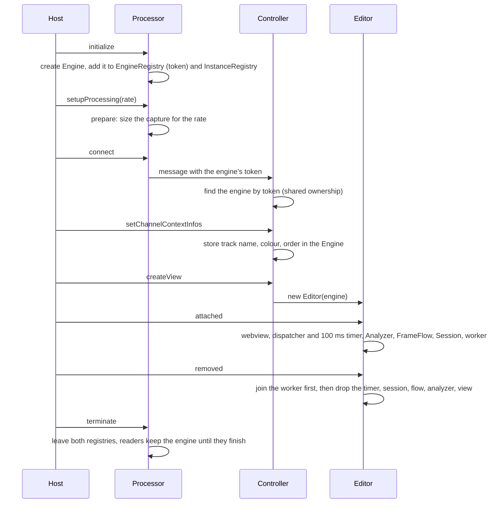

- Bus arrangements other than one input and one output of the same mono or stereo layout are
  refused.
- A `setupProcessing` while active, which the VST3 rules do not allow but some hosts send, keeps
  the capture's size and lets holds shrink to fit, rather than move memory under the audio thread.
  A triggered Single view whose rate rises this way with no new audio keeps its last frame until
  audio arrives: an accepted limit of QS-12, too rare and brief to justify more state.
- The editor's state (holds, zoom, cursors) goes with it; Compare's checks stay on the Engine
  (8.4).

### 6.6 Saving and restoring a project

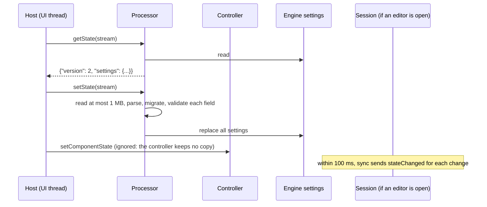

How state is read, migrated and validated is in 8.4.

## 7. Deployment view

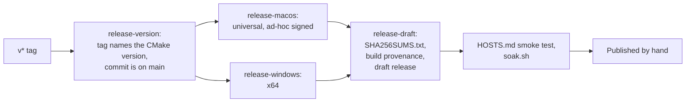

- One `.vst3` bundle per platform: universal (arm64 and x86_64) on macOS, x64 on Windows; on
  macOS also the Audio Unit, `Sineless.component`, universal.
- Each platform's release on GitHub Releases is a zip and an installer. The macOS installer
  installs both formats for the user, without a password, into `~/Library/Audio/Plug-Ins/VST3`
  and `~/Library/Audio/Plug-Ins/Components` (either can be left out under Customize); the Windows
  installer installs into `C:\Program Files\Common Files\VST3` for all users. From a zip, users
  move the bundles into those folders.
- At run time the plugin writes to disk only on Windows: WebView2's profile, in
  `%LOCALAPPDATA%\Orizon Audio\Sineless\WebView2-<n>` (8.7).
- The macOS bundle is ad-hoc signed (no Developer ID, so users clear the quarantine flag); the
  Windows bundle is not signed.
- Each release carries `SHA256SUMS.txt` and a build provenance attestation, also attached as
  `Sineless-<version>.intoto.jsonl` so a download can be checked from the files alone with
  `gh attestation verify`.
- A release is built only from a commit on `main` whose tag names the version in
  `CMakeLists.txt` (`scripts/release-on-main.ts`, `scripts/release-version.ts`); anything else
  stops the workflow.
- Packaging checks each bundle: the macOS minimum version and both architectures, and on Windows
  the x64 machine type and no dependency on the Visual C++ runtime DLLs. The release runner
  installs each installer and checks what it installed.
- Each bundle carries the licences of the third-party code compiled into it
  (`cmake/Licences.cmake`).
- The release workflow can be run as a dry run by hand, and runs as one on a pull request that
  changes its scripts.

## 8. Crosscutting concepts

### 8.1 Dependencies

| Dependency | Licence | Scope | Purpose | Pinned by |
| --- | --- | --- | --- | --- |
| VST3 SDK | MIT | shipped | Plugin API. | FetchContent, git tag |
| WebView2 SDK | BSD-3-Clause | shipped (Windows) | Webview embedding; static loader. | NuGet version + SHA-256 |
| AudioUnitSDK | Apache-2.0 | shipped (macOS Audio Unit) | The Audio Unit (AUv2) API: dispatch, buses, state, render. Its headers need C++23. | FetchContent, URL + SHA-256 |
| nlohmann/json | MIT | shipped | Control messages and saved state. | FetchContent, URL + SHA-256 |
| Geist, Geist Mono | SIL OFL 1.1 | shipped (embedded in the UI) | The UI's fonts, the same on every system (subset; see `ui/src/fonts/README.md`). | In repo |
| GoogleTest (with GMock) | BSD-3-Clause | tests | C++ unit tests. | FetchContent, URL + SHA-256 |
| TypeScript, Vite, Vitest, ESLint, typescript-eslint, Prettier, @types/node | Apache-2.0 / MIT | dev | UI build, dev server, tests, lint. | `package-lock.json` |
| Playwright, @vitest/browser-playwright | Apache-2.0 / MIT | dev | App tests in WebKit and Chromium. | `package-lock.json` |
| fast-check | MIT | dev | Property tests. | `package-lock.json` |
| Stryker | Apache-2.0 | dev | TypeScript mutation testing (`tools/mutation`). | its own lock file |
| pluginval | GPL-3.0 | checks | Host-like stress testing of the built VST3 plugin and Audio Unit. | download, version + SHA-256 |
| LLVM 23 (clang, clang-tidy, clang-format, sanitizers, libFuzzer) | Apache-2.0 with LLVM exception | checks | Lint, sanitizers, fuzzing on Linux. | apt.llvm.org; clang-format via pipx version |
| Mull | Apache-2.0 | checks | C++ mutation testing. | `.deb` + SHA-256 |
| reuse (with charset-normalizer) | GPL-3.0-or-later; MIT | checks | Every file's copyright and licence (`REUSE.toml`). | pipx version |
| GitHub Actions, Docker base images | various | CI | CI and release. | commit SHA; image digest |

Dependabot updates npm, Actions and Docker images weekly; the C++ dependencies are updated by hand.
A new dependency is agreed on first and pinned (CONTRIBUTING.md).

### 8.2 Real-time safety and threads

- `Processor::process` and everything it calls are marked `ORIZON_NONBLOCKING`
  (`[[clang::nonblocking]]` where supported), and `-Wfunction-effects` is enabled on every
  compiler that accepts it.
- RealtimeSanitizer runs the processor tests on Linux with LLVM 23.
- On every compiler, tests replace global `operator new`/`delete` with counting versions and
  assert that the audio path makes no allocations.
- The audio thread's work per block: copy the block into the capture ring (a lock-free writer),
  publish one musical stamp and one block stamp (seqlock writers; the block stamp's time is a
  nonblocking read of the monotonic clock, AD-29). It never waits on a reader.
- A performance benchmark runs eight instances and requires that all of them together use at most
  5% of each block's duration, at the 99.9th percentile (QS-1).

**Threads.** Three kinds of thread touch an instance, and a fourth on macOS 14+: the native layer's
display link thread (AD-30), which steps the display clock, draws and presents, and shares with the
worker only atomics (the clock) and FrameFlow's lock (the request and the frame). Only the audio
thread is real-time.

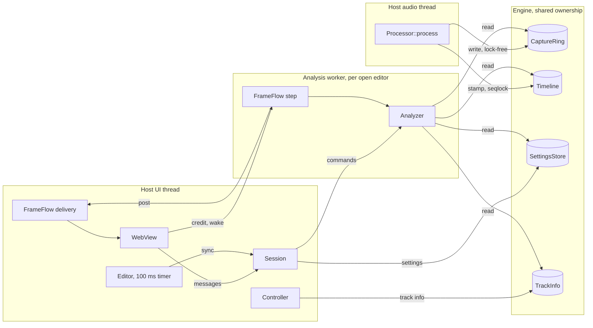

| Shared object | Written by | Read by | How |
| --- | --- | --- | --- |
| CaptureRing samples | Audio thread | Workers (this instance's and others') | Lock-free. The writer publishes the index it is about to overwrite before writing and the written end after, so a reader detects samples overwritten while it copied. Readers take the storage pointer under a lock the writer never takes. |
| Timeline stamp | Audio thread | Workers | Seqlock: the writer never waits; a reader retries if it overlapped a write. |
| Block stamp (capture index, arrival time, paced) | Audio thread | Workers | Seqlock, as the Timeline stamp. The time is read with `monotonicNanos`, a nonblocking read of the platform's monotonic clock. |
| SettingsStore | UI thread (session, `setState`) | UI thread, workers | Mutex. The audio thread never reads settings. |
| TrackInfo, compared set | UI thread (controller, session) | Workers | Mutex. |
| Analyzer commands (freeze, pan, view, arm, Compare) | UI thread (session) | Its worker | Mutex; the worker takes them on its next step. |
| Published lane set | Worker | UI thread (session) | Mutex. |
| FrameFlow credit and frame | UI thread (credit), worker (frame) | The other | Mutex; delivery is posted to the UI thread. |
| InstanceRegistry | Any thread adding or removing an instance | Workers | Mutex over weak references; a reader holds each engine by shared ownership while it reads. |

No lock is ever taken by the audio thread, and no thread waits for it.

### 8.3 Build, checks and testing

CMake builds the C++; presets cover macOS, Windows x64, Linux and the sanitizer, fuzz and
benchmark builds. Test levels, where each runs and the definition of done are in
[CONTRIBUTING.md](../CONTRIBUTING.md); review questions in [REVIEW.md](../REVIEW.md). In summary:

| Kind | What | Where |
| --- | --- | --- |
| Static | `tsc -b` (strict, `noUncheckedIndexedAccess`, `exactOptionalPropertyTypes`), ESLint (strict type-checked), Prettier, clang-format, clang-tidy | Linux; clang-tidy for the macOS glue on macOS |
| Unit, component, contract | GoogleTest and Vitest; golden frames and messages shared by C++ and TypeScript, golden saved states for C++; a signal corpus of approved frames; a matrix of sample rates, spans, mono/stereo, live/frozen | All platforms |
| Integration and app | The editor with its page in a real WKWebView or WebView2; the real page against the mock, and on sessions the real engine recorded, in WebKit and Chromium (Playwright) | macOS, Windows |
| Conformance | Steinberg VST3 validator (part of the build); pluginval at strictness 10; for the Audio Unit, Apple's auval (strict, in and out of process) and pluginval on a copy installed for the user (`scripts/validate-au.sh`) | macOS, Windows |
| Sanitizers | RealtimeSanitizer, ThreadSanitizer, AddressSanitizer + LeakSanitizer + UBSan on the shared code (Linux); ASan + UBSan and TSan on the macOS glue; MSVC ASan on the Windows glue | Linux, macOS, Windows |
| Fuzzing | libFuzzer on state loading, setting values, the session's messages, and host events (rates, channels, generated audio, transport, tracks joining and leaving, freezing), checking that the same events draw the same frames; fast-check on frame decoding and transport. Five minutes per pull request, 30 nightly, from a corpus kept on main | Linux |
| Mutation | Mutation testing of changed lines (Stryker, Mull; each C++ mutant stopped at a limit from its tests' time with no mutant), the mutants no test noticed triaged in CI (below) | Linux |
| Performance | Audio-thread deadline, frame rate, analysis CPU, reopen leaks (section 10); reported in CI, judged locally | macOS, Windows |
| Release | Soak test (`scripts/soak.sh`), the HOSTS.md smoke test by hand; occasionally the full HOSTS.md protocol and the scripted REAPER test on Windows (CONTRIBUTING.md, Releasing) | Before a release |

CI runs on pull requests, the merge queue and pushes to main; changes to documentation only skip
the builds. `main` is changed only through the merge queue.

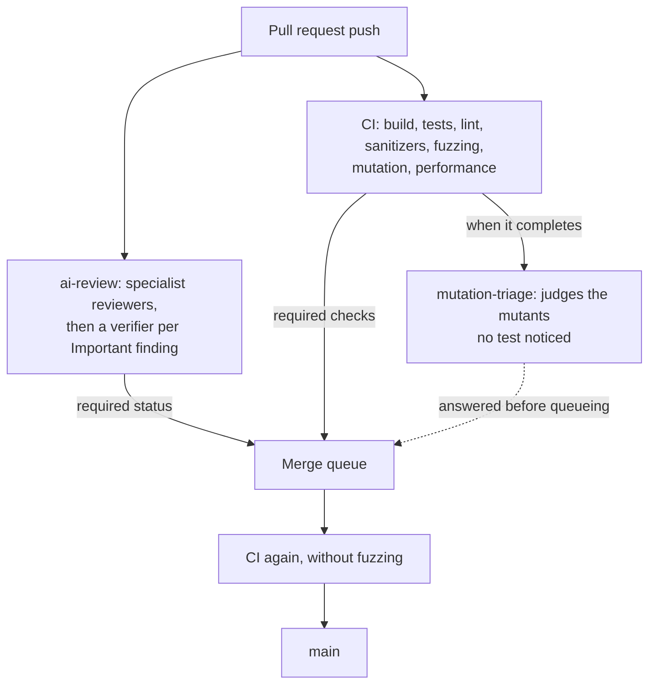

- **ai-review** reviews each push against REVIEW.md and fails while a verified finding is
  Important. Its verifiers see the author's answers to earlier findings, and keep a finding an
  answer covers only if they show the answer wrong. A maintainer can start it on a fork's pull request with `/ai-review`, or pass it with
  `/ai-review waive <reason>`; after three failed reviews the pull request is labelled
  `needs-human`, and its author stops fixing findings until a maintainer has decided: a Claude
  Code hook keeps an agent session from pushing to it, asking for another review or removing the
  label, and from pushing while a review is running. In the merge queue it passes at once: the
  pull request was reviewed.
- **mutation-triage** runs after CI, from `main`'s version of the workflow, and passes or fails
  on whether each surviving mutant needs a test (REVIEW.md); `/mutation-triage waive <reason>`
  passes it.
- Fuzzing also runs nightly for 30 minutes. Dependency review fails a pull request that adds a
  dependency with a known vulnerability; OpenSSF Scorecard runs weekly; a closed pull request's
  caches are deleted.

**Frame timing.** Motion that stutters, judders or flickers is measured at the screen, not from
the page's or the engine's own timestamps (the `frame-timing` skill). With
`SINELESS_FRAME_BARCODE=1` in the host's environment as the editor opens, every picture of the
traces, the page's (WebGL) and the editor's (Metal) alike, carries the frame barcode in the
screen's top right corner, which the cursor readout gives up meanwhile (FR-12.1, FR-12.2): two rows
of cells holding the picture's number and the time it was drawn for (`limits.ts`). A screen
recording, read back by `scripts/frame-barcode`, then counts per refresh the pictures shown on
time or late, the repeats with nothing drawn for them (making) or with a picture drawn and shown
late or never (presentation), and what the recorder itself missed. Nothing else changes with the
switch, and nothing is drawn without it.

### 8.4 State and persistence

Every value a user sees or sets lives in one of three tiers. A new value is placed in a tier by
what it is, not by convenience.

| Tier | Lasts | Values |
| --- | --- | --- |
| Saved with the project | Until changed; travels with the project | The settings table (1.2.3). |
| Kept while the plugin is loaded | Until the instance is removed or the project closed; survives closing and opening the editor | Compare's checked tracks (on the Engine). |
| Reset when the editor closes | The editor session | Freeze and held audio, pan, zoom, cursors, Preview fix, Help. |

Saved state:

- Format: `{ "version": n, "settings": { ... } }`, current version in the header. Settings are
  saved by name, and enum and flag values by the names of their values, so the protocol may
  reorder or add values without breaking saved projects; renaming or removing one needs a
  migration.
- On load, migrations run in sequence from the saved version up to the current one. Version 2
  made Beats the default time base; its migration gives a version 1 state without a time base
  (saved before tempo sync) the Seconds time base. Version 3 made Free a time base: a Seconds
  project opens in Free where its window ran free (the Free trigger mode, or a span above 1 s),
  else in Trigger; its span goes to the span whose range holds it, and to Free's, clamped to Free's
  range, where it ran free; a missing or invalid span counts as 1 s, the old default; the Free
  trigger mode becomes Auto. Version 4 made Compare a switch in Multi rather than a display mode: a
  project saved in Compare opens in Multi with Compare on.
- Each field is validated on its own. A missing or invalid field takes its default, and unknown
  fields are ignored, so a project saved by a newer version still opens in an older one; a
  setting added without a version change is simply absent from older states.
- Loading never throws to the host. A state larger than 1 MB, a stream that fails or ends early,
  or text that does not parse loads every default; a state that parses loads field by field as
  above.
- The processor's engine holds the only copy; the controller ignores the component state.
- Tests keep a golden state for each state version, and for each release that adds settings
  without a new version, and prove that every setting and every value name in them still loads
  (`engine/tests/data`).

### 8.5 Engine–UI protocol

Defined in `protocol/src`; `protocolVersion` (current value in the header) changes on any
incompatible change.

**Control messages** (JSON over the webview's message channel):

| Message | Direction | Fields | Purpose |
| --- | --- | --- | --- |
| `hello` | UI → engine | protocolVersion, viewWidth, pixelRatio | Start or restart a session. |
| `snapshot` | engine → UI | protocolVersion, settings, sampleRate, inputChannels; on macOS 14+ nativeTraces, nativeGraphicsLost; frameBarcode while the diagnostic switch is on | Full state. |
| `error` | engine → UI | code (`protocolMismatch`, `engineUnavailable`), message | Replace the screen with an explanation. |
| `setSetting` | UI → engine | name, value | Change a setting. |
| `stateChanged` | engine → UI | name, value | The setting's accepted value. |
| `viewport` | UI → engine | viewWidth, pixelRatio | Screen width in device pixels. |
| `freeze` | UI → engine | frozen | Freeze or unfreeze. |
| `pan` | UI → engine | seconds | Pan back through held audio. |
| `arm` | UI → engine | — | Re-arm Single. |
| `view` | UI → engine | start, end (fractions of the span) | Zoom. |
| `lanes` | engine → UI | laneSet, lanes (id, name, colour, own, compared), hidden | Who the lanes are. |
| `compare` | UI → engine | ids | Checked tracks. |
| `previewFix` | UI → engine | on | Preview fix. |
| `traceView` | UI → engine | viewStart, viewEnd, layout, verticalScaleDb, dim, lineWidth, emptyFrameLanes, colours, laneSets | What only the page knows about drawing the traces, while the editor draws them (AD-30). |
| `nativeGraphicsLost` | engine → UI | — | The editor's native drawing stopped for good (AD-30). |
| `about` | editor → UI | version, contact | In reply to every `hello`, first and with or without an engine: the version the host lists, and whether the build has a contact page (FR-13.1). |
| `contact` | UI → editor | — | Open the vendor's contact page in the default browser, if the build has one (FR-13.1). |

- `snapshot` is sent in reply to `hello`, and again when the sample rate or channel count changes;
  `stateChanged` in reply to every `setSetting` and for each change found by the 100 ms sync;
  `lanes` when the set of lanes changes.
- The native side ignores every message before a `hello` it accepts (but `resize`, `traceView`
  and `contact`, which the editor itself handles), and drops a message of an
  unknown type or with missing or malformed fields without replying, except a `setSetting` for a
  known setting, which is always answered (6.1).
- Each `lanes` message and each frame carry a lane set id. The page names and colours a frame's
  lanes from the `lanes` message with the same id (the latest one until it arrives), so labels
  stay with their traces although the two travel separately.

**Frames** (binary, little-endian; the reply to `fetch("orizon://ui/frame")`): a fixed header
(`frameHeaderFields` in `protocol/src/frame.ts`, 84 bytes), then float32 data.

| Part | Contents |
| --- | --- |
| Header | mode (min/max or raw), flags, views, lane count, point count; start fraction; peak, RMS, frequency; sweep cursor, cycle start, span and bar in quarter notes; view start and end, visible samples; lane set; summing gain and fixed gain; cycle seconds; pan reach; invalid sample count and lane mask; sample rate. |
| Flags | triggered, frozen, freeRunning, synced, limited, compared, partial (shown as "Filling" live, "Partial" frozen). |
| Data | Per view (Single) or per lane (Multi, Compare; the sum last): min/max pairs or raw samples. Compare frames then carry correlation, offset and polarity for each track. |

For example, a Compare frame with three tracks has four lanes (the sum last): 4 × point count × 2
floats of min/max pairs, then 3 × 3 match values.

"No value" travels as NaN (8.6).

### 8.6 Values and levels

- "No value" (not measured, silent, never sounding together) is NaN and shows "—"; a real 0 dB or
  0 correlation stays distinguishable.
- Levels are converted, floored and formatted only through the shared helpers
  (`protocol/src/limits.ts`, `ui/src/view/format.ts`).
- Three different "too quiet" limits apply to three quantities: level readouts show −∞ at or
  below −120 dBFS; a summing gain shows −∞ at or below −140 dB; analysis (frequency, Compare)
  ignores audio at or below −90 dBFS RMS.
- Samples that are not finite are left out of measurements, counted, and shown: an "Invalid
  samples" chip, and affected lanes named in yellow, the problem colour.

Shared limits (`protocol/src/limits.ts`, generated into the C++ header; the file explains each):

| Name | Value | What it is |
| --- | --- | --- |
| `levelFloorDbfs` | −120 dBFS | Level readouts show −∞ at or below. |
| `gainFloorDb` | −140 dB | Summing gains show −∞ at or below. |
| `analysisGateDbfs` | −90 dBFS | Analysis ignores audio at or below. |
| `crossingHysteresis` | 0.1 | Of peak-to-peak, for finding cycles. |
| `periodTolerance` | 0.15 | Steady cycles lie within this of the median. |
| `frozenHoldSeconds` | 4 s | How far a frozen Trigger or Free view pans back (the longest span, Free's); the freeze holds twice `pacingDelayCapSeconds` more (AD-29). |
| `triggerPosition` | 0.1 | Trigger point from the left. |
| `longestTriggerSpanSeconds` | 1 s | Trigger's longest span: longer, a trigger holds one trace too long. |
| `shortestFreeSpanSeconds` | 0.1 s | Free's shortest span: a refresh moves the window a sixth of the screen at 60 Hz. |
| `pacingDelayCapSeconds` | 0.125 s | Most a paced edge trails the newest audio (4096-sample blocks at 44.1 kHz and a third). |
| `pacedSpanMinimumSeconds` | 0.02 s | Shorter spans are not paced (their whole trace is new every frame). |
| `minimumViewWidth` | 1/256 | Narrowest zoom. |
| `maxLanes` | 16 | Multi lanes; Compare shows one fewer. |
| `readoutIntervalSeconds` | 0.1 s | Readout refresh. |
| `matchReachSeconds` | 0.01 s | Compare offset reach, each way. |
| `matchWindowSeconds` | 8 s | Audio Compare matches over. |
| `summingMarginDb` | 1 dB | Harmless summing band. |
| `frequencyWindowSeconds` | 1 s | Audio the frequency readout measures. |
| `minimumEditorWidth` | 1030 px | Editor minimum width. |
| `minimumLaneHeight` | 40 px | Stacked lane minimum height. |
| `chromeHeight` | 84 px | Height around the screen. |

Engine-only thresholds live in the engine source, each with its reason; the requirements state
the behaviour they set: the Auto timeout (FR-3), the steady share of cycles (FR-7), the sweep cap
and tempo tolerance (FR-9.3, FR-9.4), Compare's "together", "audible" and "related" levels and its
match pacing (FR-15.3, FR-15.4), the 10 ms statistics block and the lane hold margin (5.2), and
the highest sample rate the capture is sized for (5.2, CaptureRing).

**Floating point.** NaN and infinity must survive the build: "no value" is NaN, and samples that
are not finite are detected and counted. The engine therefore needs a precise floating-point
model; the VST3 SDK turns on `/fp:fast`, the project turns it off again
(`cmake/ProjectOptions.cmake`), and `engine/include/engine/PreciseFloatingPoint.h` fails the build
under `/fp:fast` or `-ffast-math`.

### 8.7 Webview integration

The editor hosts its page in the system's webview through its own thin wrapper per platform
(AD-4): `editor/src/mac/WebViewMac.mm` and `editor/src/win/WebViewWin.cpp`.

- **One origin.** The page and its fonts are embedded in the binary and served from `orizon://ui/`
  (AD-11); the frame endpoint is `orizon://ui/frame`. Native code accepts messages only from that
  origin's main frame.
- **Several plugins in one process.** On macOS the Objective-C classes are created at run time
  with names unique to the loaded binary, so two copies or versions of Sineless, or another
  plugin's classes, never clash.
- **Keyboard.** Keystrokes go to the host unless a text field in the page has focus, so the
  host's transport shortcuts keep working. On Windows, where WebView2 runs in another process,
  shortcuts arrive as accelerator keys and the page reports other keys for forwarding.
- **WebView2 profile (Windows).** WebView2 keeps a profile on disk. Its default folder sits next to
  the host's executable, which may not be writable, so it is set to
  `%LOCALAPPDATA%\Orizon Audio\Sineless\WebView2-<n>`. Views sharing a folder share one browser
  process, which refuses views with other environment options or another DPI awareness: `<n>`
  changes with the options, and DPI-unaware host windows (Live's Auto-Scale) get a folder of
  their own.
- **No flash.** The panel colour is also the webview's native background.
- **Native traces (macOS 14+, AD-30).** The web view stops painting its background
  (`drawsBackground`) and the page's own stylesheet makes it transparent over the screen; the trace
  layer sits below it at the screen's rectangle, takes no events, and is hidden with the page
  (before it has loaded, while it reloads after a crash, behind a failure message). Its view
  follows the container's size and backing scale itself, and the container clips it with the page.
- **Crash recovery** is in 8.9.

**Hardening.** The context menu is off on both platforms. On Windows, page zoom, pinch
zoom of the page, browser accelerator keys and developer tools are off too; on macOS, the first
click acts in an inactive window.

### 8.8 Security

Sineless opens no network connection or socket and serves only its embedded content (10.1); its
contact page opens in the system's default browser, which makes the connection (FR-13.1). The
inputs it does not control are the threats it guards against (SECURITY.md):

| Input | Risk | Guard | Checked by |
| --- | --- | --- | --- |
| Plugin state from a project someone else made | Crash or memory corruption while loading | At most 1 MB read; parsed by nlohmann/json; each field validated against the settings table, an invalid one refused (FR-8); never throws to the host | State fuzzer, `StateFaultTests`, ASan + UBSan |
| Messages from the page | A page that misbehaves drives the engine into bad state | Only from `orizon://ui/`'s main frame; unknown or malformed messages dropped; settings validated; the viewport width capped at 16384 columns | Session fuzzer, `SessionTests`; the width cap has no test of its own (R-8) |
| Navigation from the page | The page loads or opens content from elsewhere | Navigation outside `orizon://ui/` and new windows are refused on both platforms; the page can ask only for the vendor's contact page, which the editor opens from its own build-time address, in the default browser | No test yet (R-8) |
| Audio | Samples that are not finite corrupt readouts | Left out of every measurement, counted and reported (FR-7) | Signal corpus, `invalid-samples.test.ts`, host fuzzer |
| Downloads | A release altered after it was built | Checksums and a build provenance attestation (7) | Release workflow |

Vulnerabilities are reported privately through GitHub's security advisories (SECURITY.md).
Unsigned binaries are a known limit, not a vulnerability (R-4).

### 8.9 Failure handling

What happens when something the editor depends on fails. In every case audio keeps passing
through unchanged, and the editor says what happened in place of the traces.

| Failure | What the user sees | Where |
| --- | --- | --- |
| The editor finds no engine (AD-10) | "Display unavailable" | Editor, `app.ts` |
| The page and the plugin come from different releases | "Version mismatch", and the session stays stopped | Session |
| No WebGL2, the shaders fail to build, or the graphics memory for the traces cannot be allocated (at start or when the window grows) | "Graphics unavailable" | `app.ts` |
| The graphics context is lost (GPU reset, driver update) | "Graphics unavailable" until the context is back, then the last frame is drawn again; it stays if the restored context cannot draw | `app.ts` |
| Native drawing stops (macOS 14+, AD-30): a removed GPU, revoked access, command buffers failing for half a second, refused graphics memory | "Graphics unavailable": close and reopen the editor; the last picture stays under the message, and the page's readouts stay live from frames it fetches again | `TraceLayerMac.mm`, `EditorCore`, `app.ts` |
| An engine error and a graphics failure together | The engine error, which says what to do; the graphics message never replaces it | `app.ts` |
| The page's process ends (macOS memory pressure, a crash) | The page loads afresh, says `hello` and gets the session's state again; after 3 failures within a minute it is not reloaded and the editor says to reopen it | `WebViewMac.mm`, `WebViewWin.cpp` |
| WebView2's browser process exits (Windows) | A native message to close and reopen the editor; every view sharing that process is affected | `WebViewWin.cpp` |
| No WebView2 Runtime, or WebView2 fails to start (Windows) | A native message saying what is needed | `WebViewWin.cpp` |
| The host's stream fails while loading state | Every setting at its default (8.4) | `Processor::setState` |

### 8.10 Naming conventions

| Element | C++ (follows the VST3 SDK) | TypeScript |
| --- | --- | --- |
| Types, classes | `PascalCase` | `PascalCase` |
| Functions, variables, members | `camelCase`, no member prefix | `camelCase`; a leading `_` marks an unused parameter |
| Constants, enumerators | `kPascalCase` | `camelCase`; enum-like `as const` objects are `PascalCase` |
| Namespaces | lowercase, rooted at `orizon` (`engine`, `plugin`, `editor`, `protocol`) | n/a |
| Files | `PascalCase.h`/`.cpp`/`.mm`, named after the main type | `kebab-case.ts` |

The protocol generator maps schema names to the C++ convention. clang-tidy and ESLint enforce
identifiers, and ESLint TypeScript file names; C++ file names are kept by review.

## 9. Architecture decisions

This table is the project's only decision log. A decision is edited in place while it stands;
when it is replaced, its status says by which decision, and git history keeps earlier versions.

| ID | Status | Decision | Rationale |
| --- | --- | --- | --- |
| AD-1 | Accepted; amended by AD-25 | Build directly on each format's SDK (the VST3 SDK; AudioUnitSDK for the Audio Unit), with no plugin framework. | With two formats sharing a format-agnostic engine and editor core, a framework's cross-format layer adds little: each format's glue is thin. Using the SDKs directly runs no third-party code per block and avoids a large dependency. Cost: editor and webview embedding, and each format's view, are written in-house. |
| AD-2 | Accepted | Trigger, reduction, readouts and Compare analysis run in C++ on a worker per open editor; the UI only draws. | Deterministic and unit-testable in C++. Small frames over the bridge instead of raw samples, and no analysis on the DAW's UI thread or in the webview. No editor, no worker: a closed editor costs only the capture. |
| AD-3 | Accepted; its frame transport superseded by AD-21 | Engine and UI exchange control messages as JSON over the webview's native message channel (page to native through `webkit.messageHandlers` or `chrome.webview.postMessage`; native to page through `evaluateJavaScript` or `PostWebMessageAsString`). Display frames travel separately, as binary (AD-21). Each side reaches both through one transport interface. | No sockets and no local attack surface. The interface lets the transport change, as it did for frames when profiling demanded it. |
| AD-4 | Accepted | Own thin webview wrapper per platform, and a stub on Linux for the checks. | Full control over plugin-specific issues: class-name collisions between plugins in one process, keyboard handoff to the host, the WebView2 user-data folder, teardown order, crash recovery. |
| AD-5 | Accepted; amended by AD-30 | Traces drawn by a hand-written WebGL2 renderer; text and controls are DOM. On macOS 14+ the editor draws the traces natively with Metal (AD-30). | Smooth at high resolutions and refresh rates, and leaves room for persistence and XY without a rewrite. |
| AD-6 | Accepted | No host-automatable parameters; all settings are plugin state. | A scope's settings are view settings, not sound-shaping, and a parameter list is a permanent compatibility contract. |
| AD-7 | Accepted | No UI framework. | Few controls, and the per-frame path must bypass any reactive framework anyway. Zero runtime dependencies. |
| AD-8 | Accepted | GoogleTest for C++; Vite and Vitest for the UI, with Playwright for the real page in WebKit and Chromium. | Widely adopted. Vitest shares Vite's configuration, and the Vite dev server with the mock back end gives fast UI iteration outside a DAW. WebKit is what macOS hosts the page in. |
| AD-9 | Accepted | JSON via nlohmann/json for control messages and saved state, never on the audio thread. | Readable, easy to version and migrate. Robust parsing of untrusted state is a problem worth delegating. |
| AD-10 | Accepted | Separate VST3 processor and controller. At connect time the processor sends the controller a random 64-bit token, which the controller looks up in a module-wide registry to get shared ownership of the processor's engine. If no engine is found, the editor shows an "unavailable" state. | Follows the SDK's recommended structure, which the validator and hosts expect, while letting the editor read the capture ring without copying frames through the host's message system. Passing a token rather than a pointer means the controller never holds a raw address, and holds the engine by shared ownership while it uses it. |
| AD-11 | Accepted | The built UI, fonts included, is embedded in the binary at build time and served through a custom URL scheme on both platforms. | Self-contained binary with one stable origin; nothing on disk can go missing or be altered; the same fonts on every system. |
| AD-12 | Accepted | Frame flow is credit-based with one frame in flight. The credit is the page's open request for a frame; the worker hands over a frame only while one is open, and the page asks again after drawing. The page draws an engine frame on every n-th tick of its requestAnimationFrame clock, n the smallest whole number keeping the tick rate divided by n at or below 95 Hz (n changes only once the measured rate is 2% past a line, so a display measured near one does not flip it), counted in ticks, so each frame stays on screen for the same number of ticks: every tick up to 90 Hz, at most 90 frames a second on common displays (50 at 100 Hz, 72 at 144 Hz). On macOS 14+ the credit is the display link's request, by the same rule counted in display refreshes, and the page's request only takes copies (AD-30). | Production follows the display's refresh rate, no backlog can build up, and it stops by itself while the page is hidden. A fixed 60 frames a second does not divide 75, 100 or 144 Hz: frames stayed for 2, 1, 2 ticks while the playhead moved by the time between them, a constant judder (#308). Holding each frame for a whole number of refreshes is what games and platforms do (Unity's vSyncCount, DXGI's SyncInterval, CADisplayLink's rate as a factor of the display's). The page measures its own tick rate, which WebKit may divide below the display's. |
| AD-13 | Accepted | The audio thread publishes the host's latest musical position (position, tempo, time signature, playing, whether the instance has played with a position, at a capture index) through a seqlock, and records each position that does not continue the last one recorded (a transport jump, a tempo change beyond the sweep-length tolerance, a metre change, the first block, the block that first plays with a position) in a ring of the newest 256, each behind a seqlock of its own. Readers map sample indices to quarter notes and back by extrapolating from the record in effect at each index, or from the latest position; while stopped the clock free-runs at the last tempo. | Tempo sync needs to map sample indices to beats off the audio thread. A sweep is placed a delay behind the newest audio (AD-29), so the audio it places was often played under an earlier position than the latest: keeping the changes where they happen places each block by its own, with no state for every reader to keep. One comparison per block and a write only on a change, no locks, no waiting. |
| AD-14 | Accepted | Instances find each other through a process-wide registry in the engine module, holding weak references to the engines in a flat list; a group's members are those whose group setting matches, ordered by host track position, then creation. Each engine carries its track name, colour and position. Readers get shared ownership for as long as they read, and the editor's worker reads other instances' capture rings directly. | Needs no routing in the host and no audio-thread work: capture rings already allow lock-free writing alongside readers, and shared ownership keeps a ring alive while another editor reads it; weak references let an instance vanish even if it was never removed. It works wherever instances share a process, which is every major host's default (R-1). Instances of different Sineless versions, or of different formats (VST3 and Audio Unit), keep separate registries, so they never read each other's data. |
| AD-15 | Accepted | Lanes align on the musical clock (AD-13) that every instance receives from the host. In Beats each lane's sweep follows its own instance's clock. In Trigger and Free the own track's window start is mapped to quarter notes on its clock, then to each other track's sample index on that track's clock. | All instances see the same host position while their capture indices start at different moments. The clocks already exist, so the audio thread does no new work. While stopped, every clock free-runs at the same tempo from the same position, so lanes stay aligned; a host that reports no position would leave tracks offset by when they started. |
| AD-16 | Accepted | The engine renders Compare frames through the multi-track lane path: the tracks, then the sum of the checked ones, and computes the analysis on raw samples, each track against this one. The summing gains travel in the frame header and each track's match after the lane data. The UI names tracks by the lane id that each `lanes` entry carries, which also says which are checked. The checked set lives on the Engine. | Summing and correlating min/max columns in the UI would be wrong; only the engine has the samples. Results in the frame stay in step with the lanes they describe, at no extra message traffic. Correlation and offset are pairwise, so each track is measured against one reference: this track. On the Engine, the choice outlives the editor but not the project (8.4). |
| AD-17 | Accepted | Display cost follows change, not size. Lanes and views keep their screen columns between frames: a sweep reduces again only the columns its newest samples landed in (SweepImage reports changed ranges), a free-running window only the columns that scrolled in (columns on a grid fixed to absolute indices, exact for any span and width), and a Compare sum lane only where compared tracks changed. Readouts and summing gains are measured at most every 0.1 s of audio (always while frozen), from per-block statistics; Compare matches at most every 0.5 s per track, one track per frame, one every 0.1 s at most. The engine is optimised in Debug builds too. Measured with `editor/bench/PerfBench.mm` (`scripts/bench.sh`). | The analysis thread spent 70% of a core re-reducing whole lanes every frame, and Debug builds dropped to 5–16 frames/s. After: costs nearly flat in tracks, span and window width (doubling the width adds about 1 point). |
| AD-18 | Accepted | Numbers the engine and UI share are defined once in `protocol/src/limits.ts`, with what each measures and why it has its value, and generated into the C++ header; help text reads them from there. "No value" is NaN end to end. | Two copies of a threshold drift apart, and a display that shows 0 for "not measured" misleads. One definition makes engine, UI and help agree by construction. |
| AD-19 | Accepted | Long sweeps keep raw sample images per lane, with no lower-resolution tier: a sweep may be longer than the capture and fills in as it plays, up to 2^23 samples per lane. The worst case accepted is 15 lanes of 16 bars at 60 BPM and 96 kHz, about 580 MB, checked in Live. | One representation keeps zoom exact at every span and the code simple. The cap bounds memory; the worst case was measured acceptable in a host, and the performance check keeps it so. |
| AD-20 | Accepted | Values are persisted in three tiers (8.4): saved with the project, kept while the plugin is loaded, reset when the editor closes. | Zoom, freeze, cursors and Compare's checks are viewing choices, not settings of the track; saving them would make the project change when it is only looked at. Compare's checks are kept while the plugin is loaded so that closing and opening the editor does not undo them. |
| AD-21 | Accepted | Frames travel as the binary body of the response to the page's fetch of `orizon://ui/frame`, which is also the credit (AD-12). Replaces AD-3's frames as base64 text over the message channel. On macOS 14+ frames reach the native renderer directly, and the fetch carries copies of the frames drawn (AD-30). | Text encoding and decoding on both sides cost a fixed share of every frame in WebKit. A fetch carries bytes as they are, and the open request is a natural credit. |
| AD-22 | Accepted | The page builds trace geometry on the GPU: instanced quads read from the frame's bytes as received (uploaded as a vertex buffer), one instance per column or raw point drawing its piece of the trace as quads for the band to the next point, the two lines joining their maxes and their mins and, beside a missing point, its own vertical line, each writing the coverage worked out from the pixel's distance to that part into the trace's channel of its group's offscreen target (four traces a target, each writing only its own channel), keeping the larger where pieces overlap; one pass then layers the traces over the screen. Edges are anti-aliased without relying on multisampling, and a translucent trace blends once, as a group with an opacity is composited; no per-frame JavaScript geometry. The sweep playhead is drawn in WebGL, not as page elements, on whole device pixels. While the diagnostic switch is on (§8.3), every picture ends with the frame barcode, drawn the same way. On macOS 14+ the same passes run natively in Metal (AD-30), where the playhead and Compare's shading edges are drawn at their exact positions with coverage. | Per-frame JavaScript geometry and DOM changes added fixed WebKit cost on every frame. The remaining cost is WebKit's per-frame display pipeline (QS-3). Boxes per column and quads per segment, smoothed by multisampling, drew steep flanks as stairs and blended a translucent trace twice where quads overlapped (#269). Shading each pixel from a loop over its neighbouring points drew the same picture but made drawing without a GPU 3 to 5 times slower than before, too slow for the app tests on GPU-less CI runners. One quad per piece, shading its whole box with all its distances, every trace writing all four targets and a composite indexed at run time cost about twice the GPU time for the same picture. |
| AD-23 | Superseded by AD-26 | The editor's layout is stable: nothing is cropped, hidden or moved as the window is resized. The minimum width (`minimumEditorWidth`) fits the widest content in every state, and content of unbounded width (the status chips) wraps in a place with room for it, the screen's top-right corner. No responsive breakpoints, compact labels or hidden elements. | A control that disappears, shortens or moves at some sizes is hard to find again and makes the window feel unreliable; and a plugin window is resized often. Rejected: a shrinking chip area, hiding the wordmark below a width, single-letter compact controls. Cost: a wider minimum window (900 px), checked in every state by the editor tests. |
| AD-24 | Accepted | Windows ships x64 only; no native ARM64 build is built, tested or released for now. Windows on Arm runs the x64 build in an x64 host or in REAPER's ARM64EC build. The ARM64 presets stay, and `scripts/package.ps1` says how to bring the build back. | No native ARM64 Windows host is expected among users soon, and its CI job was among the slowest, waiting for an ARM runner. Shipping only what CI tests means dropping the binary with the job. Revisit when a user needs a native ARM64 host (R-5). |
| AD-25 | Accepted | On macOS, also an Audio Unit v2, native on Apple's AudioUnitSDK, in its own module (`au`) beside the VST3 glue, sharing the engine and `editor_core`. Codes `aufx`/`Snls`/`Oriz` (placeholders in a build without the brand, AD-27). Its view is a Cocoa view factory named per build; it exports only its factory and leaves out `sandboxSafe`, so sandboxed hosts load it out of process. | Logic Pro and GarageBand load Audio Units only. AUv2 with the host's context name keeps track names, and a spike showed Logic and GarageBand keep a project's instances in one process (out of process, in AUHostingService) and Live in its own, so Multi works, Compare included. Rejected: Steinberg's VST3-to-AU wrapper (no track names, Xcode generator only), clap-wrapper (needs a CLAP port first, no track names), AUv3 (an app extension in a sandboxed process where instances do not reliably share a process, which Multi needs, and a Developer ID for distribution). |
| AD-26 | Accepted | The editor's layout (1.5, `docs/ui/`): a toolbar holding every control that applies in the current mode, always; controls that don't apply are hidden; popovers carry the details (Group, Views, Trigger); a status bar with the cursor buttons and A4, the readouts labelled with what they measure (in Single, a button choosing it), the state chips in a fixed width, folding into "+n", Help and About. Nothing folds away as the window narrows: the minimum width (`minimumEditorWidth`, 1030 px) fits the widest toolbar with the mark alone and the status bar, and the wordmark is the only thing that hides, below the default 1060 px. Replaces AD-23. | The redesign gives the signal most of the window (the screen gets about 85% at the default size, against about 70% with the old strip) and shows what applies instead of dimming what doesn't, which the audit found cluttered and ambiguous. AD-23's stability is kept where it matters: no control moves, shortens or folds as the window is resized, and the status bar never moves when values or states change. Hiding the wordmark costs nothing a user operates. Rejected: folding controls into a ⋯ menu (controls move between places), a side panel of settings (a third less screen, and a tall window). Cost: a wider minimum window (1030 px), checked in every state by the editor tests. |
| AD-27 | Accepted | The product's name, logo and plugin IDs come from one switch, `SINELESS_BRANDING` (cmake/Branding.cmake, on by default). The logo lives in `ui/src/brand/` under terms of its own (LICENSES/LicenseRef-Orizon-Brand.txt), shipped beside it; with the switch off, the page takes `ui/src/unbranded/`, and the plugin a neutral name, placeholder VST3 IDs and Audio Unit codes, no logo or its terms, and no contact page (FR-13.1). | The code is GPL, and forks are welcome, but the names and the logo identify official releases (TRADEMARKS.md, GPLv3 section 7(c) and (e)); a fork must be able to build without them in one step, and must not collide with Sineless in a host's plugin list or saved projects. Keeping the logo in files of its own, never inlined in GPL source, keeps the split clear in REUSE.toml and the build. The switch also names the VST3 and Audio Unit bundles and the Audio Unit's view class. Not covered: internal identifiers (CMake target names, Windows window classes, the WebView2 data folder, thread names), which a fork renames with the project. |
| AD-28 | Accepted | While a value is dragged with the mouse (1.5), the macOS editor holds the pointer natively: on the press the page asks for the hold, and the editor hides the pointer and dissociates it from the mouse (`CGDisplayHideCursor`, `CGAssociateMouseAndMouseCursorPosition`), reads the motion from the drag events' deltas, reports the travel since the press to the page, and on release moves the pointer back to the press point before reassociating it. The shared state machine is `editor/src/PointerHold.cpp`. In Apple's hosts (Logic Pro Creator Studio, tested; Logic Pro and GarageBand, by the same bundle-identifier gate, not yet tested) the Audio Unit's view also turns the window server's undocumented `SetsCursorInBackground` connection property on for each hold and off once the pointer shows again (`CGSSetConnectionProperty`, looked up at run time and skipped where missing). Not where a host loads the Audio Unit in an XPC service, which cannot dissociate the pointer (AD-25's statement that Logic does was measured on an earlier Logic and is re-checked in its own issue); Windows keeps a moving pointer for now. | It is WebKit's own pointer lock, which the page cannot use: WKWebView grants Pointer Lock only through a private delegate, and WebView2 shows a banner that cannot be hidden. Travel is measured from the press on both sides, so the page switches from its own travel to the editor's without losing or repeating a step, and drags as before wherever the editor does not answer. Holding from the press, as Live's own devices do, hides the pointer before it can move; a click or the double-click to type hides it briefly, and a pointer still within a point of the press is shown there without a warp, so nothing delays the double-click's second press. Logic Pro Creator Studio 12.4 runs the Audio Unit in its own process, where the public calls report success without hiding the pointer, and nothing public hid it (a blank cursor, `[NSCursor hide]`, CSS `cursor: none`); since the failure cannot be detected, the property is chosen by host, and it is on only while a hold hides the pointer. |
| AD-29 | Accepted | A free-running window's right edge, and a live sweep's playhead, are paced, not the newest sample. The audio thread stamps each block with its capture index and the time it arrived (a nonblocking read of the platform's monotonic clock, published through a seqlock), and whether the host processes in real time (VST3 `kRealtime`; the Audio Unit's `OfflineRender` unset). The analysis worker filters the arrival times with a delay-locked loop (Adriaensen 2005, JACK2's frame timer: B = 1/8 Hz, b = √2·ω, c = ω²) into the index due at any time, and draws the edge a delay behind it: the largest lead seen while the loop locked, rising by at most 10% of the motion when a later block needs more, falling by 1% a second, capped at `pacingDelayCapSeconds`; never past the newest sample or backwards. Unpaced (the newest sample) before the loop locks (16 updates), after a stall, offline, when blocks come further apart than the cap, and for a window or sweep shorter than `pacedSpanMinimumSeconds`. A freeze holds twice the cap beyond the longest span. Triggered frames stay keyed on new audio. In Beats, the sweep is filled and its playhead placed up to the paced edge, each lane's at the same musical position (AD-15): a lane whose blocks come later raises the delay while they do, and one whose blocks stopped (as long as a stall takes) is left at its newest audio. Lanes follow their own newest audio while this track's blocks have stopped (its playhead stands still), and until both instances have played with a host position (a position reported while stopped, which an instance takes on its first block, is not shared). Audio is placed by the position it was played at, from the positions the audio thread records where they change (AD-13), so a sweep that was frozen, in Trigger or Free or in the other display mode meanwhile places it the same way. A sweep redrawn whole (its length changed: the beat span, live or frozen, or a tempo or metre change live) starts over: it places the audio held by the position at its newest audio alone. On macOS 14+ frames and sweeps read the edge at the display clock's time (AD-30). | Hosts deliver blocks (512 samples every 10.7 ms at 48 kHz) and frames come every 11 to 20 ms, so an edge at the newest sample moved by one block on some frames and two on others: a visible stutter at long spans. None of the open-source scopes checked paces its edge (JUCE `AudioVisualiserComponent`, x42 sisco, Surge XT); they hide the steps with coarse zoom, which Sineless's sample-level detail does not. Host time fields are not used: Live does not set VST3 `systemTime`, and an Audio Unit's host time is up to the host. Cost: the display trails the audio by about a block; on macOS 14+ by the display link's lead and a refresh more (about 65 ms at 60 Hz, AD-30). |
| AD-30 | Accepted | On macOS 14+ the editor draws the moving picture itself: a Metal layer below the transparent page, at the page's screen rectangle (worked out from the window's size and the insets in `limits.ts`, inside the border's curve), presented from a `CAMetalDisplayLink` on a thread of its own. It draws each frame with the page's renderer ported to Metal (AD-22's coverage, targets and composite), the grid under the traces, Compare's shading, the previous-cycle dimming and the playhead, whose moving edges sit at their exact positions with coverage; the playhead's edges fade over 1.5 device pixels and blend in linear light, so it gives off the same light wherever it sits. While the diagnostic switch is on (§8.3) every picture also carries the frame barcode, as the page draws it, stamped with the link's target time. The page keeps the controls, labels, cursors and readouts, sends what only it knows (`traceView`: the view window, layout, scale, Waiting's dim, colours, line width) and reads copies of the frames drawn. Frames and sweeps are placed by one display clock: each callback's target presentation time less a fixed lead (the largest of the first 30 callbacks' leads), a frame asked for each shown refresh (AD-12's rule, in display periods); the monotonic time while paused, before the lead is known, after four callback periods with no callback and once native drawing has stopped. A removed GPU, revoked access, command buffers failing for half a second or refused graphics memory stop native drawing for the session: the page says so and its own fetch makes the frames again. Windows and the showcase keep the page's WebGL. | WebKit commits each frame's layer changes through the host's main thread: in Live a busy main thread held commits back and frames repeated on screen, whatever the page did. A layer presented from its own thread never waits for the host. Drawing only what moves keeps the page's controls, text and their tests; a whole native UI would rewrite them. Placing frames by the display's own target times moves the traces by exact refreshes. A hard one-pixel playhead flashed as it crossed pixels on a 1x display (one bright pixel, then two dim ones), and one snapped to whole pixels moved unevenly (steps of 4 and 5 pixels); the soft edge looked steady on both kinds of display (checked in Live). Cost: two renderers to keep in step (a parity test compares their pictures, scene by scene), a constant latency of the lead and a refresh (about 65 ms at 60 Hz, measured in Live), a private WebKit switch for the transparent page (`drawsBackground`), and a layer that trails a live resize by a refresh or two, as the page's own relayout does. |
| AD-31 | Accepted | The time base chooses how the window is placed: Beats sweeps, Free runs free, Trigger is placed by the trigger. Free and Trigger keep a span each (100 ms to 4 s, and 0.5 ms to 1 s), and the trigger's controls and Re-arm show in Trigger only. It replaces Seconds, which ran free above 1 s or in a Free trigger mode, and was triggered otherwise. | With two settings deciding together, the controls showed a trigger that did not apply: a trigger mode named above 1 s, live trigger settings, a Re-arm that did nothing; and the Free trigger mode at a short span showed a different slice of the waveform each refresh. Hardware scopes agree that a rolling display has no trigger and only slow time bases (Keysight, Agilent, Rigol, Tenma manuals); some switch to it by the time base (Rigol's Roll Auto, Tenma), others by an explicit choice (Keysight, Rigol's Roll On/Off). Sineless takes the explicit choice, so the control shown is the one that applies. |

## 10. Quality requirements

### 10.1 Overview

| Category (ISO/IEC 25010) | Requirement | Goals |
| --- | --- | --- |
| Performance efficiency | The audio thread meets its deadline with headroom; the editor draws at display rate at low CPU; memory is bounded. | QG-1, QG-4 |
| Functional suitability | Measurements are correct across sample rates, spans, channel layouts and live/frozen states; "no value" is never shown as a number. | QG-3 |
| Compatibility | Passes VST3 conformance; works in the major hosts (HOSTS.md); state from any release loads. | QG-2 |
| Reliability | Malformed state, messages or samples never crash or corrupt; the editor survives reopening and webview crashes (8.9). | QG-1, QG-6 |
| Maintainability | Every change is checked by static analysis, tests at every level, sanitizers, and mutation testing of the lines it changes. | QG-6 |
| Security | No network or sockets; embedded assets only; untrusted state and messages refused safely; dependencies pinned and reviewed; releases verifiable (8.8). | QG-1, QG-5 |

### 10.2 Scenarios

| ID | Scenario | Measure | Checked by |
| --- | --- | --- | --- |
| QS-1 | Eight instances process audio together. | All eight together use at most 5% of each block's duration at the 99.9th percentile; zero allocations on the audio path. | `process_bench`; allocation-counting tests; RealtimeSanitizer |
| QS-2 | Audio passes through any instance, in any state. | Bit-exact output; reported latency 0. | `ProcessorTests` |
| QS-3 | The editor shows seven tracks over four bars, in Multi with Compare off and on. | At least 45 frames/s (on macOS 14+ the frames the native layer presents, AD-30); analysis thread within 10% (Compare off) and 30% (Compare on) of a core. | `perf_bench` (judged locally, reported in CI) |
| QS-4 | The worst case: fifteen tracks over sixteen bars at 60 BPM and 96 kHz. | At least 45 frames/s once filled (on macOS 14+ presented natively); analysis within 20% of a core; host memory grows well under 1 GB. | `perf_bench`; HOSTS.md step 10, in the full protocol when due |
| QS-5 | The editor is opened and closed 50 times while playing (200 before a release). | No threads or web views left behind; memory grows at most 20 MB (40 MB over 200). | `perf_bench --reopen=50`; `soak.sh` |
| QS-6 | A project saved by any earlier release is opened. | Every setting it saved is restored; missing or invalid ones take their defaults; loading never throws. | `StateTests` golden files; state fuzzer |
| QS-7 | A host passes malformed state, a page sends malformed messages, a frame is malformed. | No crash, no undefined behaviour; the input is refused. | libFuzzer and fast-check; ASan + UBSan |
| QS-8 | Audio contains NaN or infinite samples. | They are left out of every measurement and reported; other values stay correct. | `ui/tests/app/invalid-samples.test.ts`; signal corpus |
| QS-9 | Any sample rate from 44.1 to 384 kHz, mono or stereo, live or frozen. | Readouts, lanes and holds are correct at each. | `MatrixTests`, `high-sample-rate.test.ts`, the recorded sessions (`ui/tests/app/recorded-*.test.ts`) |
| QS-10 | A change adds a setting, mode or formatter. | Generated test cases cover it without new test code. | Parameterised tests over the protocol's tables |
| QS-11 | The page's process crashes, or the graphics context is lost, while playing. | The editor recovers by itself (up to 3 page failures a minute) or says what to do; audio is unaffected. On macOS 14+ the native traces hide while the page reloads, and a lost GPU stops them for the session with the page saying what to do (AD-30). | Editor tests, `NativeTracesTests`, `TraceLayerTests`; `graphics-lost.test.ts`, `graphics-and-errors.test.ts`, `native-mode.test.ts` |
| QS-12 | The host changes the sample rate or channel count with the editor open. | The page gets a new snapshot at the next sync, within 100 ms. | `SessionTests` |
| QS-13 | The page sends a message from another origin, or tries to navigate away. | The message is ignored; the navigation is refused. | Not yet tested (R-8) |
| QS-14 | A host delivers blocks of 32 to 4096 samples at 44.1 to 384 kHz, on time, jittered, split or in pairs, and the page draws at 30 to 120 Hz, or a macOS 14+ editor's display link calls back at 50 to 240 Hz (AD-30). | A free-running edge, or a sweep's playhead, moves within 1 ms of steady motion per frame (99th percentile; 2 ms at most) wherever the longest gap between deliveries is at most 0.6 of `pacingDelayCapSeconds`; never past the newest audio or backwards; the newest sample, as before, fails this from 5 ms blocks. | `MotionTests` (simulated hosts), `PacedSweepTests`, `PacedAnalyzerTests` and `FramePacingTests` (a simulated display link); `perf_bench` reports the analyzer's edge and playhead |

## 11. Risks and technical debt

Known risks and debts, with what limits them. A risk is removed when it no longer holds; its ID is
not reused.

| ID | Risk or debt | Effect | Mitigation | See |
| --- | --- | --- | --- | --- |
| R-1 | Hosts that run plugins in separate processes (REAPER's "Dedicated process", Bitwig's "Individually") | Instances cannot find each other: Multi shows each track alone. | Shared processes are every major host's default; HOSTS.md records each host's modes. A cross-process registry would need shared memory and is not planned. | AD-14, HOSTS.md |
| R-2 | Lane alignment depends on the host | Lanes line up only when Sineless is last on each track (the host delays other tracks to compensate for later plugins' latency) and when the host reports a musical position (AD-15). | The README tells users to put Sineless last. | FR-14.4, AD-15 |
| R-3 | Memory of long sweeps | The worst case (15 lanes, 16 bars at 60 BPM, 96 kHz) uses about 580 MB. | The sweep cap bounds it; the performance check keeps it so, and HOSTS.md step 10 checks it in a host whenever memory or capture changes (CONTRIBUTING.md, Releasing). | AD-19, QS-4 |
| R-4 | Releases are not signed with a Developer ID or code-signing certificate | macOS quarantines the download and users clear it by hand; Windows may warn. | Checksums and build provenance let a download be verified (7). | SECURITY.md |
| R-5 | No native Windows ARM64 build | Windows on Arm needs an x64 host or REAPER's ARM64EC build. | Its presets remain; `scripts/package.ps1` names what to add. | C-2, AD-24 |
| R-6 | Few hosts tested | Live (macOS, Windows) and REAPER (Windows) are tested; Cubase, Studio One, Bitwig and FL Studio are not. | pluginval and the VST3 validator on every change; the HOSTS.md smoke test before each release, and the full protocol occasionally; HOSTS.md lists the hosts tested, and reports add others. | HOSTS.md |
| R-7 | Compare is in beta | Its matching and summing gain may change with use. | Called beta in its help and in the docs; the signal corpus pins its results. Its switch, in Multi's Views popover, carries no tag, as its button did not since the redesign kept the toolbar's width (AD-26). | FR-15 |
| R-8 | Two security guards have no test: navigation refusal, and the viewport width cap | A regression would go unnoticed. | Both are small and reviewed; tests to be added. | 8.8 |
| R-9 | Mutation testing holds Vitest for Stryker at 4 | Its Vitest lags the project's until Stryker supports Vitest 5. | Pinned in `.github/dependabot.yml`, with the upstream issues named. | 8.3 |
| R-10 | The C++ dependencies are updated by hand | Fixes upstream arrive only when someone updates them. | Each is pinned by version and hash (8.1). | 8.1 |
| R-11 | Audio Unit hosts tell the plugin less, and run it apart from the VST3 plugin | Audio Units get no track colour or position: lanes take palette colours and creation order. A VST3 and an Audio Unit instance of Sineless in one host keep separate registries, so they never see each other in Multi. Logic and GarageBand run Audio Units out of process; Multi relies on them keeping a project's instances in one process, and closing a project leaves its instances for about ten seconds. | The track name comes from the host's context name; HOSTS.md records each host's process model; the README names the formats. | AD-14, AD-25, HOSTS.md |
| R-12 | The transparent page relies on a private WebKit key (macOS, AD-30) | The native traces need the web view not to paint its background; WebKit offers this only as the private `drawsBackground` key, which a release could change. | Long relied on for transparent web views; the native-mode editor tests check the page over the layer in every build, so a change shows at once; the page path stays, a switch away. | AD-30 |

## 12. Glossary

| Term | Meaning |
| --- | --- |
| Beat | A quarter note, whatever the time signature. |
| Beat span | The span in Beats, from 1/16 beat to 16 bars. |
| Capture (ring) | Each instance's recent audio, written by the audio thread. |
| Channel view | L, R, Mid or Side of this track. Not to be confused with the zoomed *view*. |
| Clock (musical) | An instance's mapping between capture samples and quarter notes (AD-13). |
| Column | One screen column of a reduced trace: a min/max pair, or raw samples when zoomed in far. |
| Compared / checked track | A track included in Compare's sum and matches. |
| Credit | The page's open request for a frame (AD-12). |
| Cycle | One pass of a sweep across the screen ("sweep cycle"); also one period of a signal (FR-7, FR-16). The text says which where both could apply. |
| Filling | A sweep longer than the captured audio, filling in as the playhead passes. |
| Frame | One binary message from engine to page with everything one screen needs. |
| Freeze, hold | Stopping the display on held audio; the held audio itself. |
| Group | A–D: the set of instances that appear together in Multi. |
| Lane | One track's trace in Multi, or one channel view when stacked. |
| Match | Compare's correlation, offset and polarity of a track against this track. |
| No value | NaN in a frame, shown "—": not measured, silent or never sounding together. |
| This track (own track) | The track this instance is inserted on; the UI says "this track". |
| Partial | A frozen sweep whose held audio does not cover the span. |
| Readout channel | What readouts, cursors and hover measure in each mode (1.2.1). |
| Related | A track whose best match with this track reaches 0.3. |
| Free | The time base whose window runs free, ending at the newest audio. |
| Free-running | A window that ends at the newest audio and moves with it: the Free time base. |
| Single | A display mode (one track, its channel views) and, separately, a trigger mode (capture one triggered frame, then freeze). Always qualified. |
| Span | The time the full screen width shows: seconds, or a beat span. |
| Span limited | A span shortened to what can be kept: a beat span stepped down because its sweep would exceed the cap, or a Free span longer than the capture or the freeze holds. |
| Sum lane | The lane Compare adds to Multi, with the sample-by-sample sum of the checked tracks. |
| Trigger | The time base whose window is placed by the trigger; labelled "Trig" in the UI. Also the toolbar's field for the trigger's settings. |
| Summing gain | The level of the checked tracks' sum against the level they would give if unrelated, in dB. |
| Sweep | The Beats display: written left to right by a playhead, cycle after cycle. |
| View (zoom) | The visible part of the span, after zoom and pan. |

**Abbreviations.** ASan, TSan, UBSan, LSan, RTSan: Address, Thread, Undefined Behaviour, Leak and
Realtime Sanitizer. CI: continuous integration. DAW: digital audio workstation (the host). dBFS:
decibels relative to digital full scale. p99.9: the 99.9th percentile. RMS: root mean square.
Seqlock: a sequence lock, where the writer never waits and readers retry if a write overlapped.
Ø: polarity inverted.
