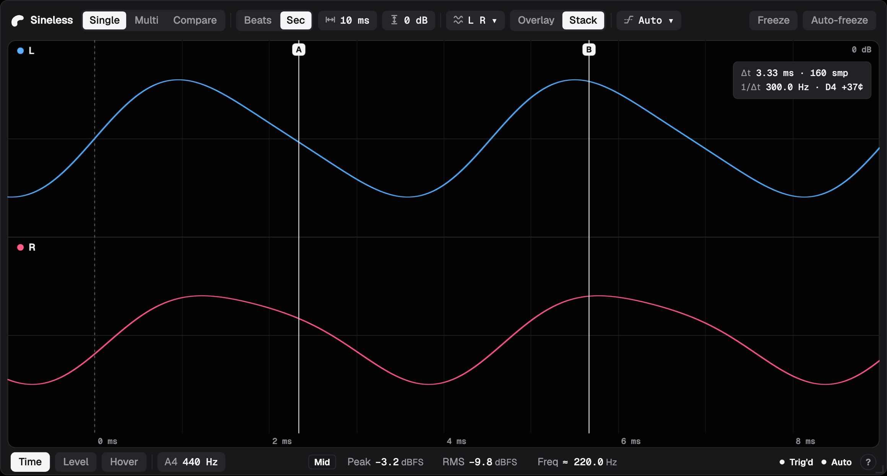
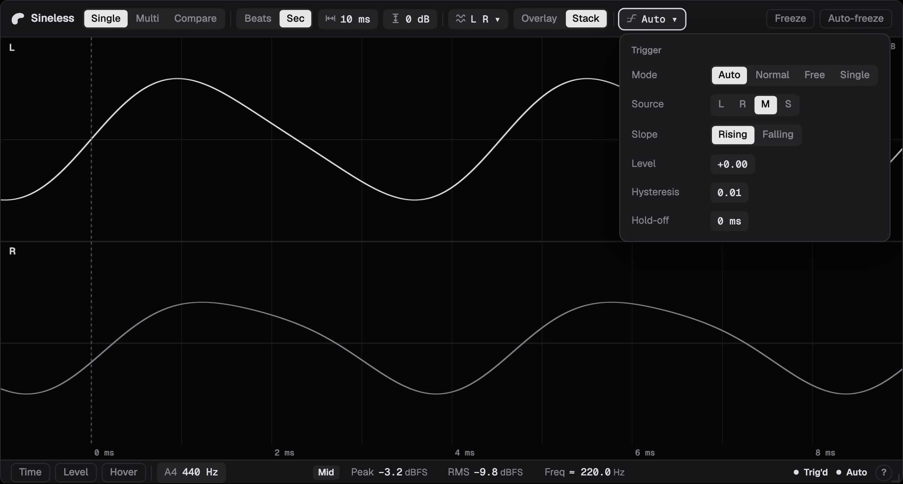
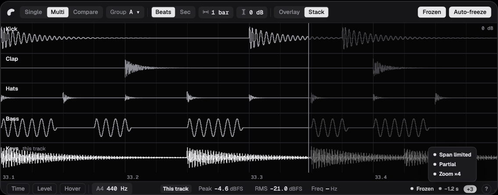
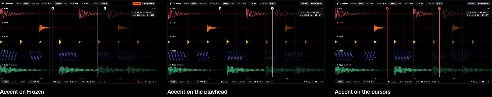
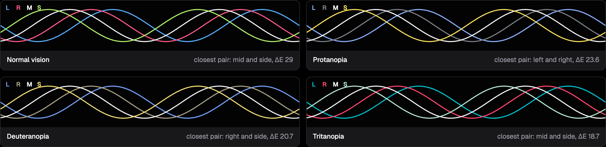
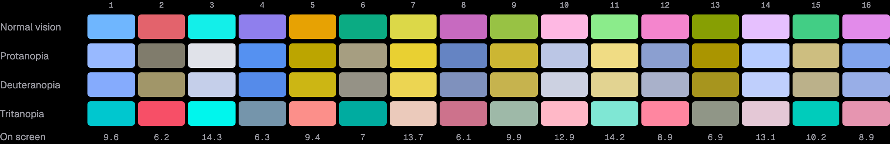
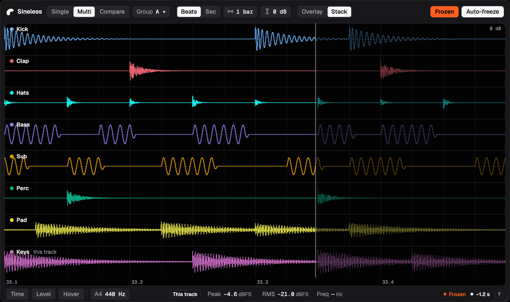

# Sineless UI redesign

The plugin's interface is being redesigned from scratch on the Orizon Audio brand: what the UI shows and how it's used, not what the plugin does. This folder holds the design work so far: the brief and decisions (this file), the design pages, and the colour tokens.

**Status:** built. Steps 1–4 (brief, layout, visual direction, colour and tokens) are below; steps 5 and 6 built them into the plugin: `ui/` holds the page, `ui/src/tokens.css` the colours, `ui/src/fonts/` Geist, and `DESIGN.md` §1.5 (with AD-26 and AD-27) describes the UI as it ships.

## Contents

| Step | Page | What it holds |
|---|---|---|
| Overview | [overview.html](overview.html) | Start here: the final design on one page, with the decisions of steps 2–4, the sizes, the look, the colours and the built UI |
| 1. Brief and audit | [audit.html](audit.html) | The current UI's problems, pinned on a screenshot; what the UI must carry; the constraints that still hold |
| 2. Layout | [layout.html](layout.html) | The locked layout (A · Toolbar) at default, large and minimum sizes, with the trigger popover open; concept B · Inspector kept for reference |
| 3. Visual direction | [direction.html](direction.html) | The layout in two treatments (Black, Graphite) and three places for the accent |
| 4. Colour and tokens | [colour.html](colour.html), [tokens/](tokens/) | Every colour and its role, contrast and colour-blindness checks, the 16-colour track palette |

GitHub shows HTML files as source. To see the pages, clone the repository and open them in a browser; they work offline. The overview uses the plugin's own Geist (`ui/src/fonts/`); the step pages use system fonts, and the PNG previews below were rendered with Geist.

## 1. Purpose and scope

- **Changes:** the look, the layout and how the controls are reached. Nothing from the current UI is kept by default, including its layout rules (AD-23), the 900 px minimum width, the bottom control strip, the 144 px chrome budget, the Roboto faces and the blue-grey palette.
- **Stays:** what the plugin does and how it behaves. The functional requirements (FR-1 to FR-16), the settings and their defaults (§1.2.3, including opening in Single display mode), and the keyboard behaviour (keys go to the host; no shortcuts of its own). Two requirements also say where a control sits, and only that part changes: Help moves from the right end of the top bar to the right end of the status bar (FR-13), and the A4 setting from the Display popover to the status bar (FR-16.3). The build (step 6) updates them with §1.5.
- **Out of scope:** DSP, behaviour, default values, keyboard shortcuts, and the engine–UI protocol beyond what the UI needs.

## 2. Process

| Step | Output |
|---|---|
| 1. Brief and audit | This file; [audit.html](audit.html) |
| 2. Structure | Layout and interaction concepts in grey, at small, default and large sizes: [layout.html](layout.html) |
| 3. Visual direction | The chosen structure in the Orizon brand, two treatments: [direction.html](direction.html) |
| 4. Colour and tokens | Screen, grid, channel colours, a 16-colour track palette, states and cursors, with contrast and colour-blindness checks: [colour.html](colour.html), [tokens/](tokens/) |
| 5. Components and screens | Every control and readout in every state; every mode and time base; messages, help, minimum and large sizes. Built on the real UI with its mock data (`npm run dev`) |
| 6. Build | The restyled UI; tests updated; `DESIGN.md` §1.5 rewritten and AD-23 superseded |

## 3. Inputs from the brand

- **References:** Apple, OpenAI, Spotify. Shared traits: a confident mark that works alone, one typeface used with discipline, mostly monochrome, colour used sparingly, generous space, the product as the hero, few words.
- **Personality:** minimal, confident, precise, warm. Not hype, retro-kitsch, aggressive or busy.
- **Voice:** plain and exact; numbers back things up.
- **Mark:** a cashew shape, black or white only.
- **Type:** Geist and Geist Mono (OFL).
- **Colour:** black and white first, dark as the primary theme; one accent, horizon orange `#FF5F1F`, for emphasis only.
- **Spacing and motion:** a 4 px spacing scale, radii 6 / 10 / 16, motion 120 / 200 / 320 ms with one easing curve.

## 4. What still constrains the design

These come from the platform and the product, not from the old design.

| Constraint | Why | Source |
|---|---|---|
| Runs in WKWebView (Safari 16.2 engine, macOS 13.1) and WebView2 | The UI is a web page inside the plugin | DESIGN §8.7 |
| Fonts, images and scripts are bundled files; no inline styles or scripts, no network | Strict CSP inside the plugin | `editor/src/EmbeddedAssets.h` |
| ≥ 45 frames/s with 7–15 tracks; drawing cost nearly flat in tracks and window size | Light on the host (QG-4, QS-3/QS-4). Blur and per-frame DOM changes cost frames in WebKit | DESIGN §1.3, AD-22 |
| What is shown is what the engine measured; "—" for no value, never 0 | Truthful display (QG-3) | DESIGN §1.3 |
| Keys go to the host unless typing in a field | Transport shortcuts must keep working while the plugin is focused | DESIGN §1.5 |
| Hosts differ in how they resize plugin windows; some give no resize edge | A resize grip is needed | HOSTS.md |
| Settings are plugin state, not automatable parameters | Changing this is an engine decision, not a UI one | AD-6 |
| Track names and colours come from the host and can be anything | Lanes must stay legible on any host colour, and Audio Units give none | FR-14.3, R-11 |
| Dark only | Decision 3 below | §8 |

## 5. What the UI has to carry

Grouped by how often someone reaches for it.

**Always visible**

- The screen: traces, grid, level and time labels, playhead in Beats, lane labels in Multi and Compare.
- Display mode: Single, Multi, Compare.
- Time base and span: Beats (1/16 beat to 16 bars) or Seconds (0.5 ms to 4 s).
- Vertical scale: −60 to +6 dBFS at the top of the screen.
- Freeze and Auto-freeze, and whether the display is frozen.
- Readouts: peak and RMS (dBFS), frequency (Hz, ≈).
- State: triggered, waiting, roll, sync, filling, no tempo, frozen, zoom, hidden lanes, invalid samples.

**Often, one step away**

- Channel views L, R, Mid, Side; overlaid or stacked.
- Trigger mode: Auto, Normal, Free, Single; Re-arm (Seconds ≤ 1 s only).
- Cursors: time (A/B) and level (1/2), with their readouts.
- Hover readout.
- Group A–D (Multi and Compare).
- Compare: which tracks are checked, match per track (offset, polarity, correlation), summing gain, Preview fix.

**Rarely**

- Trigger source, slope, level, hysteresis, hold-off.
- Concert pitch (A4, 400–500 Hz).
- Help.

**Gestures** (keep, but make findable): zoom with ⌘/Ctrl + scroll or pinch, drag to zoom a region, horizontal scroll to pan, double-click to reset, ⌥/Alt to place cursors without snapping.

**Messages:** Version mismatch, Display unavailable, Display error, Graphics unavailable; each says audio still passes through.

## 6. Audit of the current UI

From [images/audit-before.png](images/audit-before.png) (Multi, Beats, frozen, 5 lanes) and the code; annotated on [audit.html](audit.html).

1. **Everything has the same weight.** About 30 controls in small, wide-tracked uppercase, in boxes of the same size. Freeze, which people use constantly, looks like Hover, which they rarely touch.
2. **The bottom strip spends space on structure.** Each group has a box and a title ("TIME", "VERTICAL") restating what its control already says. Top bar and strip take about 140 px of a 500 px window.
3. **Controls that don't apply still take space.** In Beats the whole Trigger group sits there dimmed; in Multi the L/R/M/S toggles do too.
4. **Toggle state is ambiguous.** The channel toggles use muted channel colours for "on" and grey for "off": L (brown) and R (teal) read as disabled rather than selected.
5. **There is no colour system.** Amber, cyan, lilac, bone for channels; blue for active toggles, focus and selection; green, orange, pink for states and cursors; plus the host's track colours. Nothing says what colour means.
6. **The readouts are detached.** Peak, RMS and Freq sit at the top right, far from the traces they describe, and it is not obvious which channel or track they measure.
7. **Lane labelling is cluttered.** Each lane repeats "0 dB", and the scale labels share the corner with the track name.
8. **Important state is small.** "FROZEN" is a small chip in the corner; the sweep's playhead and dimmed previous cycle are subtle.
9. **Interaction is hidden.** Zoom, pan, cursor snapping and the drag fields can only be found through Help, which is off by default, behind a "?".
10. **The identity is generic.** "SINELESS · ORIZON" in condensed caps, no mark.

## 7. Design principles

1. **The signal is the hero.** Most of the window is the screen. Chrome recedes.
2. **Colour is data.** The interface is black, white and greys. Colour belongs to traces, so a colour always means a channel or a track. The orange accent marks Frozen and nothing else. Sineless never gives it to a trace: the channel colours and the fallback track palette stay clear of it. A host's track colour is used as it comes and may be orange; the accent stays distinct because it only ever appears on the Frozen button and chip, never as a line.
3. **Show what applies now.** Controls that don't apply in the current mode are hidden, not dimmed in place.
4. **Exact and quiet numbers.** Readouts in Geist Mono with tabular figures, units in the secondary ink, "—" for no value, readouts labelled with what they measure.
5. **Discoverable gestures.** Hints at the moment they are useful rather than a separate help mode alone.
6. **Calm in motion.** No animation on the traces' frame; short, single-easing motion only for opening and closing panels.

## 8. Decisions

From 2026-10-24 and 2026-10-25.

1. **Control ranking:** as in §5. Auto-freeze is used a lot, so it sits with Freeze, always visible.
2. **Minimum size:** set by the new design (§9).
3. **Theme:** dark only.
4. **Keyboard:** unchanged. Keys go to the host; no shortcuts of its own.
5. **Defaults and behaviour:** unchanged, including opening in Single display mode.
6. **Layout:** concept A (Toolbar), as in [layout.html](layout.html).
7. **Treatment:** Graphite, with the accent on Frozen ([direction.html](direction.html)).
8. **Colour:** the tokens in [tokens/](tokens/) ([colour.html](colour.html)).
9. **Sizes:** the design sets them, and `protocol/src/limits.ts` holds the ones the engine shares: `minimumEditorWidth` 1020 (the widest toolbar, measured at 1012 px in Geist) and `chromeHeight` 84 (toolbar and status bar, measured at 82). The native default is 1080 × 580 and the minimum height 400 (`editor/include/editor/EditorCore.h`). The size tokens in `tokens/` record the design; `ui/src/tokens.css` holds the colours the page uses.

## 9. The layout: concept A, Toolbar

- **Toolbar, left to right:** mark and wordmark; Single | Multi | Compare; Group (Multi and Compare, a dropdown); Beats | Sec; Span; Scale; Views (Single); Overlay | Stack; Trigger (Seconds up to 1 s), and Re-arm when the trigger mode is Single; Freeze and Auto-freeze at the right. Only the controls that apply in the current mode are there.
- **No ⋯ menu.** The window can't get narrower than the widest toolbar, so every control always fits. Span, Scale, Views and Trigger show icons instead of labels at every width; their popovers carry the labels.
- **Sizes**, measured on the widest toolbar (Multi or Compare · Seconds with trigger mode Single, so Re-arm shows, and Frozen; Single is 1 px narrower): default **1080 × 580** (the toolbar needs 1071 px with the wordmark); minimum **1020 × 400** (1012 px with the mark alone). Between the two, only the wordmark hides.
- **Trigger popover:** mode, source, slope, level, hysteresis and hold-off.
- **Status bar:** Time, Level, Hover and A4 on the left; what the readouts measure (Left, Right, Mid or Side in Single; "This track" in Multi and Compare, where the readouts measure this track's Mid, DESIGN §1.2.1), then Peak, RMS and Freq in the centre; the state and Help on the right. The left group never changes width and the state area has a fixed width, so the readouts never move.
- **More states than fit** fold into a "+n" chip that lists them on hover, keeping the order of the state table in DESIGN §1.5.

## 10. The look: Graphite, accent on Frozen

- **Graphite chrome** around an inset black screen with rounded corners; the selected option is white.
- **Type:** Geist for controls in sentence case; Geist Mono for every number.
- **Colour only in the traces:** Left blue, Right pink, Mid white, Side lime in Single; host track colours in Multi and Compare; a white sum.
- **Orange marks Frozen**, on the Frozen button and the Frozen chip: the one state where the screen isn't live.

## 11. Colour and tokens

[tokens/sineless-tokens.json](tokens/sineless-tokens.json) is the source of truth (DTCG format); [tokens/sineless-tokens.css](tokens/sineless-tokens.css) holds the same values as CSS variables, prefix `--sl-`. [colour.html](colour.html) carries a snapshot of them.

- **Rules:** the chrome is greys; colour only in traces; orange (`#FF5F1F`) for Frozen only; yellow (`#FFD23F`) for problems (invalid samples, tracks that cancel when summed); cursors, the playhead, the hover line, the zoom band and the focus ring are white or grey. The current UI's green, blue and pink state colours are retired.
- **Channel colours:** Left `#5AB0FF`, Right `#FF5C8A`, Mid `#F5F5F7`, Side `#B3F06B`. Side was violet in step 3; with deuteranopia it was nearly the same as Left's blue (CIEDE2000 ΔE 2.5). With lime, the closest pair is ΔE 18.7 or more in normal vision, protanopia, deuteranopia and tritanopia (simulated after Machado 2009).
- **Track palette:** 16 colours for lanes whose host gives no colour (every Audio Unit host today), at OKLCH lightness 0.66 / 0.76 / 0.86, clear of the accent and the white sum, all at least 6.1:1 on the screen. Ordered so adjacent lanes differ by ΔE 18 or more in every vision type tested, and lanes two apart by ΔE 11 or more in normal vision. Not all 16 can be told apart with colour blindness; every lane shows its track's name.
- **Contrast:** every text pair passes WCAG 2.2 AA (lowest: labels on controls 5.4:1, the Frozen chip 5.8:1); traces are 7.0–18.9:1 on the screen.

## 12. How the layout got here

Step 2 took six rounds.

- **v1:** three concepts. A · Toolbar: one row on top, status bar below. B · Inspector: a side panel with every setting and, in Multi and Compare, a track list. C · Player bar: a bottom bar with Freeze as one large, centred button.
- **v2:** C dropped (mixed button sizes and shapes, confusing placement). A: Beats | Sec moved before Span, since the time base decides which spans exist; all trigger settings in one popover; status chips placed so they never move the cursor buttons. B: readouts moved out of the panel, so they stay visible when it's closed; the panel never covers the traces.
- **v3:** A without any ⋯ menu: the minimum width became the widest toolbar's. Group became a dropdown; Compare lost its "beta" tag; Overlay | Stack joined the toolbar. B: one control per line, with labels.
- **v4:** A hid its field labels on narrow windows.
- **v5:** icons replaced the hidden labels; extra state chips fold into "+n".
- **v6:** the icons became permanent, so only the wordmark ever hides. A was locked.

Measured sizes went from 1150 / 1100 px (v3; an estimate 8 px short, corrected in v4) to the final 1080 / 1020 px.
